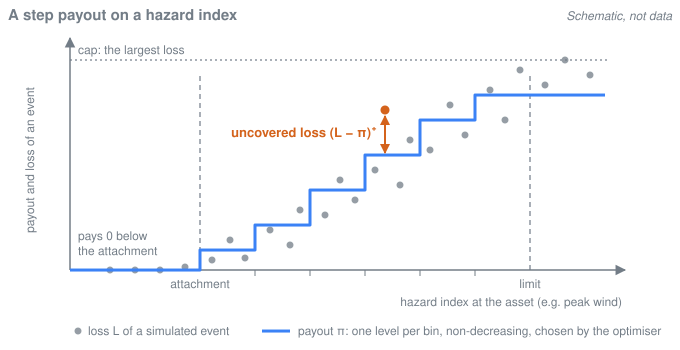

# parametric-insurance-design

A Python library for designing parametric insurance payouts. A parametric cover pays a set function of a hazard index, such as the peak wind at an insured site, instead of the assessed loss. Given simulated events with the index and the loss at each site, the library calibrates that function, a step payout on the index, by solving an optimisation problem under a premium budget.

It is built around the two ideas of a master's thesis. They can be used separately or together.

**Tail-risk objective.** The part of a loss that the payout doesn't cover is the uncovered loss U: the basis risk that the policyholder keeps. Besides the mean squared error and the expected uncovered loss E[U], the library can minimise a weighted CVaR, α·CVaR<sub>β</sub>(U) + (1 − α)·E[U]. It mixes the average uncovered loss with its average over the worst 1 − β of outcomes, such as the worst 1 % of years, and the design problem stays a linear program. See [the tail-risk objective](docs/concepts/tail-risk-objective.md).

**Portfolio (joint) calibration.** When one owner holds several sites, their payouts can be calibrated jointly, on the owner's total loss, instead of one site at a time. In the portfolio scope, each site keeps its own payout on its own index, but the objective and the budget apply to the sum, so a payout at one site can cover a shortfall at another in the same event. The cluster scope does the same with one payout per cluster of sites, and the individual scope calibrates each site on its own. See [portfolio calibration](docs/concepts/portfolio-calibration.md).

Any objective works with any scope, so the two ideas can be studied apart or together, depending on the owner. One site: the tail view, where the objective is the choice. Many sites with a mandate on the average fit: the portfolio view, where the scope is the choice. Many sites with a mandate on the tail: the combination, a weighted-CVaR objective calibrated jointly across the sites. This README and the docs describe the method and the tool. They don't claim that either idea, or the two combined, outperforms the alternatives.



*Schematic, not data.* A design sets one payout level per bin between the attachment and the limit. Nothing is paid below the attachment, the levels never decrease, and no level exceeds the cap, the largest loss. The objective scores the uncovered losses: the gaps where an event's loss exceeds the payout.

## Status

Version `0.1.0.dev0`, in development. There is no release yet and nothing is on PyPI: install from a clone, as below.

- **Parity with the thesis.** The core reproduces the results of the thesis code. [`parity/REPORT.md`](parity/REPORT.md) compares its runs with the thesis's result tables and explains every difference: alternative optima of the same linear program, or the accuracy of the quadratic solver on the MSE designs. The CLIMADA adapter regenerates the thesis's event-loss table bit for bit.
- **Core v1 features**, each with a methodology page:
  - [out-of-sample evaluation](docs/methodology/out-of-sample.md) on year-block holdout and k-fold splits;
  - [block-bootstrap confidence intervals](docs/methodology/bootstrap.md) over simulated years;
  - [the annual basis](docs/methodology/annual-basis.md), on which an outcome is a simulated year;
  - [cost-of-capital pricing](docs/methodology/pricing.md), next to the pure premium.
- **CLIMADA adapter.** [`packages/climada`](packages/climada/README.md) builds EventSets from IRIS hurricane tracks (track, wind field, impact), with a cat-in-a-circle index and [vulnerability draws](docs/methodology/vulnerability.md) as options.
- **Planned, not built yet:** the website; a showcase with Climate Risk Commons, whose scope isn't decided yet; a parametric insurance module for CLIMADA itself; a paper; and robust design under uncertainty (until then, `parametric_insurance_design.robust` raises `NotImplementedError`).

## Quickstart

Install [uv](https://docs.astral.sh/uv/), clone this repository and run `uv sync` in it. This script designs a weighted-CVaR payout for one asset of the thesis fixture, an EventSet committed to the repository (9 Miami assets, the IRIS hurricane catalogue, 10,000 simulated years, losses in USD):

```python
import parametric_insurance_design as pid

# Asset A1 of the thesis fixture: 9 Miami assets, IRIS, 10,000 simulated years.
es = pid.EventSet.from_parquet("parity/tests/data/thesis_eventset")
es = es.select_locations(["A1"])
train, test = pid.splits.holdout(es, train_fraction=0.7)  # first 70 % of the years
scope, basis = pid.Individual(), pid.Basis.ANNUAL  # annual: an outcome is a year
(result,) = pid.design(
    es,
    scope,
    pid.StepPayout(attachment=20.0, limit=70.0, n_bins=15, below_attachment="zero"),
    pid.WeightedCVaR(alpha=0.9, beta=0.99),  # 0.9 CVaR_0.99(U) + 0.1 E[U]
    basis=basis,
    constraints=(pid.Budget(1.0),),  # pure premium <= 1.0 x expected loss
    sample=train,  # calibrate on the train years only
)
kpis = pid.evaluate.kpis(
    es, scope, [result], basis=basis, beta=0.99, run_id="quickstart", sample=test
)
value = kpis[kpis.level == "portfolio"].set_index("kpi").value
print(
    "Setup: asset A1 of the thesis fixture; no added basis risk (no noise layer, no\n"
    "vulnerability draws); 15-bin step payout on [20, 70] m/s of peak wind, 0 below\n"
    "20 m/s; weighted CVaR design (alpha 0.9, beta 0.99); pure premium <= 1.0 x\n"
    f"expected loss; annual basis; calibrated on years 0-{train.years[-1]:,}.\n"
    f"Test years {test.years[0]:,}-{test.years[-1]:,} (out of sample), USD: "
    f"E[U] = {value['expected_uncovered']:,.0f}, "
    f"CVaR_0.99(U) = {value['cvar_uncovered']:,.0f}, "
    f"E[loss] = {value['expected_loss']:,.0f}"
)
```

Run it from the root of the clone with `uv run python examples/quickstart.py`. It prints its setup and, on the test years (out of sample), E[U], CVaR<sub>0.99</sub>(U) and the expected loss. The block above is [`examples/quickstart.py`](examples/quickstart.py) without its docstring. CI runs the script, and a test checks that the two stay the same. [`examples/`](examples/README.md) has a script for each idea that also draws figures.

## Concepts

- [The tail-risk objective](docs/concepts/tail-risk-objective.md): the uncovered loss, the weighted-CVaR objective, why the design problem is a linear program, and the premium budget.
- [Portfolio calibration](docs/concepts/portfolio-calibration.md): the individual, portfolio and cluster scopes, and cross-coverage for one risk owner with several sites.
- [Glossary](docs/concepts/README.md#glossary): the words that carry more than one meaning in the code.

How a design is evaluated (the bases, out-of-sample splits, the bootstrap, pricing and vulnerability uncertainty) is in the [methodology pages](docs/README.md#methodology). The [documentation index](docs/README.md) lists every page.

## Repository layout

The layout follows [ADR 0004](docs/adr/0004-repository-structure.md).

```
parametric-insurance-design/
├── packages/
│   ├── core/       # parametric-insurance-design: the core library, no hazard-model dependency
│   ├── viz/        # parametric-insurance-design-viz: figures, read from the result store
│   ├── crc/        # parametric-insurance-design-crc: placeholder for a Climate Risk Commons adapter
│   └── climada/    # parametric-insurance-design-climada: CLIMADA adapter (own pixi env)
├── examples/       # runnable scripts on the public API, run in CI
├── docs/           # docs index, concepts, methodology, SPEC, ADRs, reviews
├── parity/         # thesis golden data, parity tests and the parity report
├── research/       # the paper's working area: configs, scripts, notes, checkpoints
├── showcase/crc/   # the Climate Risk Commons showcase (planned)
├── site/           # the website (planned)
└── scripts/        # repository checks and the local CI script
```

| Distribution | Import name |
|---|---|
| `parametric-insurance-design` | `parametric_insurance_design` (by convention `import parametric_insurance_design as pid`) |
| `parametric-insurance-design-viz` | `parametric_insurance_design_viz` |
| `parametric-insurance-design-crc` | `parametric_insurance_design_crc` |
| `parametric-insurance-design-climada` | `parametric_insurance_design_climada` |

## Environments

- **uv workspace** for `core`, `viz` and `crc`, with one lockfile (`uv.lock`). The core supports Python 3.11 to 3.13 with numpy ≥ 1.26 and pandas ≥ 2.1. The CRC package needs Python ≥ 3.12, so the workspace uses Python 3.12 or later (`.python-version` selects 3.12).
- **pixi** for `packages/climada`, which is not a uv workspace member: CLIMADA comes from conda-forge, and its pins would clash with the pandas ≥ 3 of the CRC SDK, which the CRC package will import. Its README says how to set it up.

The two environments share data only through EventSet Parquet files ([`docs/SPEC.md`](docs/SPEC.md) §5).

## Development

From a clone, with [uv](https://docs.astral.sh/uv/) on your PATH:

```bash
uv sync                          # create .venv with all workspace packages and the dev tools
uv run pytest                    # run the tests of core, viz and crc
uv run pytest parity/tests examples   # the parity tests and the examples
uv run ruff check                # lint
uv run ruff format               # format
uv run pyright                   # type-check (basic mode)
uv run pre-commit install        # run the hooks on every commit
```

CI ([`.github/workflows/`](.github/workflows/)) runs on every pull request: ruff, pyright and the pre-commit hooks; the workspace tests on Python 3.12 and 3.13; the core alone on Python 3.11, with its newest and its lowest supported dependencies; a coverage gate of 85 % for the core; the parity tests and the examples; a build of all four packages; and the CLIMADA adapter's tests in its pixi environment.

## How this repository is built

AI coding agents build this repository, and the owner, Marc Prinzing, makes the decisions:

- each worker agent implements one planned issue in one pull request, under [`AGENTS.md`](AGENTS.md), the working agreement for everyone who contributes;
- an orchestrator agent plans the work, delegates it, reviews the pull requests and merges them, following [`docs/ORCHESTRATION.md`](docs/ORCHESTRATION.md);
- [`docs/SPEC.md`](docs/SPEC.md) is the technical spec, and the [architecture decision records](docs/adr/) record the decisions.

The root `CLAUDE.md` loads `AGENTS.md` for Claude Code, and [`.claude/skills/orchestrate/`](.claude/skills/orchestrate/SKILL.md) starts the orchestrator's loop. The plan and its status are tracked in Linear. That workspace is private, so the Linear links in some files don't open for visitors. The [documentation index](docs/README.md#how-its-built) has more on how the repository is built.

## Thesis

The library builds on the master's thesis *Tail-Risk-Optimized Payout Design in Parametric Insurance* by Marc Prinzing, Technical University of Munich. The thesis isn't public. Its code is, at [marc272/parametric-insurance-framework](https://github.com/marc272/parametric-insurance-framework), and the parity report checks the core against it.

## Licences

The licence boundary is the package boundary ([ADR 0001](docs/adr/0001-name-and-licence.md)):

| Part | Licence | Licence file |
|---|---|---|
| `packages/core`, `packages/viz` | BSD-3-Clause | [`LICENSE`](LICENSE) (copied into each package) |
| `examples/`, `research/`, `site/`, `docs/`, repository tooling | BSD-3-Clause | [`LICENSE`](LICENSE) |
| `parity/` code | BSD-3-Clause | [`parity/LICENSE`](parity/LICENSE) |
| `parity/golden/` (the thesis result tables, computed from IRIS-derived losses) | CC-BY-4.0 | [`parity/golden/LICENSE`](parity/golden/LICENSE) |
| `parity/tests/data/thesis_eventset/` (derived from IRIS) | CC-BY-4.0: IRIS-derived data is treated as CC BY 4.0, the stricter of its two licence records | recorded in its `metadata.json` |
| `showcase/crc/` code | BSD-3-Clause; the AGPL applies to the combined work with the CRC adapter | [`showcase/crc/LICENSE`](showcase/crc/LICENSE) |
| `packages/crc` | AGPL-3.0-or-later, because it will import the AGPL-licensed CRC SDK | [`packages/crc/LICENSE`](packages/crc/LICENSE) |
| `packages/climada` | GPL-3.0-or-later, because it imports GPLv3 CLIMADA | [`packages/climada/LICENSE`](packages/climada/LICENSE) |

The core and viz packages never import an adapter, so they stay under the permissive licence. Data comes with its own terms, recorded in [`docs/data-sources.md`](docs/data-sources.md). Only small data files are committed: the parity fixture and the thesis result tables (both CC BY 4.0), and small tables derived from research runs under `research/data/`.
