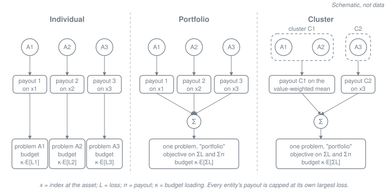

# Portfolio calibration

The second idea of the thesis this library comes from[^thesis]: when one owner holds several assets, calibrate their payout functions **jointly**, on the owner's total loss, instead of one asset at a time. In the portfolio scope, each asset keeps its own payout function of its own index, but the objective and the budget are on the sum. So a payout at one asset can cover a shortfall at another in the same event.

This page describes the method and the code (`scopes.py`, `problem.py`, `clustering.py`), as checked in the [core design review](../reviews/core-design-review.md). It makes no claim that joint calibration outperforms individual calibration. In sample, the joint problem does at least as well on its own objective, which is a property of the optimisation ([below](#joint-versus-individual-calibration-at-the-same-budget)). Out of sample, whether it lowers the owner's shortfall is an open question of this project.

How joint calibration works together with the tail objective, and which view fits which owner: [combining the two ideas](combination.md).

[^thesis]: M. Prinzing, *Tail-Risk-Optimized Payout Design in Parametric Insurance*, master's thesis, Technical University of Munich, 2026. Not public. Equation numbers on this page refer to it.

## The use case: one risk owner

Cross-coverage only makes sense if the losses of all assets and all the payouts belong to the same party: a company with several sites, a municipality, a state or a sovereign (SPEC §3.2, M5). If the assets had separate owners, a payout triggered at one asset would not help the owner of another.

- The paper portfolio is Florida's 67 counties, with the State of Florida as the single owner, a documented proxy (SPEC §6.6).
- The thesis case is 9 assets in Miami.

## Three scopes

A scope maps locations (assets) to payout entities and design problems. Every entity gets its own [step payout](tail-risk-objective.md#setting) on its own index, capped at its largest loss in the calibration rows. Every design problem has one objective and one budget, both on the sum over its entities:

$$L_e = \sum_j L_{e,j}, \qquad \pi_e = \sum_j \pi_{e,j}.$$

| | `Individual` | `Portfolio` | `Cluster` |
|---|---|---|---|
| Design problems | one per asset (`problem_id` = the asset's id) | one (`problem_id = "portfolio"`) | one (`problem_id = "portfolio"`) |
| Payout entities | the asset | one per asset | one per cluster (`C1`, `C2`, …) |
| Entity index | the index at the asset | the index at each asset | the value-weighted mean index of the cluster's assets |
| Entity loss and cap | the asset's loss; cap: its largest loss | each asset's loss; cap: its largest loss | the cluster's summed loss; cap: its largest summed loss |
| Objective on | the asset's loss and payout | the summed loss and payout | the summed loss and payout |
| Budget | $\mathrm{Premium}(\pi_i) \le \kappa \mathbb{E}[L_i]$ for each asset i | $\mathrm{Premium}(\sum_i \pi_i) \le \kappa \mathbb{E}[\sum_i L_i]$ | $\mathrm{Premium}(\sum_c \pi_c) \le \kappa \mathbb{E}[\sum_i L_i]$ |

The portfolio and cluster scopes are the **joint** scopes; SPEC §1 calls the portfolio scope "integrated". The right-hand sides of the budgets add up to the same total, $\sum_i \kappa \mathbb{E}[L_i] = \kappa \mathbb{E}[\sum_i L_i]$, in every scope: the same total budget, as in thesis eq. (2.9)–(2.11).

## Cross-coverage

In a joint design problem, the uncovered loss of an event is taken on the sums over assets. In the portfolio scope:

$$\Big(\sum_i (L_{e,i} - \pi_{e,i})\Big)^+ \quad\le\quad \sum_i (L_{e,i} - \pi_{e,i})^+ .$$

The left side is what the joint objective counts, the right side what separate covers leave. Within an event, an over-payment at one asset offsets a shortfall at another. This is **cross-coverage**. The optimiser puts the budget where it reduces the portfolio's shortfall most, whichever asset's index triggers the payout. It can leave an asset's payout function at zero when the payouts at other assets cover its losses: "the asset the optimiser drops". Two limits:

- An entity never pays more than its cap, its own largest loss in the calibration rows. So one asset's payout covers another's loss only up to that cap.
- It works only within an event. Across the events of a year (annual basis), shortfalls still add up.

With the MSE objective, the residual is the summed one, so over- and under-payments across assets net too, in both directions.

**A worked toy example, not data.** Two assets A and B, four equally likely years with one event each, two bins ([20, 45) and [45, 70] m/s), the E[U] objective, pure premium, κ = 1:

| Event | Index at A | Index at B | Loss at A | Loss at B |
|---|---|---|---|---|
| 1 | 50 | 60 | 2 | 4 |
| 2 | 65 | 20 | 6 | 0 |
| 3 | 20 | 60 | 0 | 0 |
| 4 | 20 | 20 | 0 | 0 |

B's index is high in event 3, where nothing is lost. A's index is high in both events with a loss, and A's cap is 6.

| Scope | θ at A (low, high) | θ at B (low, high) | E[U] of A + B |
|---|---|---|---|
| Individual, budgets 2 (A) and 1 (B) | (0, 4) | (0, 2) | 0.5 |
| Portfolio, budget 3 | (0, 6) | (0, 0) | 0 |

The joint design drops B. A's payout of 6 covers both assets' loss in event 1 and A's loss in event 2, while the individual cover of B spends half its expected payout in event 3. Both optima are unique, and the library returns these numbers on all three bases.

The joint design relies on A's index for B's losses. In a year where B loses while A's index stays low, it pays nothing for B. That is what cross-coverage risks out of sample. And if A and B had different owners, B's owner would get nothing at all.

## Joint versus individual calibration at the same budget

**In sample, the joint problem relaxes the individual one** (review F6; thesis eq. (2.9)–(2.11)). Take the individual designs and use them together as one portfolio design:

1. They meet the portfolio scope's payout constraints: the same payout structure and the same caps.
2. They meet its budget: $\mathrm{Premium}(\sum_i \pi_i) \le \sum_i \mathrm{Premium}(\pi_i) \le \sum_i \kappa \mathbb{E}[L_i] = \kappa \mathbb{E}[\sum_i L_i]$. The first step is an equality under the pure premium. Under the cost-of-capital load it holds because CVaR is sub-additive.
3. So the portfolio optimum is at most the individual designs' objective evaluated on the portfolio.
4. For E[U] and weighted CVaR, that is in turn at most the sum of the individual objectives, because $(\sum_i a_i)^+ \le \sum_i a_i^+$ and CVaR is monotone and sub-additive. MSE has no such step: the square of a summed residual can exceed the sum of the squares.

`test_portfolio_optimum_is_at_most_the_individual_designs_on_the_aggregate` proves steps 1 to 4 on all three bases, for the three objectives, under pure and loaded pricing, with and without a budget.

**Out of sample, nothing follows.** The relaxation compares optima on the calibration data. On other years:

- neither design is optimal on the new data, so no ordering of their objectives is implied;
- the joint design has more freedom to fit the calibration sample's joint pattern (which assets are hit together, and how hard), and more freedom can mean more overfitting, as the toy design's reliance on A's index shows;
- the budget holds on the calibration sample only, and the premium differs on other years.

Whether joint calibration lowers the shortfall on years it wasn't calibrated on is a question for the [out-of-sample evaluation](../methodology/out-of-sample.md), not for this argument.

## Under a cost-of-capital load: two effects

Under `CostOfCapitalLoad`, a joint scope differs from the individual scope in two ways, and a comparison should keep them apart:

1. **Cross-coverage** ([above](#cross-coverage)): the objective nets shortfalls across assets within an event.
2. **A pricing-diversification credit**: the budgets constrain different premiums.

| Scope | The budget constrains |
|---|---|
| `Individual` | each asset's stand-alone premium, $\mathrm{Premium}(\pi_i) \le \kappa \mathbb{E}[L_i]$ |
| `Portfolio`, `Cluster` | the premium of the aggregate payout, $\mathrm{Premium}(\sum_j \pi_j) \le \kappa \mathbb{E}[\sum_i L_i]$ |

The loaded premium is sub-additive, $\mathrm{Premium}(\sum_i \pi_i) \le \sum_i \mathrm{Premium}(\pi_i)$, and lower when the payout tails of the parts fall in different outcomes. So at the same total budget, a joint scope can buy payouts whose stand-alone premiums would add up to more than the budget. Under the pure premium the expectation is additive and this credit is zero, which leaves cross-coverage alone.

The KPIs use the same definitions ([pricing](../methodology/pricing.md), "Portfolio premium"). The `premium` KPI at `level = "portfolio"` is the pricing applied to the run's aggregate payout:

- for a joint scope, it is the premium that the single budget constrained;
- for the individual scope, it is at most the sum of the problem premiums, which are what the budgets constrained. So under a load it can lie below the total budget even when every individual budget binds.

## The cluster scope

The cluster scope groups the assets into clusters and gives each cluster one payout function of a cluster index, the value-weighted mean of its assets' indices (`index.ValueWeightedIndex`, thesis eq. (3.22)):

$$\xi_{e,c} = \sum_{i\in c} w_i x_{e,i}, \qquad w_i = \frac{v_i}{\sum_{k\in c} v_k},$$

with $x_{e,i}$ the index at asset i and $v_i$ its value (`locations.value`). A cluster's loss is the sum of its assets' losses. Like the portfolio scope, the cluster scope is one joint design problem, with the objective and the budget on the whole portfolio.

**The clustering** (`pid.ThesisWardClustering`, a port of the thesis code) computes five features per asset on the calibration rows:

- the log of its value;
- its mean share of the portfolio loss in the portfolio's loss tail;
- its tail beta to the portfolio loss;
- the standard deviation of its loss-correlation distances to the other assets;
- the mean of its index-correlation distances to them.

It z-scores the features and cuts a Ward-linkage tree into `n_clusters` clusters. Two caveats (review F9):

- The features weight rows by `rate / Σ rate`, the `event_conditional` measure, whatever the run's basis.
- The tail is the rows whose portfolio loss is at or above its `beta_tail` quantile. If at least `beta_tail` of the row probability has no portfolio loss, that quantile is 0, and the "tail" would be every row. The clustering then raises `clustering.DegenerateTailError` instead of using whole-sample features ([review finding F9](../reviews/core-design-review.md#f9-clustering-features-ignore-the-basis-and-their-tail-can-silently-be-the-whole-sample-clarity)).

**It changes the index, not only the granularity** (review F7). The thesis describes the cluster scope as changing only the granularity at which cover is allocated (§2.3.3). In the code, it also changes the trigger: a cluster pays on the mean index of its assets, not on each asset's own index. So the cluster scope is neither a restriction nor a relaxation of the portfolio scope:

- With one asset per cluster, the value-weighted index is the asset's own index, and the cluster problem is the portfolio problem (`test_one_cluster_per_location_is_the_portfolio_scope`).
- It can fit better in sample. Toy example: two assets of equal value, and a loss only when both indices are high. The mean index separates that event from the others; no sum of per-asset step payouts can. One cluster fits it exactly (MSE 0), while the portfolio scope's best fit has MSE 8.33 (`test_one_cluster_can_beat_the_portfolio_scope_in_sample`, all three bases).
- It can fit worse. If an asset loses only when its own index is high, the index pairs (60, 20) and (20, 60) have the same mean and get the same cluster payout, while the portfolio scope can pay on the first and not the second.

So a difference between the cluster and portfolio scopes mixes a change of trigger, the thesis's zonal basis risk, with the change of calibration.

**Separating the index from the calibration.** The same holds against the individual scope: the cluster scope changes the index and the calibration at once. `pid.Cluster(strategy, n_clusters, joint=False)` (config: `joint: false` in the cluster scope) keeps the clusters and the cluster index, but calibrates each cluster on its own. Each cluster is one design problem (`problem_id = "cluster:C1"`, …), on its cluster's index and summed loss, with its own objective and its own budget $\mathrm{Premium}(\pi_c) \le \kappa \mathbb{E}[\sum_{i\in c} L_i]$, as the individual scope does per asset. So:

- `Cluster(joint=False)` against `Individual` changes only the index (asset index → cluster index), with calibration on its own in both;
- `Cluster(joint=True)` against `Cluster(joint=False)` changes only the calibration (joint → on its own), with the same clusters and the same index.

With one asset per cluster, `joint=False` is the individual scope (`test_one_location_per_cluster_separate_is_the_individual_scope`). The default, `joint=True`, is the thesis's cluster scope; a config that leaves `joint` out keeps its config hash.

## Per-asset results of joint designs are not unique

A joint design is identified only through the portfolio ([review finding F8](../reviews/core-design-review.md#f8-per-asset-kpis-and-payout-functions-of-joint-designs-are-not-identified-defect-known-mar-100-mar-91)):

- The MSE objective of a joint scope depends only on the summed payout of each row. Any other split of the same row sums across the entities that meets the payout constraints is optimal too.
- E[U] and weighted CVaR have the same freedom wherever the LP has more than one optimal solution.

So the per-entity results of a joint design show one member of a set of optimal designs, picked by the solver. That covers the `evaluate.kpis` rows at `level = "entity"`, the per-entity θ in the `payouts` table, and per-entity payout-function figures. Read the problem- and portfolio-level KPIs. In the toy example above the optimum is unique, so its per-asset θ are meaningful; that isn't true in general.

**Per-asset KPIs need an allocation rule.** By default, `evaluate.kpis` reports no per-asset rows. Pass `allocation="value"` or `allocation="loss"` to split each design problem's total payout across its assets by a stated rule:

- `"value"`: pro rata to insured value;
- `"loss"`: pro rata to each asset's loss in the event.

The rows then depend on the problem's total payout only, not on the solver's split, and their `level` names the rule (`location_by_value`, `location_by_loss`). The thesis allocates a cluster's payout to its assets by value weight within the cluster (eq. (3.23)). The `"value"` rule allocates over the whole design problem instead, because the split across clusters isn't unique either. The rules, their properties and their limits are in [allocating a joint payout to assets](../methodology/payout-allocation.md).

**Per-asset payout functions have no such rule.** The payout-function figures of a joint design (`payout_grid`, `normalised_payout` in the viz package) carry a caption saying that they show one of several optimal designs, and `joint_entities="refuse"` makes them raise instead. An external output (website, posts, examples) shows a joint design's per-entity payout functions only with that caption, and reads its results at the portfolio level.

## Code map

All modules are in `packages/core/src/parametric_insurance_design/`. After `import parametric_insurance_design as pid`, the components of both stories are top-level names (`pid.WeightedCVaR`, `pid.Portfolio`, …), and everything else is reached through its module, as `pid.<module>`. `pid.design(...)` builds and solves every design problem of a scope in one call.

| Concept | Code |
|---|---|
| Scopes | `pid.Individual`, `pid.Portfolio`, `pid.Cluster(strategy, n_clusters)`; config `scopes: [{kind: individual}, {kind: portfolio}, {kind: cluster, ...}]` |
| The `problem_id` of both joint scopes | `pid.scopes.PORTFOLIO_PROBLEM_ID` (`"portfolio"`) |
| Entity index | `pid.index.PointIndex` (individual and portfolio scopes), `pid.index.ValueWeightedIndex` (cluster scope) |
| Clustering | `pid.ThesisWardClustering(beta_tail, linkage="ward")`; the `pid.clustering.ClusteringStrategy` protocol |
| Design in one call | `pid.design(eventset, scope, payout, objective, *, basis, ...)`: one `pid.SolveResult` per design problem, so one per asset in the individual scope and one (`problem_id = "portfolio"`) in the joint scopes |
| Sum over entities, caps, assembly | `pid.problem.build_context`, `pid.problem.build_problems` (one `BuiltProblem` per design problem), then `pid.solve.solve` for each (the low-level path that `pid.design` composes) |
| Budget and premiums | `pid.Budget(loading)`; `pid.PurePremium`, `pid.CostOfCapitalLoad(rate, q)` |
| KPI levels | `pid.evaluate.kpis`: `level` is `entity`, `problem` or `portfolio`; with `allocation="value"` or `"loss"`, also `location_by_value` or `location_by_loss` ([payout allocation](../methodology/payout-allocation.md)) |

## Proven properties

Tests in `packages/core/tests/test_design_properties.py`.

| Statement | Test |
|---|---|
| At the same total budget, the individual designs fit the portfolio problem (caps; aggregate premium ≤ sum of premiums ≤ κ·E[ΣL]), so the portfolio optimum is at most their objective on the portfolio; for E[U] and weighted CVaR, that is at most the sum of the individual objectives | `test_portfolio_optimum_is_at_most_the_individual_designs_on_the_aggregate` (all three bases; three objectives; pure and loaded pricing) |
| One asset per cluster is the portfolio scope | `test_one_cluster_per_location_is_the_portfolio_scope` |
| The cluster scope is not a restriction of the portfolio scope | `test_one_cluster_can_beat_the_portfolio_scope_in_sample` (all three bases) |
