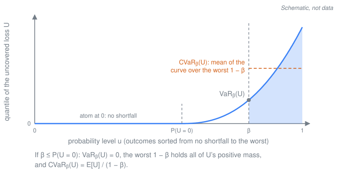

# The tail-risk objective

A parametric cover pays a function of a hazard index, not the loss itself, so it leaves part of the loss uncovered. The first idea of the thesis this library comes from[^thesis] is to design the payout so that the uncovered loss is small on average **and** in the bad years. The objective mixes the expected uncovered loss with its conditional value-at-risk (CVaR), and the design problem stays a linear program (LP).

This page states the objective as the code implements it, as checked in the [core design review](../reviews/core-design-review.md), and says where that differs from the thesis text. It describes the method only. Whether the tail objective lowers tail basis risk against other objectives out of sample is an open question of this project, and nothing here claims that it does.

[^thesis]: M. Prinzing, *Tail-Risk-Optimized Payout Design in Parametric Insurance*, master's thesis, Technical University of Munich, 2026. Not public. Equation numbers on this page refer to it.

## Setting

A **design problem** calibrates the payout functions of its payout entities: one asset in the individual scope, or every asset or every cluster of assets in a joint scope ([portfolio calibration](portfolio-calibration.md)).

- **Rows.** An EventSet row e is an event, or one draw of an event (noise copies, vulnerability draws). $L_e \ge 0$ is the loss of the row and $\pi_e \ge 0$ the payout, both summed over the entities of the design problem.
- **Outcomes.** The basis groups rows into outcomes o with probabilities $p_o$ that sum to one ([evaluation basis](../methodology/annual-basis.md)). On `annual`, an outcome is a simulated year (and draw), and the years without rows are outcomes with zero loss. On `event` and `event_conditional`, every row is an outcome, and `event` adds one "no event" outcome. Per-row quantities add up within an outcome: $L_o = \sum_{e\in o} L_e$ and $\pi_o = \sum_{e\in o} \pi_e$.

**Step payout.** Entity j pays $\theta_{j,k}$ when its index $\xi_{e,j}$ falls in bin $B_k$:

$$\pi_{e,j} = \sum_k \theta_{j,k} \mathbf{1}[\xi_{e,j}\in B_k], \qquad 0 \le \theta_{j,0} \le \theta_{j,1} \le \dots \le \theta_{j,K-1} \le c_j,$$

where the cap $c_j$ is the entity's largest loss in the calibration rows. The bins are uniform on [attachment, limit] by default, and an index at or above the limit falls into the last bin.

**Below the attachment (today's behaviour).** An index below the attachment falls into the first bin and pays $\theta_{j,0}$ (`payout.StepPayout`, as in the thesis code). Nothing forces $\theta_{j,0} = 0$. A row that the threshold filter dropped, and a year without rows, pays nothing. So a design with $\theta_{j,0} > 0$ depends on which rows the EventSet holds (review finding F1). [MAR-170](https://linear.app/marc-prinzing/issue/MAR-170) tracks the fix.

## The uncovered loss

$$U_o = \sum_{e\in o} (L_e - \pi_e)^+, \qquad x^+ = \max(x, 0).$$

This is thesis eq. (2.7) and (3.6), and the `ExpectedUncovered` objective's $U$.

- Only shortfalls count. An over-payment in an event is not credited.
- On `annual`, the shortfalls of a year's events add up, and an over-payment in one event doesn't offset a shortfall in another.
- In a joint design problem, $L_e$ and $\pi_e$ are sums over assets. Within an event, an over-payment at one asset does offset a shortfall at another: that is [cross-coverage](portfolio-calibration.md#cross-coverage).
- Since $\pi_e \ge 0$, $0 \le U_o \le L_o$. An outcome without loss has no uncovered loss, whatever the design.

## The objective

$$F_{\alpha,\beta}(\theta) = \alpha \mathrm{CVaR}_\beta(U) + (1-\alpha) \mathbb{E}[U], \qquad \alpha\in[0,1],\ \beta\in(0,1).$$

**α weights the CVaR term**, as in `objectives.WeightedCVaR`, thesis eq. (2.4) and (3.9), and SPEC §6.7.

- α = 0 is E[U] exactly: the code builds `ExpectedUncovered`'s term and creates no CVaR variables.
- α = 1 is the CVaR of U alone.
- In between, α trades the mean shortfall against the mean shortfall of the worst $1-\beta$ of outcomes.

"Weighted CVaR", the class name and the config `kind: weighted_cvar`, means this mean–CVaR mixture. It is not a CVaR with weights on the outcomes ([glossary](README.md#glossary)).

**β** sets the tail. $\mathrm{CVaR}_\beta(U)$ is the mean of the worst $1-\beta$ of the probability mass of U, and what that mass is depends on the basis:

| Basis | The worst 1 − β is a share of | β = 0.99 means |
|---|---|---|
| `annual` (paper default) | simulated years (and draws) | the mean of the worst 1 % of years: the 100-year level and beyond |
| `event` | annual event probability | about the 100-year occurrence level, when years rarely hold several bad events |
| `event_conditional` (thesis parity) | the events above the threshold filter | no return period; it depends on the filter and the catalogue |

[The evaluation basis](../methodology/annual-basis.md) has the full return-period table. Three edge cases:

- As β → 0, the CVaR tends to E[U].
- When $1-\beta$ is smaller than the smallest outcome probability, the CVaR is the single worst outcome, and the objective becomes a minimax over outcomes. The code doesn't warn about this (review F15).
- When β is at most the probability of the outcomes without loss, the objective has the same minimisers as E[U] ([below](#when-the-weighted-cvar-design-is-the-eu-design)).

The objective's β is not the KPI β. `evaluate.kpis(..., beta=...)`, the config's `evaluation.beta`, sets the level at which the `var_uncovered` and `cvar_uncovered` KPIs are reported. When the two are equal, a design's objective value equals its problem-level KPI, α·`cvar_uncovered` + (1 − α)·`expected_uncovered`.

Two other objectives fill the same slot: `ExpectedUncovered` (E[U]) and `MSE`, the mean squared signed residual per outcome, $\mathbb{E}[(L_o - \pi_o)^2]$, which counts over-payment like under-payment.

## CVaR, as implemented

The code uses the Rockafellar–Uryasev (RU) CVaR everywhere: in the objective (`objectives.rockafellar_uryasev`), in the cost-of-capital premium, and in the KPIs (`riskmeasures.var_cvar`):

$$\mathrm{CVaR}_\beta(X) = \min_{\zeta\in\mathbb{R}} \Big\lbrace \zeta + \frac{\mathbb{E}[(X-\zeta)^+]}{1-\beta} \Big\rbrace.$$

For a discrete X the minimum is attained at $\zeta = \mathrm{VaR}_\beta(X)$, the lower β-quantile (the smallest $v$ with $P(X \le v) \ge \beta$). The value is the mean of the worst $1-\beta$ of the mass, taking only as much of the atom at the VaR as it needs:

$$\mathrm{CVaR}_\beta(X) = \frac{1}{1-\beta}\Big(\sum_{x > \mathrm{VaR}_\beta} p_x x + \big(1 - \beta - P(X > \mathrm{VaR}_\beta)\big) \mathrm{VaR}_\beta\Big).$$

**The thesis text defines another CVaR.** Its eq. (2.3) is $\mathbb{E}[X \mid X \ge \mathrm{VaR}_\beta(X)]$, but it solves the RU form, eq. (3.8). The two differ when X has an atom at its VaR, and the uncovered loss usually has one at 0. If $P(U = 0) \ge \beta$, for example, then $\mathbb{E}[U \mid U \ge 0] = \mathbb{E}[U]$, while the RU value is $\mathbb{E}[U]/(1-\beta)$. The RU value is the coherent CVaR, and it is what every CVaR from this library means (review F5).

**VaR on a step.** When β falls exactly on a step of a discrete distribution, the VaR can be either of the two adjacent atoms, depending on rounding. On the annual basis this is the normal case (review F2, [MAR-155](https://linear.app/marc-prinzing/issue/MAR-155)). The CVaR doesn't depend on which atom is chosen, so no design or premium does. The `var_uncovered` KPI and the exceedance curves do.

## The design problem is a linear program

For one design problem with the weighted-CVaR objective, the code builds this problem. cvxpy creates the auxiliary variables v, w and s when it compiles the positive parts (`cvxpy.pos`).

- **Payout**, linear in θ: $\pi_e(\theta) = \sum_j \sum_k \theta_{j,k} \mathbf{1}[\xi_{e,j}\in B_k]$. The index is data, so the bin indicators are a fixed 0/1 matrix (`StepPayout.basis_matrix`).
- **Uncovered loss:** $v_e \ge L_e - \pi_e(\theta)$, $v_e \ge 0$, and $U_o = \sum_{e\in o} v_e$.
- **CVaR auxiliaries:** $w_o \ge U_o - \zeta$, $w_o \ge 0$, with ζ free.
- **Objective:** minimise $\alpha\big(\zeta + \tfrac{1}{1-\beta}\sum_o p_o w_o\big) + (1-\alpha)\sum_o p_o U_o$ over θ, ζ, v and w.
- **Payout shape:** $0 \le \theta_{j,0} \le \dots \le \theta_{j,K-1} \le c_j$.
- **Budget:** $\mathrm{Premium}(\pi) \le \kappa \mathbb{E}[L]$ ([below](#the-budget)).

Every line is linear, so the problem is an LP, and it solves the original problem exactly:

1. Each positive part is replaced by a variable bounded below by both of its arguments. The minimised objective is non-decreasing in each of these variables, directly or through the lower bounds on w (α, 1 − α and $p_o$ are all ≥ 0). So for a given θ, setting each to its lower bound, the positive part, is optimal.
2. The RU minimisation over ζ merges with the minimisation over θ. So the LP has the optimal value and the optimal θ of $\min_\theta F_{\alpha,\beta}(\theta)$.
3. The cost-of-capital premium has its own RU variable η and auxiliaries s (below). In the budget, "some η and s meet the bound" is the same as "the minimum over η meets it". So the feasible set is exactly the set of payouts whose loaded premium meets the budget.

The builder checks that the assembled problem is convex under cvxpy's rules (DCP) and raises `ComponentConfigError` if not (`problem.build_problems`). A component that rewarded a larger U would be refused when the problem is built. With the `MSE` objective the problem is a quadratic program.

## The budget

$$\mathrm{Premium}(\pi) \le \kappa \mathbb{E}[L].$$

$\mathbb{E}[L]$ is taken on the same outcome measure as the premium and the objective. κ is the budget loading (`constraints.Budget(loading)`, the thesis's `budget_loading`). The premium is a separate component (`pricing.py`; [pricing](../methodology/pricing.md)):

- `PurePremium`: $\mathrm{Premium} = \mathbb{E}[\pi] = \sum_o p_o \pi_o$.
- `CostOfCapitalLoad(rate=r, q=q)`: $\mathrm{Premium} = (1-r) \mathbb{E}[\pi] + r \mathrm{CVaR}_q(\pi)$ with $r\in[0,1]$. It is convex in the payout, so the problem stays an LP. In the problem it reads $(1-r)\sum_o p_o \pi_o + r\big(\eta + \tfrac{1}{1-q}\sum_o p_o s_o\big)$, with $s_o \ge \pi_o - \eta$ and $s_o \ge 0$.

The budget is an inequality without a risk loading. The thesis text writes it as an equality with a loading λ, $(1+\lambda)\sum p \pi = \kappa \sum p L$ (eq. (3.15)). The thesis code, which the parity runs reproduce, uses the inequality without λ. The two differ only where the budget doesn't bind, for example for MSE designs with κ ≥ 1 (review F5).

## When the weighted-CVaR design is the E[U] design

**A theorem** (review F4). Let $P(L_o = 0)$ be the probability of the outcomes in which the design problem has no loss. If $\beta \le P(L_o = 0)$, then for every design:

1. $P(U_o = 0) \ge P(L_o = 0) \ge \beta$, because $0 \le U_o \le L_o$;
2. so the VaR of U at level β is 0, and its CVaR is $\mathbb{E}[U]/(1-\beta)$;
3. so $F_{\alpha,\beta} = \big(\tfrac{\alpha}{1-\beta} + 1 - \alpha\big) \mathbb{E}[U]$, a positive multiple of E[U], and the weighted-CVaR designs are the E[U] designs.

The condition is per design problem, and it depends on the basis. On the annual basis the years without loss belong to the measure, so $P(L_o = 0)$ can be large. On the thesis data:

| Design problem (annual basis) | $P(L_o = 0)$ |
|---|---|
| `portfolio`: the portfolio and cluster scopes | 0.930 |
| each of the 9 assets: the individual scope | 0.943 to 0.947 |

Setup: the thesis fixture `parity/tests/data/thesis_eventset` (9 Miami assets, IRIS, 10,000 years; content hash `sha256:404b0c3a…294df`), prepared as in `parity/configs/thesis.yaml`: heteroscedastic noise 0.3 with 13 copies and seed 42, then the 20 m/s threshold filter. The prepared EventSet has 13,897 rows and content hash `sha256:008057c84ba2541847f1c447c19a201c3d4951320610625e246a7a4bbd5eafdf`. Annual basis over all 10,000 years (no train/test split). The values are definitional: they depend on the data, not on any design. The thesis default β = 0.95 lies above all of them, so the theorem doesn't cover it on these data.

**Above $P(L_o = 0)$ it is not a rule.** On these data the two designs still coincided a little above it. In a β sweep of the portfolio-scope weighted-CVaR design (α = 0.9, pure premium, κ = 1, 15 bins on [20, 70] m/s, annual basis, in sample), the design gave the same KPIs as the E[U] design for β from 0.90 to 0.96, and a different design from β = 0.97 (`research/notes/annual-basis-rerun.md`, observation 6; config hashes `6cdc86585a9c` at β = 0.96 and `4b973e4cf17f` at β = 0.97). That is an observation on these data, not a property of the method. Another EventSet, payout or budget can separate the designs at any β above $P(L_o = 0)$.

**A zero VaR at the E[U] design is not enough.** If the E[U] design happens to leave a shortfall in at most $1-\beta$ of the outcomes, its own VaR is 0 and its CVaR is E[U]/(1 − β). That doesn't make it the weighted-CVaR design, because another design can have a positive VaR and a lower CVaR. A worked toy example, not data: one asset, 100 equally likely years. 40 years have no event; 50 have an event in the low bin with loss 1; in the high bin, 9 have loss 10 and 1 has loss 0. So $P(L_o = 0) = 0.41$. Two bins, a budget of 0.8 a year (pure premium), β = 0.9:

| | E[U] design | Weighted-CVaR design (α = 1 or 0.9) |
|---|---|---|
| θ (low bin, high bin) | (1, 3), the unique optimum | (0, 8) |
| VaR₀.₉(U) | 0 | 1 |
| CVaR₀.₉(U) | 6.3 | 1.9 |
| E[U] | 0.63 | 0.68 |

## When the budget pins it

When the budget binds, it fixes the premium, and with it parts of the KPIs, whichever objective calibrated the design.

- **Pure premium.** Every design whose budget binds has $\mathbb{E}[\pi] = \kappa \mathbb{E}[L]$. Since $(L_e - \pi_e)^+ = (L_e - \pi_e) + (\pi_e - L_e)^+$, its E[U] is $(1-\kappa) \mathbb{E}[L]$ plus its expected over-payment.
- **Cost-of-capital load.** Take a design that pays only in outcomes of total probability at most $1-q$. Then $\mathrm{CVaR}_q(\pi) = \mathbb{E}[\pi]/(1-q)$, and its premium is $\big(1 - r + \tfrac{r}{1-q}\big) \mathbb{E}[\pi]$. A binding budget then fixes $\mathbb{E}[\pi] = \kappa \mathbb{E}[L] \big/ \big(1 - r + \tfrac{r}{1-q}\big)$, whatever the payout's shape. Suppose, in addition, that those outcomes lie within the worst $1-q$ of the loss, that the payout never exceeds the loss there, and that the worst $1-q$ of the loss stays the worst $1-q$ of U. Then $\mathrm{CVaR}_q(U) = \mathrm{CVaR}_q(L) - \mathbb{E}[\pi]/(1-q)$, the same for every such design.

So when the KPI level equals the load's q, the tail KPI can't tell such designs apart in sample: the budget alone fixes it. Out of sample, or read at another level, they can differ.

A worked toy example, not data. 100 equally likely years: a loss of 1 in 20 years, losses of 10, 20, 30, 40 and 50 in the five worst, and 0 otherwise. r = 0.10 and q = 0.95, so these designs' premium is 2.9·E[π]. Three designs pay only in the five worst years and never more than the loss: (5, 5, 5, 5, 5), (0, 0, 0, 0, 25) and (2, 4, 6, 6, 7), listed in the order of the five losses. Each has E[π] = 0.25, CVaR₀.₉₅(π) = 5, a premium of 0.725, and CVaR₀.₉₅(U) = 25 = CVaR₀.₉₅(L) − 5.

## Where the thesis text and the implementation differ

The implementation follows the thesis code, which the parity gate reproduces, and every number from this library uses it (review F5):

| Topic | Thesis text | Implemented, as in the thesis code |
|---|---|---|
| CVaR | E[X ∣ X ≥ VaR] (eq. (2.3)) | the RU CVaR (eq. (3.8)), [above](#cvar-as-implemented) |
| Budget | (1 + λ)·E[π] = κ·E[L] (eq. (3.15)) | Premium ≤ κ·E[L], no λ |
| Probabilities | 1/T per event (eq. (3.3)): the `event` basis | the thesis code and the parity runs: the rates rescaled to sum to one after the threshold filter, the `event_conditional` basis. The core v1 features and the paper: `annual` |
| Index below the attachment | pays nothing (§3.3) | pays the first bin's $\theta_{j,0}$ (§3.3.1), [above](#setting); MAR-170 |

Between `event` and `event_conditional`, E[U], MSE and the budget change by one constant factor, so their designs agree. The weighted-CVaR designs don't: on `event_conditional`, β is a share of the events above the threshold, not the annual level the thesis text gives it.

## Code map

All modules are in `packages/core/src/parametric_insurance_design/`, reached as `pid.<module>` after `import parametric_insurance_design as pid`.

| Concept | Code |
|---|---|
| α·CVaR_β(U) + (1 − α)·E[U] | `objectives.WeightedCVaR(alpha, beta)`; config `objectives: [{kind: weighted_cvar, alpha, beta}]` |
| E[U]; MSE | `objectives.ExpectedUncovered`; `objectives.MSE` |
| RU form in the design problem | `objectives.rockafellar_uryasev(values, probability, beta)` |
| VaR and CVaR of a realised distribution | `riskmeasures.var_cvar(values, probability, beta)`, `riskmeasures.lower_quantile` |
| Premium | `pricing.PurePremium`, `pricing.CostOfCapitalLoad(rate, q)`; config `pricing` |
| Budget | `constraints.Budget(loading)`; config `constraints: [{kind: budget, loading}]` |
| Basis and outcome measure | `basis.Basis`, `basis.outcome_measure`, `basis.OutcomeMeasure`; config `basis` |
| Step payout | `payout.StepPayout(attachment, limit, n_bins)`; config `payout` |
| Assembly, caps, DCP check | `problem.build_problems`, `problem.build_context` |
| KPIs | `evaluate.kpis`: `expected_uncovered`, `var_uncovered`, `cvar_uncovered` at the KPI β |

## Proven properties

Tests in `packages/core/tests/`.

| Statement | Test |
|---|---|
| α = 0 gives the E[U] design | `test_engine_properties.py` and `test_engine_properties_bases.py`: `test_weighted_cvar_with_alpha_zero_equals_expected_uncovered` (all three bases) |
| β → 0 gives E[U] | `test_engine_properties.py::test_weighted_cvar_converges_to_expected_uncovered_as_beta_goes_to_zero` |
| `var_cvar` is the RU minimum | `test_evaluate.py::test_var_cvar_is_the_rockafellar_uryasev_minimum` |
| E[U] and weighted CVaR are LPs, MSE a QP | `test_objectives.py::test_problem_classes` |
| The objective value equals its problem-level KPI | `test_design_properties.py::test_objective_value_equals_its_problem_level_kpi` (all three bases) |
| β ≤ P(L_o = 0): the weighted-CVaR design is an E[U] design, objective (α/(1 − β) + 1 − α)·min E[U] | `test_design_properties.py::test_weighted_cvar_reproduces_expected_uncovered_below_the_zero_loss_mass` (all three bases; individual and portfolio scopes; α ∈ {0.5, 0.9, 1}) |
| A zero VaR at the E[U] design is not enough (the toy table) | `test_design_properties.py::test_var_zero_at_the_expected_uncovered_design_is_not_enough` (`annual`, `event`) |
| The CVaR on an exact step doesn't depend on the order of ties | `test_design_properties.py::test_cvar_on_an_exact_step_does_not_depend_on_the_order_of_ties` |
| A loaded design meets its budget on its exact loaded premium | `test_engine_properties_loaded.py::test_loaded_solution_is_feasible_and_meets_the_loaded_budget` |
