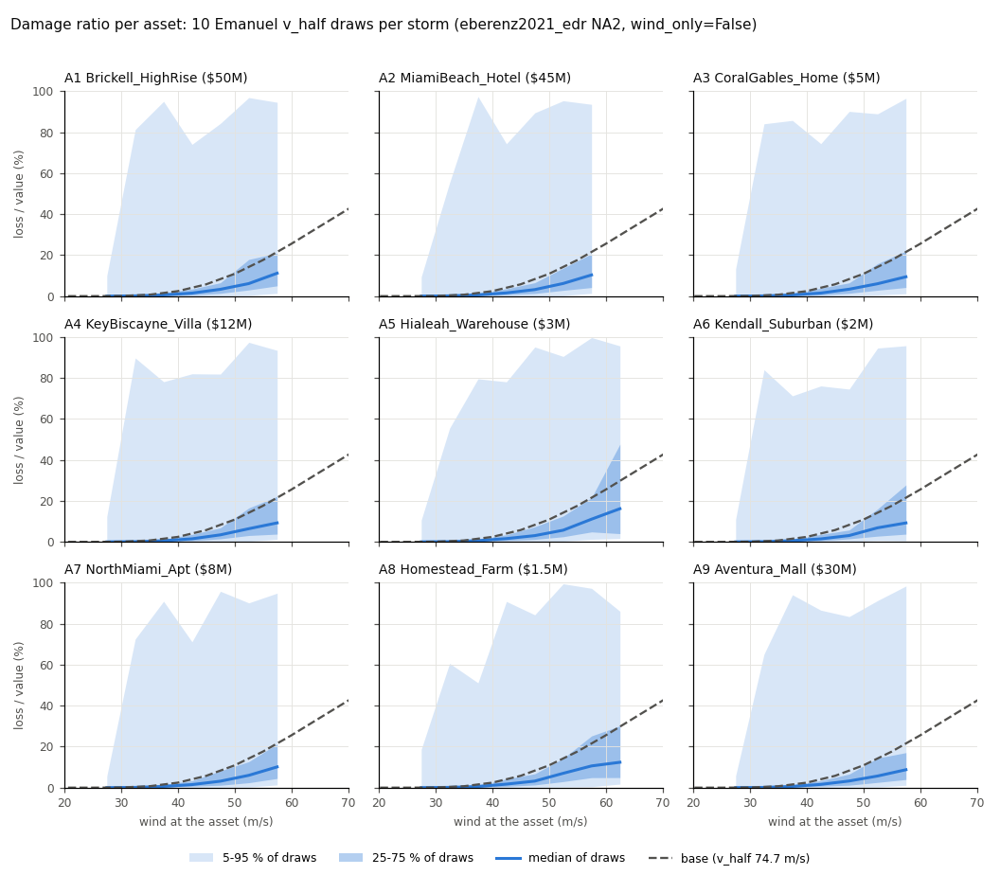

# Vulnerability uncertainty: Emanuel `v_half` draws

Issue MAR-25 (F-12), SPEC §6.3 ("loss truth"). Code: `packages/climada/src/parametric_insurance_design_climada/vulnerability.py`; config section `vulnerability` (see `packages/climada/README.md`).

## Why

The thesis made the loss truth uncertain only with a synthetic lognormal noise layer (thesis issue M2). Here the loss of each storm is recomputed with the impact function's own parameter drawn from a prior that comes from a published calibration. Each draw is one `draw_id` row of the EventSet: the index stays the same, and only the loss varies.

## The model

The loss at an asset is CLIMADA's tropical-cyclone impact with the Emanuel (2011) function, as in the thesis:

- `mdd(w) = scale · v³ / (1 + v³)`, with `v = max(w − v_thresh, 0) / (v_half − v_thresh)`;
- the function is tabulated on CLIMADA's intensity grid (0–120 m/s in 5 m/s steps) and interpolated linearly, as `ImpactCalc` does;
- `loss = value · paa(w) · mdd(w)`, with `w` the wind at the asset and `paa = 1`.

Only `v_half` is uncertain. `v_thresh` (25.7 m/s) and `scale` (1) stay fixed, for two reasons:

- the calibration this prior comes from holds them fixed;
- event damages alone cannot separate `v_half` from `v_thresh`.

The issue allowed `v_thresh` draws "if needed". They aren't.

**Sampling.**

- For every storm and every draw, one `v_half` is drawn. All locations of that storm share it: one impact function for the portfolio, as in the calibration, which fits one `v_half` per event and country.
- Storms and draws are independent.
- The draws come from a `numpy.random.Generator` seeded from the config (`vulnerability.seed`). The pipeline consumes it event-major, as `rng.random((n_events, n_draws))` per batch, so `batch_size` doesn't change the result. Tests check this.
- Each draw row carries `rate / n_draws` (SPEC §5), so the draws of one storm keep its rate.

**Provenance.** The EventSet's metadata gets a second transform record, `vulnerability_draws`. It holds:

- the parameter and the fixed parameters;
- the prior: kind, region, source, DOI, the CLIMADA data file with its SHA256, every value and some quantiles;
- `n_draws`, the sampling rule, the loss formula and the seed.

`content_hash()` covers all of it.

## The prior and its source

**Default: `eberenz2021_edr`, region `NA2` (USA and Canada).**

Eberenz, S., Lüthi, S. and Bresch, D. N. (2021): *Regional tropical cyclone impact functions for globally consistent risk assessments.* Nat. Hazards Earth Syst. Sci. 21, 393–415, [doi:10.5194/nhess-21-393-2021](https://doi.org/10.5194/nhess-21-393-2021).

What they did:

- calibrated `v_half` of the Emanuel function per world region against EM-DAT damages for 473 events, holding `v_thresh = 25.7` m/s fixed;
- reported two regional fits: RMSF-optimal and TDR-optimal (total damage ratio = 1);
- also fitted `v_half` to every single event, so that its simulated damage equals its reported damage (EDR = 1);
- show the spread of these event-wise fits as interquartile bands (their Fig. 5);
- searched `v_half` from 25.8 to 325.7 m/s;
- recommend event-fitted or RMSF-optimal functions for sensitivity analysis (their Sect. 5.1).

CLIMADA 6.1.0 ships all four calibration results as `climada/data/system/tc_impf_cal_v01_{EDR,RMSF,TDR1.0,TDR1.5}.csv`. `ImpfSetTropCyclone.calibrated_regional_vhalf("EDR", q)` returns quantile `q` of a region's event-wise values. The prior is that distribution:

- a draw is `calibrated_regional_vhalf("EDR", q=u)["NA2"]` with `u ~ U(0, 1)`;
- that is, the linear-interpolation quantile function of the 43 NA2 event-wise values;
- the file's SHA256 is pinned (`bde5670d…a3343e39`), and loading fails if it differs.

| NA2 event-wise `v_half` (m/s) | min | 5 % | 25 % | median | 75 % | 95 % | max |
|---|---|---|---|---|---|---|---|
| all 43 events (default) | 25.8 | 29.5 | 74.1 | 91.8 | 115.1 | 207.1 | 232.4 |
| `wind_only: true` (19 events) | 25.8 | 35.9 | 79.1 | 95.4 | 143.7 | 221.9 | 232.4 |

For comparison:

- the regional fits in the same files are NA2 RMSF 86.0 m/s and TDR 89.2 m/s;
- the global fits are RMSF 73.4 m/s and TDR 110.1 m/s;
- the thesis's and CLIMADA's default is 74.7 m/s.

**Option `wind_only: true`.** This leaves out events whose EM-DAT record lists an associated disaster (surge, rain, flood, slide, other). Their reported damage isn't wind damage alone, which pulls the fitted `v_half` down. Examples among the five lowest NA2 values: 1992249N12229 and 2017228N14314 (Flood flags). The default keeps all events, as the published distribution does. Which one to use is an open question for the owner.

**Alternative: `uniform`.** `v_half ~ U(low, high)`, for sensitivity runs; you supply the bounds and their source. It may be used with any `v_thresh` and `scale`. The Eberenz prior requires `v_thresh = 25.7` and `scale = 1`, and the config refuses anything else.

**How each source was checked.**

- **Eberenz et al. (2021):** checked on the NHESS article page (doi:10.5194/nhess-21-393-2021). Confirmed there:
  - title, authors and DOI;
  - `v_thresh` fixed at 25.7 m/s and 74.7 m/s as the default `v_half`;
  - the RMSF and TDR approaches and the event-wise fits;
  - the global fits of 73.4 and 110.1 m/s;
  - the 3 m/s RMSF–TDR gap for NA2;
  - the 25.8–325.7 m/s search range;
  - the recommendation in Sect. 5.1.

  The per-region table is an image on that page, so the region values come from the CLIMADA files. They match the numbers the text states: global 73.4/110.1 m/s, and NA2 86.0 vs 89.2 m/s, a 3.2 m/s gap.
- **Emanuel (2011), Weather, Climate, and Society** ([doi:10.1175/WCAS-D-11-00007.1](https://doi.org/10.1175/WCAS-D-11-00007.1)): the publisher page returned HTTP 403, so the citation is taken from CLIMADA's `from_emanuel_usa` docstring and from Eberenz et al. It wasn't checked at the primary source.
- **CLIMADA `unsequa`** (Kropf et al. 2022, GMD 15, 7177–7201, [doi:10.5194/gmd-15-7177-2022](https://doi.org/10.5194/gmd-15-7177-2022); citation checked on the GMD page): not used. The draws here are a direct quantile transform and need neither `unsequa` nor its sampling dependencies.

## Number of draws and runtime

Measured on the thesis portfolio (9 Miami assets, IRIS 10,000 years, 6,057 storms within 500 km), CLIMADA 6.1.0, on the owner's Apple-silicon Mac:

| | 1 draw | 10 | 20 | 50 |
|---|---|---|---|---|
| EventSet rows | 6,057 | 60,570 | 121,140 | 302,850 |
| pipeline build, s | 35.0* | 30.4 | 29.6 | 29.6 |
| core build + solve, individual (A1), s | 0.3 | 6.9 | 15.5 | 96.2 (HiGHS) |
| core build + solve, portfolio, s | 0.4 | 11.5 | 24.2 | 143.8 (HiGHS) |

\* The first build includes warm-up. Without draws (the default config) the build takes 31.5 s.

Notes on the measurement:

- The draws themselves cost about **4.5 ms per draw** for 6,057 storms × 9 assets, measured in isolation. The build time is set by CLIMADA's wind field, about 30 s, and doesn't grow with the number of draws.
- The core runs used a weighted CVaR (α = 0.5, β = 0.99), a 10-bin step payout, a pure premium, `Budget(1.0)` and the event-conditional basis. The annual basis is MAR-24.
- At 50 draws CLARABEL didn't return an accepted result, and the solver policy fell back to HiGHS.

**Default `n_draws = 10`.** The cost that matters is the design LP downstream, not the build, and it grows faster than linearly in rows. Ten draws:

- meet the acceptance (≥ 10);
- keep one design solve at about 7–12 s on this portfolio;
- are close to the thesis noise layer's 13 copies.

Use more draws for final paper runs if the solve budget allows.

## Observations on the thesis portfolio (no conclusions)

Setup: `configs/thesis_vulnerability.yaml` (centroid-wind index) and `configs/thesis_cat_in_circle_vulnerability.yaml` (cat-in-a-circle, r = 50 km), 10 draws, seed 20261025, prior `eberenz2021_edr` NA2 with all events. Both have 60,570 rows × 9 locations. The loss columns of the two are identical; only the index differs.

- Per asset, the rate-weighted expected annual loss over the draws is **2.66–2.81 times** that of the base function (v_half 74.7). With `wind_only: true` (computed outside the pipeline with the same seed) it is 1.72–1.83 times.
- The prior's median (91.8 m/s) gives *lower* damage than the base function. The higher mean comes from the lower tail of the prior: draws near the 25.8 m/s search bound give damage ratios near 100 % at winds of 30–40 m/s. Example, mean damage ratio over the prior at the wind shown:

  | wind | over the prior | at the median `v_half` | base |
  |---|---|---|---|
  | 35 m/s | 7.7 % | 0.3 % | 0.7 % |
  | 55 m/s | 20.1 % | 8.0 % | 17.6 % |

- For storms with a non-zero loss, the median per-storm coefficient of variation of the loss across the 10 draws is 1.91–1.98 per asset.
- The AAL computed per `draw_id` (each draw as one version of the 10,000 years) ranges, for asset A1, from 163k to 229k USD across the 10 draws. The mean is 191k, and the base is 70k.

The figure is made by `packages/climada/scripts/plot_vulnerability_spread.py` from the centroid-wind build:

- one panel per asset: the damage ratio (loss / value) of every (storm, draw) row against the wind at the asset;
- the median and the 25–75 % and 5–95 % bands, in 5 m/s wind bins with at least 50 rows;
- the base impact function, dashed.

## Limits

- The calibration used CLIMADA's TC wind model of the time, on IBTrACS tracks and LitPop exposure at country level. This pipeline uses IRIS tracks with the same H08 wind model and point exposures. The event-wise spread therefore also carries hazard-model and reporting error, not only building vulnerability.
- NA2 contains two Hawaiian (East Pacific) events (1982324N10193, 1992249N12229). Both sit at the 25.8 m/s search bound.
- Draws are independent across storms. A draw is not one fixed `v_half` for the whole catalogue: that is the epistemic reading, SPEC §6.5 (ii). For it, build one EventSet per `impact_function.v_half` value.
