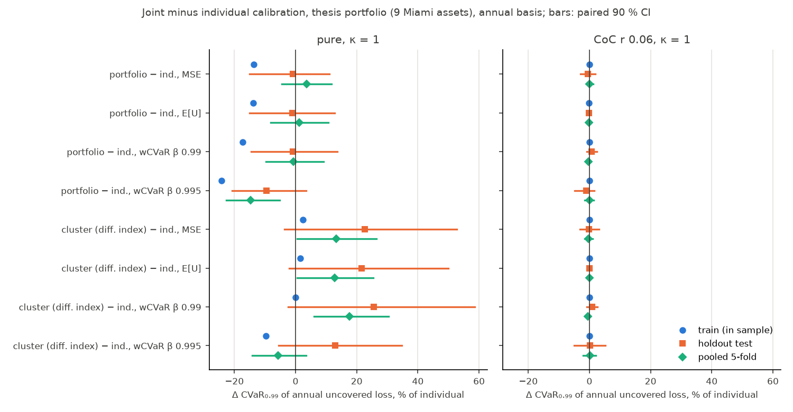

# Checkpoint C1: do the tail and portfolio advantages hold under the core v1 features?

- Issue: [MAR-29](https://linear.app/marc-prinzing/issue/MAR-29/c1-checkpoint-does-the-tail-advantage-hold-under-the-core-v1-features) (Human / Gate / Decision), SPEC §6 "Checkpoint C1" and §1 publication rule.
- **Status: draft prepared by a worker agent on 2026-10-28, for the owner; portfolio addendum (RQ2, section 6b, [MAR-158](https://linear.app/marc-prinzing/issue/MAR-158)) added on 2026-10-31.** Sections 1–6b are observations. Section 7 is the agent's recommendation, clearly marked, for both stories (RQ1 tail, RQ2 portfolio). Section 8 is empty: the narratives, D4 and D6 are the owner's decisions.
- Scripts: `research/scripts/c1_build_eventsets.sh` (F-12 EventSets), `research/scripts/c1_checkpoint.py` (runs, bootstrap, tables), `research/scripts/c1_figures.py` (figures and `research/data/c1/tables.md`). Base config: `research/configs/c1/c1_main.yaml`. RQ2 addendum: `research/scripts/c1_rq2.py` (cross-scope comparisons, k-fold runs) and `research/scripts/c1_rq2_tables.py` (`research/data/c1-rq2/`, its `tables.md` and figure).
- Data: `research/data/c1/`. `runs.csv` maps every run to its full `config_hash` and `run_id`. `kpis_<family>.csv` and `paired_<family>.csv` hold every number below. `tables.md` holds every table of the grid, generated. Hashes in this note are the first 12 hex digits of the `sha256:` config hash.

## Publication rule (unchanged until the owner marks C1 Done)

Until C1 is Done, external outputs (website, posts, CRC showcase, CLIMADA tutorial):

- present the method and the tool;
- state the setup of every number shown (portfolio, basis-risk model, pricing);
- use numbers from out-of-sample runs on the annual basis;
- make **no general claim** that tail optimisation outperforms;
- make **no general claim** that joint (portfolio or cluster) calibration outperforms individual calibration (added on the Program hub, 2026-10-31).

Nothing in this draft changes that. The owner's decision in section 8 decides which claims may be made afterwards, for both stories.

## 1. The question

Two co-equal questions (Program hub, "Two co-equal stories", 2026-10-31):

- **RQ1 (tail), sections 3–6.** Using the core v1 features (F-09 to F-12): does the weighted-CVaR design still lower tail basis risk **out of sample**, under **realistic basis risk** and **loaded pricing**, compared with the MSE and E[U] designs, for each scope (individual, cluster, portfolio)?
- **RQ2 (portfolio), section 6b.** At the same budget, does joint calibration (portfolio or cluster scope) lower the owner's shortfall against individual calibration, out of sample, under each objective (MSE, E[U], weighted CVaR), under realistic basis risk and loaded pricing?

## 2. Setup of every number

**Main line** (`family = main`; every number in sections 3–5 unless stated otherwise):

| Item | Setting |
|---|---|
| Portfolio | Thesis portfolio, 9 Miami assets (`A1`–`A9`). EventSet `parity/tests/data/thesis_eventset`, content hash `sha256:404b0c3a3aefa38965ad3ace2747d308685a67e3b218cb835d45a9ab375294df`, IRIS 10,000 years |
| Basis-risk model | Thesis noise layer: heteroscedastic, η = 0.3, 13 copies, seed 42; threshold 20 m/s on the index (it drops only zero-loss rows: `expected_loss_dropped = 0`); 13,897 rows after preparation |
| Basis | `annual` (paper basis, SPEC §6.2). An outcome is a (year, copy) slot; U_y = Σ_{e∈y}(L_e − π_e)⁺; CVaR over slots. CVaR₀.₉₉ is the mean of the worst 1 % of slots (the 100-year level) |
| Split | Holdout, `train_fraction` 0.7: calibrate on years 0–6,999, evaluate on years 7,000–9,999 (**test**). Train values are in-sample |
| CIs | Year-block bootstrap, B = 1000, seed 0, level 0.9, percentile intervals. All designs of one (variant, scope) are bootstrapped on the same resampled test years, so **paired** differences are reported (`bootstrap.paired_difference`) |
| Payout | Step payout, 15 bins on [20, 70] m/s |
| Scopes | individual (9 problems); cluster (3 clusters, thesis Ward, `beta_tail` 0.9; `cap_n_clusters` stays at its default `false`: C1 runs no `n_assets` sweep); portfolio (1 problem) |
| Designs | MSE; E[U] (`expected_uncovered`); weighted CVaR, α = 0.9, design β ∈ {0.95, 0.97, 0.98, 0.99, 0.995} |
| Pricing | `pure` (premium = E[π]); `cost_of_capital` r = 0.06 and r = 0.10, q = 0.99 (premium = (1 − r)·E[π] + r·CVaR_q(π)) |
| Budget | premium ≤ κ·E[L] on the train years, κ ∈ {0.5, 1, 1.5}; κ = 1 unless stated |
| KPIs | Portfolio level only (sum over the 9 assets and all payouts). Evaluated on the test years at KPI β 0.95, 0.99 and 0.995; the config's `evaluation.beta` is 0.99. **No per-asset KPIs of joint (cluster, portfolio) designs** (MAR-98, MAR-100: not unique without an allocation rule) |
| Solver | `solve.DEFAULT_POLICY` (LP: CLARABEL → HiGHS → SCS; QP: OSQP at 1e-8 → CLARABEL; inaccurate accepted). **Never `THESIS_POLICY`** (MAR-98) |
| Code | Package `0.1.0.dev0`, `origin/main` at 5836676 (MAR-131 merged) |

**Headline design.** The headline weighted-CVaR design is β = 0.99, read at KPI β 0.99. This is the agent's choice, proposed rather than settled: on the annual basis about 5 % of slots have an uncovered loss, so at β ≤ 0.97 the weighted-CVaR design is the E[U] design (section 5.1, MAR-24 observation 4), and the thesis β = 0.95 would compare E[U] with itself. All five β are reported.

**Reference column** (`family = reference`): the same thesis config on the thesis basis, `event_conditional` (CVaR over event rows given an event), KPI β 0.95 (thesis) and 0.99, weighted CVaR at the thesis β 0.95, κ = 1. Its pure-pricing rows reproduce MAR-23 (`research/notes/bootstrap-headline.md`) exactly: same config hashes (`f8725a9beee8`, `76fa6a211ef8`, …) and the same paired intervals.

**F-12 sensitivities** (`family = f12`, **provisional**, section 6): annual basis, holdout, bootstrap as above, κ = 1, pricing pure and r = 0.06, designs MSE, E[U], weighted CVaR β 0.95 and 0.99. No noise layer: the basis risk comes from the index and the loss model.

| Label | EventSet | Index | Loss | Threshold, payout | Content hash |
|---|---|---|---|---|---|
| `cic50` | `thesis_cat_in_circle.yaml` | (b) cat-in-a-circle, r = 50 km | base Emanuel (`v_half` 74.7) | none; one bin per category 0–5 | `sha256:de0153d3…304279a` |
| `vuln` | `thesis_vulnerability.yaml` | (a) wind at the asset | 10 `v_half` draws, default prior (wind-only NA, 17 events) | 20 m/s; 15 bins [20, 70] | `sha256:18170363…f849e9` |
| `cic50_vuln` | `thesis_cat_in_circle_vulnerability.yaml` | (b), 50 km | 10 draws, default prior | none; one bin per category | `sha256:8050edc7…098939d627` |
| `vuln_basins_null` | `research/configs/c1/eventsets/thesis_vulnerability_basins_null.yaml` | (a) | 10 draws, prior without basin filter (19 events, MAR-103) | 20 m/s; 15 bins | `sha256:f93e7cdd…99c314f9` |

The `vuln` and `cic50_vuln` content hashes equal those in `docs/methodology/vulnerability.md` (MAR-132 builds). Full hashes: `research/data/c1/summary.json`.

**Size.** 312 runs (189 main, 27 reference, 96 F-12), all solved (`optimal` 304, `optimal_inaccurate` 8: CLARABEL on the `cic50_vuln` E[U] and weighted-CVaR β 0.95 runs, accepted by the policy). Wall time 4,147 s at `--jobs 3` on the shared 10-core Mac (load average up to 34): 2,707 s solving, 1,435 s bootstrapping. Regenerate with:

```bash
IRIS_CATALOGUE=<…>/IRIS_NA_10000Y_merged.txt research/scripts/c1_build_eventsets.sh
uv run python research/scripts/c1_checkpoint.py --jobs 3
uv run python research/scripts/c1_figures.py
```

## 3. Main result per scope (annual basis, test years, κ = 1)

Test expected loss: 231,626 per year (train 215,536). Money in the fixture's loss unit (USD).

### 3.1 Pure pricing

| Scope | Design | Test CVaR₀.₉₉(U) [90 % CI] | Test E[U] [90 % CI] | Train CVaR₀.₉₉(U) | Config hash |
|---|---|---|---|---|---|
| individual | MSE | 1,004,087 [650,025, 1,396,670] | 10,552 [6,942, 14,618] | 983,110 | `b6a790bd484c` |
| individual | E[U] | 1,011,027 [648,216, 1,405,215] | 10,500 [6,779, 14,620] | 977,257 | `9326e4840c25` |
| individual | wCVaR β 0.99 | 864,213 [679,984, 1,058,017] | 14,412 [11,856, 17,301] | 901,744 | `f89028d0ef02` |
| cluster | MSE | 1,231,809 [806,023, 1,686,791] | 13,067 [8,643, 18,035] | 1,006,788 | `80bee12e4c89` |
| cluster | E[U] | 1,230,165 [798,845, 1,665,920] | 12,934 [8,480, 17,713] | 991,669 | `b78a04a941dd` |
| cluster | wCVaR β 0.99 | 1,084,783 [752,179, 1,459,088] | 14,481 [10,698, 18,724] | 900,985 | `9a25ee86197d` |
| portfolio | MSE | 995,075 [676,459, 1,344,372] | 10,784 [7,430, 14,537] | 848,637 | `4d63dddd3335` |
| portfolio | E[U] | 1,001,281 [636,576, 1,417,756] | 10,621 [6,731, 15,069] | 841,320 | `08a569620416` |
| portfolio | wCVaR β 0.99 | 856,026 [635,489, 1,115,816] | 12,844 [10,032, 16,092] | 745,547 | `7d700f7bd02d` |

Paired differences, weighted CVaR (β 0.99) minus the other design, test years:

| Scope | Δ CVaR₀.₉₉(U) vs MSE [90 % CI] | Δ CVaR₀.₉₉(U) vs E[U] | Δ E[U] vs MSE | Δ E[U] vs E[U] design |
|---|---|---|---|---|
| individual | −139,875 [−370,782, 44,789] (−13.9 %) | −146,814 [−379,308, 43,448] (−14.5 %) | +3,860 [1,488, 6,015] (+36.6 %) | +3,912 [1,549, 6,167] (+37.3 %) |
| cluster | −147,026 [−299,700, −3,843] (−11.9 %) | −145,383 [−285,647, −16,451] (−11.8 %) | +1,414 [−140, 2,887] (+10.8 %) | +1,547 [63, 2,881] (+12.0 %) |
| portfolio | −139,049 [−260,374, −21,146] (−14.0 %) | −145,255 [−335,117, 8,519] (−14.5 %) | +2,060 [598, 3,421] (+19.1 %) | +2,223 [264, 3,820] (+20.9 %) |

At the 200-year level (KPI β 0.995) the same design is 17.7–30.8 % below MSE and E[U] in every scope, every paired interval excluding zero; the β 0.995 design is 24.1–31.1 % below (`tables.md`, β grid).

### 3.2 Cost-of-capital pricing (q = 0.99)

| Scope | Design | r = 0.06: test CVaR₀.₉₉(U) [90 % CI] | Config hash | r = 0.10: test CVaR₀.₉₉(U) [90 % CI] | Config hash |
|---|---|---|---|---|---|
| individual | MSE | 14,463,870 [11,281,120, 17,052,150] | `af9fe556d6aa` | 15,655,240 [11,937,800, 18,900,210] | `9aed2418ab22` |
| individual | E[U] | 15,522,110 [10,608,130, 20,672,730] | `3bee2dabbfe6` | 16,364,080 [11,445,180, 21,519,090] | `a8e3d193b7d2` |
| individual | wCVaR β 0.99 | 14,487,770 [11,014,520, 17,943,110] | `9c0222a65bad` | 15,777,460 [11,595,110, 19,940,740] | `102653e1f758` |
| cluster | MSE | 14,445,040 [11,194,970, 17,107,260] | `96457b8a9204` | 15,726,040 [11,978,510, 19,029,020] | `f514d937ee8b` |
| cluster | E[U] | 15,520,700 [10,601,950, 20,676,270] | `f5d42cdbabde` | 16,366,780 [11,447,530, 21,522,400] | `7bcffc295bd3` |
| cluster | wCVaR β 0.99 | 14,610,290 [11,025,160, 18,203,530] | `a56b270c97e4` | 15,848,360 [11,667,830, 20,084,470] | `9e2e281aa4b6` |
| portfolio | MSE | 14,401,690 [11,162,160, 16,970,350] | `0ada0ff98fb2` | 15,670,310 [11,933,050, 18,906,000] | `b4a513c6f1ab` |
| portfolio | E[U] | 15,500,420 [10,582,900, 20,656,070] | `e86fd26ac86f` | 16,354,950 [11,435,290, 21,510,610] | `94bbfeba79fe` |
| portfolio | wCVaR β 0.99 | 14,582,600 [10,994,790, 18,275,400] | `a705dea1563a` | 15,845,120 [11,703,940, 20,136,770] | `120c06502b37` |

Paired differences, weighted CVaR (β 0.99) minus the other design, test CVaR₀.₉₉(U):

| Scope | r = 0.06 vs MSE | r = 0.06 vs E[U] | r = 0.10 vs MSE | r = 0.10 vs E[U] |
|---|---|---|---|---|
| individual | +23,901 [−1,325,494, 1,796,445] (+0.2 %) | −1,034,338 [−2,693,054, 402,611] (−6.7 %) | +122,217 [−1,337,830, 2,136,726] (+0.8 %) | −586,622 [−1,418,371, 246,517] (−3.6 %) |
| cluster | +165,245 [−1,481,874, 2,297,194] (+1.1 %) | −910,416 [−2,397,953, 396,210] (−5.9 %) | +122,314 [−1,356,780, 2,209,850] (+0.8 %) | −518,426 [−1,334,430, 267,572] (−3.2 %) |
| portfolio | +180,911 [−1,480,112, 2,301,200] (+1.3 %) | −917,815 [−2,309,289, 390,144] (−5.9 %) | +174,803 [−1,346,318, 2,304,175] (+1.1 %) | −509,835 [−1,330,037, 281,874] (−3.1 %) |

Every one of these twelve intervals contains zero. At KPI β 0.995 the weighted-CVaR designs (β 0.99 and 0.995) are 7.8–20.3 % below E[U], intervals excluding zero, and within ±6.3 % of MSE, intervals containing zero.


### 3.3 Observations on sections 3.1–3.2

1. **Pure pricing.** The weighted-CVaR design's test CVaR₀.₉₉(U) is 11.8–14.5 % below MSE and E[U] in every scope. The paired 90 % interval excludes zero against MSE in the cluster and portfolio scopes and against E[U] in the cluster scope; the other three contain zero, with upper bounds of +8,519 to +44,789. The separate intervals of the three designs overlap in every scope.
2. **Its cost.** The same design's test E[U] is 10.8–37.3 % higher than MSE's and E[U]'s; that interval excludes zero in five of six cases (not cluster vs MSE).
3. **Cost-of-capital pricing.** The weighted-CVaR and MSE designs are within ±1.3 % of each other on test CVaR₀.₉₉(U), with paired intervals about ±10–16 % wide. Against E[U] the weighted-CVaR design is 3.1–6.7 % lower, intervals containing zero.
4. **Why MSE and weighted CVaR tie under the load (arithmetic, observed).** On the train years the MSE, weighted-CVaR β 0.99 and β 0.995 designs of the cluster and portfolio scopes have the same expected payout (31,057), the same premium (215,536 = the budget) and the same train CVaR₀.₉₉(U) (13,936,399–13,936,405). With q = 0.99 and all payout in at most 1 % of slots, CVaR₀.₉₉(π) = E[π]/0.01, so the premium is (0.94 + 0.06/0.01)·E[π] = 6.94·E[π], and the binding budget fixes E[π] = 215,536 / 6.94 = 31,057 for any such design. If those slots are the worst-loss slots, CVaR₀.₉₉(U) = CVaR₀.₉₉(L) − E[π]/0.01 is then fixed by the budget alone. So when the load's q equals the KPI β, the tail KPI cannot separate the designs in sample; out of sample they differ only by sampling noise. The E[U] design spreads its payout (E[π] about 63,000) and has the higher tail. MAR-27 (annual section, in sample, KPI β 0.95) found the weighted-CVaR (= E[U]) design 12.6–20.9 % below MSE: the order depends on which KPI β is read.
5. **Out-of-sample gap.** On the test years every design's CVaR₀.₉₉(U) is higher than on train in the cluster and portfolio scopes (pure: +15 to +24 %), and the test expected loss is 7.5 % above train (231,626 vs 215,536).

## 4. The event-conditional reference column (thesis basis)

Weighted CVaR (thesis β 0.95) minus MSE / E[U], test CVaR over event rows (per event, not per year):

| Pricing | Scope | KPI | Δ vs MSE [90 % CI] | Δ vs E[U] [90 % CI] | Hash wCVaR / MSE / E[U] |
|---|---|---|---|---|---|
| pure | individual | CVaR₀.₉₅ | −487,913 [−1,022,660, −15,911] (−29.3 %) | −482,276 [−1,022,426, −13,310] (−29.1 %) | `f8725a9beee8` / `76fa6a211ef8` / `a9256cc9b34c` |
| pure | cluster | CVaR₀.₉₅ | −462,011 [−831,624, −116,770] (−23.0 %) | −461,977 [−822,261, −126,836] (−23.0 %) | `691419c8ea6e` / `d54442e350cc` / `e7d6062c6f2e` |
| pure | portfolio | CVaR₀.₉₅ | −458,863 [−826,914, −122,980] (−28.0 %) | −450,630 [−901,711, −65,205] (−27.6 %) | `effe8566488c` / `b3b396a3e817` / `1dff61a5f097` |
| CoC r 0.06 | individual | CVaR₀.₉₅ | −553,757 [−1,614,855, 1,284,718] (−4.9 %) | −2,784,793 [−4,306,054, −711,415] (−20.6 %) | `0e97a9d29c21` / `41b74f19563a` / `2536de7fa7a6` |
| CoC r 0.06 | cluster | CVaR₀.₉₅ | −52,262 [−1,345,635, 1,764,759] (−0.5 %) | −2,743,902 [−4,567,404, −418,471] (−20.3 %) | `365c816e1846` / `c2d84badeb59` / `036fcac0c6bf` |
| CoC r 0.06 | portfolio | CVaR₀.₉₅ | −132,545 [−1,468,472, 1,756,785] (−1.2 %) | −2,688,614 [−4,388,348, −413,197] (−20.0 %) | `909ecc5c722e` / `0ca0a44fb462` / `c69b087130d2` |
| CoC r 0.10 | individual | CVaR₀.₉₅ | −251,483 [−758,771, 397,259] (−1.8 %) | −2,554,788 [−3,072,061, −938,046] (−15.8 %) | `1320905a2b60` / `7d0011502138` / `bcddf7bb67ae` |
| CoC r 0.10 | cluster | CVaR₀.₉₅ | −102,168 [−572,966, 681,755] (−0.7 %) | −2,476,715 [−3,319,315, −588,898] (−15.3 %) | `61001be28e26` / `0822a0132856` / `87ee9059b49b` |
| CoC r 0.10 | portfolio | CVaR₀.₉₅ | −71,199 [−628,188, 634,874] (−0.5 %) | −2,380,465 [−3,185,780, −441,900] (−14.8 %) | `a2cb9a2e589f` / `056ca8575b1c` / `26acf8347604` |

Observations:

6. On the thesis basis under pure pricing the paired intervals exclude zero in every scope (MAR-23 reproduced). Under the loads the lead over MSE falls to 0.5–4.9 % with intervals containing zero, and the lead over E[U] stays at 14.8–20.6 % with intervals excluding zero. Read at CVaR₀.₉₉ (per event), the loaded weighted-CVaR design is 3.5–17.4 % **above** MSE (interval excludes zero only for individual, r = 0.10) and 8.4–15.8 % below E[U] (`tables.md`).
7. The size of the pure-pricing lead differs between the bases: 23–29 % per event on `event_conditional` at β 0.95, 12–15 % per year on `annual` at β 0.99.

## 5. Robustness of the main line

### 5.1 Design β (κ = 1)


Relative paired difference in test CVaR₀.₉₉(U), weighted CVaR at design β minus MSE (`*` = 90 % interval excludes zero; the full grid with KPI β 0.95 and 0.995 and the E[U] comparisons is in `tables.md`):

| Pricing | Scope | β 0.95 | β 0.97 | β 0.98 | β 0.99 | β 0.995 |
|---|---|---|---|---|---|---|
| pure | individual | +0.6 % | +0.7 % | −4.3 %* | −13.9 % | +0.7 % |
| pure | cluster | −0.1 % | −0.2 % | −2.2 % | −11.9 %* | −7.3 % |
| pure | portfolio | +0.5 % | +0.3 % | −8.8 %* | −14.0 %* | −8.0 % |
| CoC r 0.06 | individual | +7.3 % | +7.3 % | +7.1 % | +0.2 % | −0.3 % |
| CoC r 0.06 | cluster | +7.4 % | +7.4 % | +7.0 % | +1.1 % | +0.1 % |
| CoC r 0.06 | portfolio | +7.6 % | +7.6 % | +7.2 % | +1.3 % | −0.9 % |
| CoC r 0.10 | individual | +4.5 % | +4.5 % | +4.2 % | +0.8 % | +0.3 % |
| CoC r 0.10 | cluster | +4.1 % | +4.1 % | +3.9 % | +0.8 % | +0.6 % |
| CoC r 0.10 | portfolio | +4.4 % | +4.4 % | +4.1 % | +1.1 % | −0.6 % |

Observations:

8. **The β 0.90–0.97 coincidence.** At design β 0.95 and 0.97 the weighted-CVaR design is the E[U] design: its paired difference to E[U] is within ±0.4 % at every KPI β, pricing and scope. MAR-24 explained the arithmetic: when at most 5 % of slots carry an uncovered loss, VaR_β(U) = 0 for β ≥ 0.95 and CVaR_β(U) = E[U]/(1 − β), so the weighted-CVaR objective is a constant multiple of E[U] and has the same minimisers. Here the same holds through β 0.97 on the holdout train years. It separates from β 0.98.
9. **The matched β.** Under pure pricing the largest test-tail reduction at a KPI β is reached with the design β near that KPI β: at KPI 0.99 by β 0.99 (−11.9 to −14.0 %), at KPI 0.995 by β 0.99–0.995 (−17.9 to −30.6 %). At KPI 0.95 the β 0.99 and 0.995 designs are 10.7–87.2 % **above** MSE and E[U] (the tail at 0.95 is E[U]/0.05; observation 2).
10. **Under the loads** no design β gives a test CVaR₀.₉₉(U) below MSE with an interval excluding zero; β ≤ 0.98 (≈ the E[U] design) is 3.9–7.6 % above MSE.

### 5.2 Budget loading κ


Weighted CVaR (β 0.99) minus MSE / E[U], test CVaR₀.₉₉(U), relative [90 % CI]:

| Pricing | Scope | vs | κ 0.5 | κ 1 | κ 1.5 |
|---|---|---|---|---|---|
| pure | individual | MSE | +3.5 % [−4.9, +14.3] | −13.9 % [−36.9, +4.5] | −100.0 % [−139.7, −64.2] |
| pure | individual | E[U] | −14.0 % [−27.3, −1.6] | −14.5 % [−37.5, +4.3] | both 0 (see 12) |
| pure | cluster | MSE | +1.4 % [−3.7, +7.8] | −11.9 % [−24.3, −0.3] | −97.2 % [−133.2, −63.9] |
| pure | cluster | E[U] | +2.6 % [−0.9, +6.2] | −11.8 % [−23.2, −1.3] | −15.6 % [−29.8, −4.0] |
| pure | portfolio | MSE | −3.1 % [−8.0, +3.0] | −14.0 % [−26.2, −2.1] | −92.2 % [−120.7, −65.5] |
| pure | portfolio | E[U] | −4.5 % [−7.5, −0.5] | −14.5 % [−33.5, +0.9] | +1.9 % [−0.2, +4.5] |
| CoC r 0.06 | individual | MSE | +0.4 % [−7.3, +11.8] | +0.2 % [−9.2, +12.4] | +0.4 % [−7.1, +10.2] |
| CoC r 0.06 | individual | E[U] | −3.4 % [−7.1, +0.4] | −6.7 % [−17.3, +2.6] | −9.8 % [−27.7, +5.5] |
| CoC r 0.06 | cluster | MSE | +0.0 % [−8.3, +11.5] | +1.1 % [−10.3, +15.9] | +2.9 % [−6.5, +14.9] |
| CoC r 0.06 | cluster | E[U] | −3.0 % [−6.7, +0.6] | −5.9 % [−15.5, +2.6] | −9.1 % [−27.5, +6.4] |
| CoC r 0.06 | portfolio | MSE | +0.3 % [−8.0, +12.7] | +1.3 % [−10.3, +16.0] | +4.7 % [−5.5, +17.4] |
| CoC r 0.06 | portfolio | E[U] | −3.0 % [−6.7, +0.7] | −5.9 % [−14.9, +2.5] | −9.2 % [−26.6, +5.5] |
| CoC r 0.10 | individual | MSE | +0.6 % [−5.4, +10.1] | +0.8 % [−8.5, +13.6] | +0.4 % [−9.5, +13.5] |
| CoC r 0.10 | individual | E[U] | −1.9 % [−4.1, +0.5] | −3.6 % [−8.7, +1.5] | −5.4 % [−15.3, +3.1] |
| CoC r 0.10 | cluster | MSE | −0.3 % [−6.2, +9.5] | +0.8 % [−8.6, +14.1] | +0.2 % [−10.3, +13.9] |
| CoC r 0.10 | cluster | E[U] | −1.6 % [−3.9, +0.6] | −3.2 % [−8.2, +1.6] | −4.7 % [−13.7, +3.3] |
| CoC r 0.10 | portfolio | MSE | +0.7 % [−5.4, +11.0] | +1.1 % [−8.6, +14.7] | +1.3 % [−10.4, +16.0] |
| CoC r 0.10 | portfolio | E[U] | −1.6 % [−3.9, +0.7] | −3.1 % [−8.1, +1.7] | −4.7 % [−13.2, +3.3] |

Observations:

11. **Under the loads κ changes little.** Against MSE the difference stays within −0.3 to +4.7 % at every κ, intervals containing zero. Against E[U] it grows with κ (r 0.06: −3.0/−3.4 % at κ 0.5 to −9.1/−9.8 % at κ 1.5), intervals containing zero.
12. **Pure, κ 1.5 is a different regime.** The E[U] and weighted-CVaR designs pay out 1.44–1.50 times the train expected loss and have **zero** train uncovered loss in every scope (individual: also zero on test), while the MSE design leaves a third of the budget unused (budget use 0.667–0.669: overpaying raises the squared error). The −92 to −100 % "advantage" over MSE there is MSE not spending its budget, not a tail effect.
13. **Pure, κ 0.5.** The lead over MSE is gone (−3.1 to +3.5 %, intervals containing zero); over E[U] it is 4.5–14.0 % in the individual and portfolio scopes (intervals excluding zero) and +2.6 % in the cluster scope.

## 6. Realistic basis risk (F-12): provisional sensitivities

**These rows are provisional.** The vulnerability prior's default is open (MAR-118 Q5: the basin-filtered prior lowers the expected loss to about 0.37 times the base function's; options include recentring it), and so is the cat-in-a-circle radius (Q6). The runs below use the thesis radius (50 km) and two priors only, so that the owner can see how much the C1 answer moves with them. They choose neither.


Weighted CVaR (β 0.99) minus MSE / E[U], test CVaR₀.₉₉(U), κ = 1; last column the same for test E[U] against MSE:

| EventSet | Pricing | Scope | Δ CVaR₀.₉₉ vs MSE [90 % CI] | Δ CVaR₀.₉₉ vs E[U] [90 % CI] | Δ E[U] vs MSE | Hash wCVaR / MSE / E[U] |
|---|---|---|---|---|---|---|
| `cic50` (no draws) | pure | individual | −2,395,574 [−3,803,348, −1,122,670] (−22.9 %) | −467,194 [−952,987, −53,553] (−5.5 %) | −19.8 % [−33.0, −8.0] | `68af9dd29d49` / `cd924bdc540a` / `52f1033fd0e0` |
| `cic50` | pure | cluster | −1,942,095 [−3,439,219, −620,668] (−19.8 %) | −391,953 [−1,063,508, 231,204] (−4.7 %) | −16.0 % [−30.4, −3.6] | `875b87ea6c3d` / `28016e9477db` / `1957fb2ed7c7` |
| `cic50` | pure | portfolio | −1,702,525 [−2,905,307, −647,462] (−17.2 %) | −424,739 [−1,018,759, 80,484] (−4.9 %) | −13.9 % [−25.3, −4.0] | `37482b754d70` / `c0b61f74da65` / `309bac0d270f` |
| `cic50` | CoC r 0.06 | individual | −26,179 [−44,663, −5,646] (−0.2 %) | −499,512 [−1,176,441, 142,820] (−3.1 %) | −0.3 % [−0.4, −0.1] | `630397b025de` / `0bef181cc134` / `6e88696018c5` |
| `cic50` | CoC r 0.06 | cluster | +164,403 [−131,814, 386,563] (+1.1 %) | −365,498 [−1,231,022, 380,391] (−2.3 %) | −0.3 % [−2.6, +1.6] | `8ae9371b3689` / `d985959a47c1` / `ce25619e0b77` |
| `cic50` | CoC r 0.06 | portfolio | +10,759 [−17,486, 38,332] (+0.1 %) | −543,656 [−1,249,770, 71,068] (−3.4 %) | −0.2 % [−0.4, −0.0] | `7248df3df4b6` / `b6487e34b0cd` / `fdcc1dffdd40` |
| `vuln` (default prior) | pure | individual | −161,056 [−411,859, 41,640] (−4.3 %) | −99,323 [−309,268, 55,878] (−2.7 %) | +1.1 % [−5.7, +6.8] | `07a358596f2d` / `39c960edac57` / `510e25de745a` |
| `vuln` | pure | cluster | −217,402 [−520,340, 33,867] (−5.7 %) | −81,295 [−305,759, 106,120] (−2.2 %) | −0.2 % [−8.2, +6.5] | `a7c597d4cb8a` / `f659ad79493a` / `3b3652549050` |
| `vuln` | pure | portfolio | −286,274 [−524,574, −56,102] (−7.5 %) | −124,099 [−323,346, 29,144] (−3.4 %) | −2.5 % [−8.7, +3.3] | `071a05cfea70` / `bee80d9de843` / `e50bd2ef119d` |
| `vuln` | CoC r 0.06 | individual | −62,156 [−452,136, 415,709] (−0.9 %) | −36,606 [−116,021, 30,870] (−0.5 %) | −8.6 % [−14.7, −2.0] | `f35f6a190334` / `a3d507bc365c` / `12ad82a1f332` |
| `vuln` | CoC r 0.06 | cluster | −299,863 [−608,400, 79,333] (−4.3 %) | −126,536 [−301,968, 21,534] (−1.9 %) | −11.6 % [−16.8, −6.0] | `8b60936a7d0b` / `28e31882347c` / `ce12ea3edbc1` |
| `vuln` | CoC r 0.06 | portfolio | −168,700 [−503,294, 241,036] (−2.5 %) | −138,097 [−336,855, 33,470] (−2.0 %) | −9.8 % [−15.5, −3.8] | `019baa827f09` / `e78600315f04` / `982c9dc93107` |
| `cic50_vuln` (default prior) | pure | individual | −758,438 [−1,067,182, −451,177] (−13.3 %) | −52,675 [−115,667, 2,081] (−1.1 %) | −12.0 % [−17.7, −6.6] | `98809bd74191` / `6b3a82f1fa82` / `ba20e7794a76` |
| `cic50_vuln` | pure | cluster | −618,870 [−953,159, −323,279] (−11.3 %) | −76,590 [−184,120, 18,805] (−1.5 %) | −10.2 % [−16.3, −4.7] | `11596f3ed696` / `dba21ff10525` / `a8b78a2532b9` |
| `cic50_vuln` | pure | portfolio | −478,197 [−678,297, −268,620] (−8.9 %) | −36,077 [−117,895, 34,220] (−0.7 %) | −7.6 % [−11.7, −3.6] | `c5f813d92aa7` / `7a5ad7b997f7` / `80cff8be5fe5` |
| `cic50_vuln` | CoC r 0.06 | individual | +17,175 [−79,567, 112,991] (+0.2 %) | −56,216 [−107,151, −319] (−0.8 %) | −1.9 % [−3.7, −0.0] | `e32cb1866838` / `b4736037fd2c` / `564782ce44c4` |
| `cic50_vuln` | CoC r 0.06 | cluster | +1,143 [−200,450, 211,189] (+0.0 %) | −43,313 [−94,918, 8,809] (−0.6 %) | −2.4 % [−5.9, +1.0] | `5d202346e1fc` / `bec5df794959` / `0aad10cb3333` |
| `cic50_vuln` | CoC r 0.06 | portfolio | +117,636 [−46,672, 264,337] (+1.7 %) | −32,341 [−91,744, 27,392] (−0.5 %) | −0.4 % [−3.3, +2.4] | `02dd5fedba16` / `4b1a23389bfb` / `6627960abcc6` |
| `vuln_basins_null` | pure | individual | −899,134 [−2,248,331, 177,278] (−2.8 %) | +248 [−151, 666] (+0.0 %) | −2.8 % [−6.9, +0.5] | `280b72bb0cd0` / `ce56625c7f36` / `66e1b63a33f1` |
| `vuln_basins_null` | pure | cluster | −895,125 [−2,429,879, 335,513] (−2.8 %) | −25 [−87, 29] (−0.0 %) | −2.8 % [−7.5, +1.0] | `25e4772a02f2` / `60c13d3cef01` / `23629473b8a8` |
| `vuln_basins_null` | pure | portfolio | −703,308 [−1,941,715, 253,890] (−2.2 %) | −233 [−501, 15] (−0.0 %) | −2.2 % [−6.0, +0.8] | `6b2cf262d897` / `ff3889cde896` / `81119aede690` |
| `vuln_basins_null` | CoC r 0.06 | individual | −35,769 [−156,284, 110,902] (−0.1 %) | −15,674 [−87,051, 43,730] (−0.0 %) | −0.1 % [−0.5, +0.3] | `f48448ae8f68` / `89a256a82683` / `5f8794ac506d` |
| `vuln_basins_null` | CoC r 0.06 | cluster | −59,226 [−173,554, 55,586] (−0.2 %) | +82,779 [−46,401, 199,435] (+0.2 %) | −0.2 % [−0.5, +0.2] | `b84b1bef585a` / `48dd6afb1099` / `f0a734f87871` |
| `vuln_basins_null` | CoC r 0.06 | portfolio | −372,957 [−752,083, −37,821] (−1.0 %) | −78,858 [−282,656, 92,942] (−0.2 %) | −1.0 % [−2.1, −0.1] | `63d697ef93e8` / `0fdcb9d6e5e9` / `01b1bab14f62` |

Observations:

14. **Against E[U] the lead nearly disappears with vulnerability draws.** Under pure pricing it is 0.7–3.4 % on both draw EventSets with the default prior, every interval containing zero; without draws (`cic50`) it is 4.7–5.5 %, excluding zero in the individual scope only.
15. **Against MSE it depends on the index.** Pure pricing: 17–23 % with cat-in-a-circle and no draws, 8.9–13.3 % with cat-in-a-circle and draws (intervals excluding zero in all scopes), 4.3–7.5 % with wind and draws (excluding zero in the portfolio scope). On the cat-in-a-circle EventSets the MSE design leaves 5–7 % of its budget unused (budget use 0.929–0.953) and has the higher E[U] too.
16. **The prior without basin filter reproduces the β coincidence at β 0.99.** On `vuln_basins_null` the weighted-CVaR β 0.99 design equals the E[U] design (differences −233 to +248 under pure pricing): VaR₀.₉₉(U) of the E[U] design is 0–57 USD on the test years, so fewer than about 1 % of (year, draw) slots carry an uncovered loss and CVaR₀.₉₉(U) = E[U]/0.01. A design β above 0.99 would be needed to separate them; it wasn't run.
17. **Under the load** the F-12 differences are −4.3 to +1.7 % against MSE and −3.4 to +0.2 % against E[U]. Three of the 24 intervals exclude zero, all for differences of at most 1.0 %: `cic50` individual vs MSE (−0.2 %), `vuln_basins_null` portfolio vs MSE (−1.0 %), `cic50_vuln` individual vs E[U] (−0.8 %).
18. **Draws change the scale.** Test expected annual loss: 87,818 with the default prior, 433,418 without the basin filter, 231,743 for `cic50` (base function), against 231,626 on the main line (thesis noise layer, base function).

**What depends on Q5 (prior) and Q6 (radius).**

- Q5: whether the weighted-CVaR design differs from the E[U] design at β 0.99 at all (default prior: yes, by 0.7–3.4 % under pure pricing; prior without basin filter: no), and the size of its lead over MSE (4.3–7.5 % vs 2.2–2.8 %, wind index, pure).
- Q6: every cat-in-a-circle number. Only 50 km was run. MAR-133 found that at 50 km 36.7 % of the Florida counties' loss falls on category-0 pairs, against 7.3 % at 100 km (a different portfolio): the lead over MSE on `cic50*` may come from MSE fitting a coarse index badly, which a larger radius could change.
- Not dependent on Q5/Q6: the main line (sections 3–5), which uses the thesis noise layer.

## 6b. Portfolio calibration (RQ2): joint against individual calibration

Added by [MAR-158](https://linear.app/marc-prinzing/issue/MAR-158) on 2026-10-31. Sections 3–6 compare the objectives *within* a scope. This section compares the scopes *with each other*, per objective: at the same budget, does calibrating the 9 assets jointly lower the owner's total shortfall against calibrating each asset on its own? Observations only; the RQ2 recommendation is in section 7b, the decision in section 8. Tables T1–T11 are in `research/data/c1-rq2/tables.md`, generated from the CSVs next to it.



### 6b.1 Setup (in addition to section 2)

| Item | Setting |
|---|---|
| Comparison | Scope *a* minus scope *b* for the **same design** (objective and design β), pricing and κ: portfolio − individual, cluster − individual, cluster − portfolio; relative differences are (a − b)/b. The KPIs are those of section 2, at the portfolio level: the owner's annual uncovered loss summed over the 9 assets |
| Budgets | The same total, κ·E[L] on the train years. Individual: 9 design problems, each budgeting its **stand-alone** premium, P(π_i) ≤ κ·E[L_i]. Cluster and portfolio: one design problem budgeting the **aggregate** premium, P(Σ_j π_j) ≤ κ·E[L]. Under pure pricing P is linear and the two budgets coincide; under a load they differ (section 6b.5). At an equal total budget the portfolio problem relaxes the individual one in sample (MAR-161 F6, property-tested) |
| Cluster scope | **A different index**, not only a coarser one: 3 clusters (thesis Ward) with a value-weighted mean index each. It is neither a restriction nor a relaxation of the portfolio scope (MAR-161 F7). Cluster rows mix an index change with joint calibration; section 6b.6 separates the two |
| Designs | The C1 main-line runs of section 2, read from the C1 store, not re-solved: MSE, E[U], weighted CVaR β 0.99 and 0.995; κ 0.5, 1, 1.5; pure and CoC r 0.06 / 0.10 (q 0.99). 108 runs in 36 (pricing, κ, design) groups, config hashes as in sections 3–5 |
| Intervals | Paired year-block bootstrap on the **C1 resample** of the test years (B 1000, seed 0, level 0.9). All main-line runs share the prepared EventSet and the bootstrap section, so every scope is resampled with the same years. Recomputing the C1 scopes' test KPIs from the stored designs reproduces C1's values and bounds: 2,592 main-line and 1,728 F-12 rows, rtol 1e-8 |
| Pairing across scopes | `bootstrap.paired_difference` pairs KPI rows on `PAIR_KEY`, which includes `problem_id`: `"*"` for the individual scope (9 problems), `"portfolio"` for the joint scopes, so it refuses an individual-vs-joint pair as is. `c1_rq2.py` keeps both designs' portfolio-level rows, gives them the same `problem_id` label and calls `paired_difference` unchanged; its same-resample check still applies and the replicates are untouched. No library code changes. The k-fold differences use `kfold.pooled_difference`, which pairs across scopes natively |
| Derived designs | Solved by `c1_rq2.py` from public library functions, not by the runner, so they carry a `derived:` id (SHA-256 of the base run's config hash and the derivation) instead of a config hash. `cluster_separate`: the cluster scope's three clusters and index, each cluster its own design problem with budget κ·E[L_cluster] (section 6b.6). `portfolio_alt`, `cluster_alt` (κ 1): the C1 joint design problem solved again with another solver order, HiGHS first for LPs and CLARABEL first for QPs (section 6b.4) |
| k-fold | Year-block 5-fold (2,000-year blocks, MAR-22) at κ 1, pure and r 0.06, the four designs and three scopes: 120 runs through the runner (about 20 min at `--jobs 4` on the shared machine). Pooled out-of-sample KPIs (MAR-151, `experiment.kfold.pooled_kpis`): every year is evaluated by the design that did not see it, on one resample of all 10,000 years (B 1000, seed 0) shared by every design |
| Per asset | **Payout per entity only** (asset or cluster), and the entity's loss, which is data. No per-asset uncovered-loss or premium KPI of a joint design (MAR-98, MAR-100). A joint design's split across entities is one member of its optimal set (MAR-161 F8); section 6b.4 measures how wide that set is |
| F-12 | The provisional F-12 runs of section 6 (κ 1, pure and r 0.06, MSE, E[U], wCVaR β 0.99): same treatment, no `_alt` designs (section 6b.7, T10) |
| Code | Branch head with `origin/main` f74f123 merged (adds `experiment/kfold.py` and `bootstrap.premium_replicates`). The C1 designs were solved at 5836676 (section 2); the derived designs and the k-fold runs at the merged head |
| Data | `research/data/c1-rq2/`: `runs.csv` (every design: config hash or `derived:` id, run id, statuses, solvers), `scope_kpis.csv`, `scope_paired.csv`, `scope_kpis_f12.csv`, `scope_paired_f12.csv`, `entity_payouts.csv`, `payout_ranges.csv`, `premiums.csv`, `kfold_folds.csv`, `summary.json`, `tables.md`. Regenerate (after `c1_checkpoint.py`, whose store it reads): `uv run python research/scripts/c1_rq2.py --jobs 4`, then `uv run python research/scripts/c1_rq2_tables.py` |

### 6b.2 Joint against individual on the holdout split

CVaR₀.₉₉(U), joint scope minus individual, κ = 1. Train is in sample; test is the holdout test years; pooled is the 5-fold result of section 6b.3 (T1; every κ and KPI β: T2p, T2c, T3; absolute values: T4). `*`: the paired 90 % interval excludes zero.

| Pricing | Design | Portfolio − individual, train | test [90 % CI] | pooled k-fold [90 % CI] | Cluster (different index) − individual, train | test [90 % CI] | pooled k-fold [90 % CI] | Hash individual / cluster / portfolio |
|---|---|---|---|---|---|---|---|---|
| pure | MSE | −13.7 % | −0.9 % [−15.0, +11.1] | +3.6 % [−4.5, +11.7] | +2.4 % | +22.7 % [−3.7, +52.7] | +13.4 %* [+0.5, +26.5] | `b6a790bd484c` / `80bee12e4c89` / `4d63dddd3335` |
| pure | E[U] | −13.9 % | −1.0 % [−15.1, +12.7] | +1.1 % [−8.1, +10.6] | +1.5 % | +21.7 % [−2.2, +49.9] | +12.8 %* [+0.5, +25.4] | `9326e4840c25` / `b78a04a941dd` / `08a569620416` |
| pure | wCVaR β 0.99 | −17.3 % | −0.9 % [−14.5, +13.7] | −0.8 % [−9.7, +9.2] | −0.1 % | +25.5 % [−2.4, +58.5] | +17.6 %* [+6.1, +30.4] | `f89028d0ef02` / `9a25ee86197d` / `7d700f7bd02d` |
| pure | wCVaR β 0.995 | −24.1 % | −9.5 % [−20.8, +3.4] | −14.6 %* [−22.7, −5.1] | −9.7 % | +13.0 % [−5.5, +34.7] | −5.7 % [−14.2, +3.5] | `28ac9b153c21` / `4f21280640b7` / `af7553a9ab56` |
| CoC r 0.06 | MSE | −0.0 % | −0.4 % [−2.9, +2.0] | −0.0 % [−1.1, +1.1] | −0.0 % | −0.1 % [−3.2, +3.1] | −0.3 % [−1.6, +1.0] | `af9fe556d6aa` / `96457b8a9204` / `0ada0ff98fb2` |
| CoC r 0.06 | E[U] | −0.2 % | −0.1 %* [−0.2, −0.0] | −0.2 %* [−0.3, −0.1] | −0.0 % | −0.0 % [−0.1, +0.0] | −0.1 %* [−0.1, −0.0] | `3bee2dabbfe6` / `f5d42cdbabde` / `e86fd26ac86f` |
| CoC r 0.06 | wCVaR β 0.99 | −0.0 % | +0.7 % [−0.9, +2.5] | −0.4 % [−1.1, +0.4] | −0.0 % | +0.8 % [−0.8, +2.6] | −0.6 % [−1.4, +0.2] | `9c0222a65bad` / `a56b270c97e4` / `a705dea1563a` |
| CoC r 0.06 | wCVaR β 0.995 | −0.0 % | −1.1 % [−4.8, +1.5] | −0.0 % [−1.6, +1.3] | −0.0 % | +0.2 % [−4.9, +5.2] | +0.1 % [−2.0, +2.1] | `587393142489` / `163912a4237f` / `f6aa2ce3adec` |
| CoC r 0.10 | MSE | −0.0 % | +0.1 % [−1.6, +1.5] | not run | −0.0 % | +0.5 % [−1.3, +2.3] | not run | `9aed2418ab22` / `f514d937ee8b` / `b4a513c6f1ab` |
| CoC r 0.10 | E[U] | −0.1 % | −0.1 %* [−0.1, −0.0] | not run | −0.0 % | +0.0 % [−0.0, +0.0] | not run | `a8e3d193b7d2` / `7bcffc295bd3` / `94bbfeba79fe` |
| CoC r 0.10 | wCVaR β 0.99 | −0.0 % | +0.4 % [−0.6, +1.5] | not run | −0.0 % | +0.4 % [−0.4, +1.2] | not run | `102653e1f758` / `9e2e281aa4b6` / `120c06502b37` |
| CoC r 0.10 | wCVaR β 0.995 | −0.0 % | −0.8 % [−2.8, +1.0] | not run | −0.0 % | +0.7 % [−1.0, +2.5] | not run | `5c46a9cb2efe` / `f19e460aa906` / `7588f543b8ef` |

Pooled 5-fold experiment config hashes: pure MSE, E[U], wCVaR β 0.99: `dcfc293da286`; pure wCVaR β 0.995: `0b9b994ccdda`; CoC r 0.06 MSE, E[U], wCVaR β 0.99: `e365ed1566e4`; CoC r 0.06 wCVaR β 0.995: `46bdbdf8095f`.

Observations:

19. **In sample, the portfolio scope is ahead under pure pricing.** At κ 1 its train CVaR₀.₉₉(U) is 13.7 % (MSE), 13.9 % (E[U]), 17.3 % (wCVaR β 0.99) and 24.1 % (β 0.995) below the individual scope's. The cluster scope (different index) is within −0.1 to +2.4 % of individual for MSE, E[U] and β 0.99, and 9.7 % below for β 0.995.
20. **On the holdout test years most of that is gone.** Portfolio − individual is −0.9 % (MSE, [−15.0, +11.1]), −1.0 % (E[U]), −0.9 % (β 0.99) and −9.5 % (β 0.995, [−20.8, +3.4]); every interval contains zero. Cluster − individual is +13.0 to +25.5 %, every interval containing zero (lower bounds −2.2 to −5.5 %). These are the numbers of MAR-158's starting observation, now with paired intervals.
21. **The train-to-test change belongs to the jointly calibrated designs.** From train to test, CVaR₀.₉₉(U) changes by −7.9 to +3.5 % for the individual designs and by −6.8 to +5.9 % for `cluster_separate` (separately calibrated, cluster index), against +9.9 to +19.0 % for the portfolio designs and +15.3 to +24.0 % for the cluster designs (pure, κ 1, the four designs; T4). The test expected loss is 7.5 % above train for all of them (observation 5).
22. **Across the whole holdout grid** (36 groups × 3 KPI β = 108 tail cells per comparison, test; T2p, T2c), portfolio − individual has 19 intervals below zero and 10 above:
    - below zero: 13 are E[U] designs under the load with differences of at most 0.2 %; the other six are pure κ 0.5 E[U] at KPI β 0.995 (−28.8 % [−49.2, −8.6]), pure κ 0.5 wCVaR β 0.99 at KPI 0.995 (−8.9 % [−18.3, −0.4]), pure κ 1 wCVaR β 0.995 at KPI 0.95 (−13.8 % [−23.2, −4.2]) and CoC r 0.06 κ 1.5 MSE at all three KPI β (−2.6 to −4.8 %);
    - above zero: nine are pure κ 1.5, where the individual E[U] and weighted-CVaR designs have no test shortfall at all and the joint ones have 15,147–15,519 USD (CVaR₀.₉₅) to 151,473–155,187 USD (CVaR₀.₉₉₅); the tenth is CoC r 0.10 κ 1.5 wCVaR β 0.99 at KPI 0.995 (+2.3 %).

    Cluster − individual has 10 below zero (pure κ 0.5 E[U] at KPI 0.995, −29.1 % [−49.6, −9.7]; nine E[U] cells under the load of at most 0.7 %) and 12 above (nine pure κ 1.5 cells as above; pure κ 1 wCVaR β 0.99 and 0.995 at KPI 0.995, +43.8 % [+8.2, +83.6] and +33.2 % [+6.1, +63.1]; one CoC cell of 0.0 %).
23. **A scarce budget is the one regime where joint calibration was ahead both in and out of sample.** At κ 0.5, pure, the E[U] design's portfolio − individual is −9.2 % (train) and −13.8 % (test, [−31.7, +2.2]) at KPI 0.99, and −24.2 % (train) and −28.8 % (test, interval excluding zero) at KPI 0.995. At κ 0.5 the MSE and weighted-CVaR designs are within −4.2 to +2.3 % at KPI 0.99 (T2p, T3).
24. **Under the load the scopes tie in sample, by the budget arithmetic of observation 4.** With CoC (q 0.99) every MSE and weighted-CVaR design in every scope has the same train expected payout (31,057 at r 0.06 and 19,774 at r 0.10, κ 1; T7) and, over κ 0.5–1.5, train CVaR₀.₉₉(U) differences of 0.0 to −0.1 % between portfolio and individual (the E[U] designs 0.0 to −0.4 %). At κ 1 and KPI 0.995 the train portfolio − individual differences are −0.8 to +1.1 %. On test the scopes are within −1.1 to +0.8 % at κ 1 (KPI 0.99), every interval containing zero except E[U] cells of 0.1 %. At κ 1.5 (r 0.06) the joint MSE design is 3.7 % below individual at KPI 0.99 ([−7.1, −0.7]).
25. **Expected shortfall.** Pure, κ 1, test E[U]: portfolio − individual is +2.2 % (MSE), +1.1 % (E[U] design), −10.9 % (wCVaR β 0.99, [−20.7, +0.2]) and −13.7 % (β 0.995, [−23.1, −4.1]) (T2p, column Δ E[U]).

### 6b.3 Is the gap specific to the holdout split? (pooled 5-fold)

26. **Pooled over five folds (all 10,000 years out of sample), the portfolio scope is level with individual for three designs and ahead for one.** Pure, κ 1, CVaR₀.₉₉(U): portfolio − individual is +3.6 % [−4.5, +11.7] (MSE), +1.1 % [−8.1, +10.6] (E[U]), −0.8 % [−9.7, +9.2] (β 0.99) and −14.6 % [−22.7, −5.1] (β 0.995). For the β 0.995 design the pooled difference is −20.8 % [−27.6, −13.8] at KPI 0.95 and −1.0 % [−13.0, +13.9] at KPI 0.995 (T1, `scope_paired.csv`).
27. **The cluster scope (different index) is behind out of sample.** Pooled cluster − individual: +13.4 % [+0.5, +26.5] (MSE), +12.8 % [+0.5, +25.4] (E[U]), +17.6 % [+6.1, +30.4] (β 0.99), all three excluding zero, and −5.7 % [−14.2, +3.5] (β 0.995). Under CoC r 0.06 every pooled scope difference is within −0.6 to +0.1 % (T1).
28. **The in-sample gain appears in every fold; the out-of-sample result changes sign between folds.** On each fold's 8,000 calibration years the portfolio designs are 8.7–16.3 % below individual (MSE, E[U], β 0.99) and 25.4–31.2 % below (β 0.995). On the held-out 2,000-year blocks the difference ranges from −22.5 to +19.9 % (MSE, E[U], β 0.99) and from −34.3 to +3.3 % (β 0.995) (T9). The holdout split of section 6b.2 is not an outlier: its point estimates lie within this spread. The pooled intervals are about half to two-thirds as wide as the holdout ones.

### 6b.4 What the joint designs do differently: payout per asset

Train expected payout per asset relative to its expected loss, E[π_i]/E[L_i], pure, κ 1. Portfolio designs: the stored design, and in brackets the smallest and largest value over all designs whose objective is within 1e-5 (relative) of the optimum (T11; n/a: that range problem ended `optimal_inaccurate`). Every individual design pays 1.00 to every asset. **A joint design's split is one member of its optimal set** (MAR-100, MAR-161 F8); the brackets show how wide the set is.

| Asset | Loss share (train) | Portfolio MSE | Portfolio E[U] | Portfolio wCVaR β 0.99 | Portfolio wCVaR β 0.995 |
|---|---|---|---|---|---|
| A1 | 32.0 % | 0.50 [0.39, 0.55] | 0.44 [0.38, 0.49] | 0.51 [0.45, 0.56] | 0.49 [0.44, 0.58] |
| A2 | 28.6 % | 0.89 [0.84, 0.97] | 0.85 [0.81, 0.89] | 0.86 [0.82, 0.89] | 0.91 [0.83, 0.96] |
| A3 | 3.2 % | 2.24 [2.16, 2.31] | 2.57 [2.48, 2.66] | 2.55 [2.43, 2.67] | 3.09 [2.99, 3.15] |
| A4 | 7.8 % | 1.74 [1.64, 1.93] | 2.02 [1.95, 2.11] | 1.85 [1.77, 1.96] | 1.77 [1.69, 1.84] |
| A5 | 1.9 % | 2.24 [n/a, n/a] | 2.02 [1.95, 2.12] | 2.22 [2.12, 2.30] | 1.96 [1.85, 2.04] |
| A6 | 1.3 % | 0.89 [0.74, 1.10] | 1.04 [0.94, 1.16] | 0.80 [0.73, 0.94] | 0.27 [0.20, 0.40] |
| A7 | 5.1 % | 3.43 [3.16, 3.56] | 3.00 [2.93, 3.13] | 2.90 [2.84, 3.00] | 2.66 [2.59, 2.79] |
| A8 | 1.0 % | 1.54 [1.41, n/a] | 1.24 [1.17, 1.32] | 1.10 [1.06, 1.14] | 1.15 [1.12, 1.23] |
| A9 | 19.0 % | 0.71 [n/a, 0.76] | 0.83 [0.80, 0.84] | 0.79 [0.78, 0.81] | 0.81 [0.78, 0.82] |

29. **The individual designs pay each asset its own budget.** Under pure pricing every individual design pays E[π_i] = κ·E[L_i] (ratio 1.00 for every asset at κ 1; MSE at κ 1.5 is the exception of observation 12), so payout shares equal loss shares.
30. **The joint designs move payout from the large assets to the small ones, and every near-optimal joint design does.** The portfolio designs pay A1, A2 and A9 (79.6 % of the train loss) 54.1–57.4 % of the payout, and A3, A4, A5 and A7 (18.0 % of the loss) 41.1–43.3 %. Over the near-optimal sets A1 gets 0.38–0.58 times its expected loss, A3 2.16–3.15 times and A7 2.59–3.56 times, so the reallocation is a property of the optimum, not of one solver's vertex. The cluster designs do the same at cluster level: C1 (A1, A2; 60.6 % of the loss) 0.73–0.82 times, C2 (A3–A6) 1.59–1.75 times, C3 (A7–A9) 1.10–1.22 times, with near-optimal ranges of at most ±0.06 (T6, T11).
31. **"The asset the optimiser drops".** Under pure pricing at κ 1 no near-optimal joint design drops an asset (the smallest lower end is A6, 0.20, wCVaR β 0.995). Under CoC r 0.06 the joint MSE design pays A5, A6 and A8 (4.2 % of the loss) nothing, and every near-optimal MSE design pays them at most 0.02, 0.01 and 0.00 of their loss; the joint E[U] design pays A8 nothing (range 0.00–0.05) and A5 2.11 times its loss (1.75–2.45). The joint weighted-CVaR designs under CoC are not identified at all: every asset's range starts at 0.00 and reaches 0.04–2.25, so which asset such a design drops is the solver's choice (T11). At κ 0.5, pure, the stored joint MSE and weighted-CVaR designs pay A8 0.06–0.19 and A6 0.07–0.33 times their loss (`entity_payouts.csv`; no ranges were computed at κ 0.5).
32. **A second optimum tests differently.** The `_alt` designs (κ 1) have the train objective of the C1 designs (train CVaR₀.₉₉ within 0.3 % for MSE, 0.04 % for E[U], 0.01 % for weighted CVaR), payout shares that differ by up to 1.7 percentage points under pure pricing and up to 63 under CoC, and a test CVaR₀.₉₉(U) that differs by −1.3 to +5.0 % (pure) and −0.5 to +4.0 % (CoC). Four of the 24 paired intervals exclude zero, for differences of +2.7 to +4.0 %; four more exclude zero for differences of under 10 USD (T8). So part of a joint design's out-of-sample result depends on which of several equally good train fits the solver returns. An individual design has one asset per problem; its split question does not arise.

### 6b.5 The premium under a load: cross-coverage and pricing diversification

Two effects can make a joint design better than the individual ones at the same total budget (MAR-161 F6):

- **cross-coverage:** one budget for all assets, and shortfalls net across assets within an event (the joint problem relaxes the individual one);
- **pricing diversification:** under a load the individual covers are budgeted on their stand-alone premiums P(π_i) and the joint cover on the aggregate premium P(Σπ), which is lower for a subadditive load (CVaR).

Under pure pricing only the first exists. The `premium` KPI at the portfolio level of an individual run is the aggregate premium of its summed payout, not the quantity its 9 budgets constrained.

33. **The pricing-diversification credit is at most 0.24 % on this portfolio.** In the individual scope the aggregate premium is 0.9976–1.0000 of the sum of the 9 stand-alone premiums on the train years; for the MSE and weighted-CVaR designs 0.9994–1.0000 (T7). The 9 assets' payouts fall in the same worst years, so CVaR_q of the summed payout is nearly the sum of the parts. This agrees with MAR-27 observation 7 and A7.
34. **So under the load the joint scopes do not buy more cover here, and what differs is cross-coverage.** At κ 1, r 0.06, the train expected payout of every MSE and weighted-CVaR design is 31,057 in every scope; for the E[U] design it is 62,963 (individual), 63,289 (cluster) and 62,096 (portfolio) (T7). A run that separates the two effects (the joint design budgeted at the individual designs' aggregate premium) was not made: on this portfolio the credit it would remove is ≤ 0.24 % of the budget. The Florida portfolio (67 counties) can show the effect; this one cannot.

### 6b.6 The cluster scope: index against calibration

The cluster scope differs from the individual one twice: its entities are clusters with a **value-weighted mean index** (3 payout functions instead of 9), and it is **calibrated jointly**. `cluster_separate` keeps the clusters and the index and calibrates each cluster on its own, so cluster − individual = (`cluster_separate` − individual: the index part) + (cluster − `cluster_separate`: the joint part). Test CVaR(U), pure, κ = 1 (T5; under the loads every part is within −1.3 to +2.3 %):

| Pricing | Design | KPI β | Cluster − individual | of which index (separate − individual) | of which joint (cluster − separate) | Train: index / joint | Hash separate |
|---|---|---|---|---|---|---|---|
| pure | MSE | 0.99 | +22.7 % [−3.7, +52.7] | +15.6 % [−4.0, +37.9] | +6.1 % [−4.3, +16.7] | +11.5 % / −8.2 % | `0c468b597c4d` |
| pure | MSE | 0.995 | +22.2 % [−4.9, +49.7] | +14.5 % [−5.0, +34.5] | +6.7 % [−3.9, +16.5] | +8.0 % / −8.1 % | `0c468b597c4d` |
| pure | E[U] | 0.99 | +21.7 % [−2.2, +49.9] | +12.7 % [−7.3, +34.7] | +8.0 % [−2.4, +19.0] | +10.2 % / −7.9 % | `c681b6c90e2b` |
| pure | E[U] | 0.995 | +20.8 % [−3.2, +46.2] | +13.0 % [−6.5, +33.6] | +6.9 % [−3.4, +16.6] | +7.8 % / −7.9 % | `c681b6c90e2b` |
| pure | wCVaR β 0.99 | 0.99 | +25.5 % [−2.4, +58.5] | +14.2 % [−3.0, +33.6] | +9.9 % [−3.5, +24.6] | +8.9 % / −8.3 % | `3952356eb909` |
| pure | wCVaR β 0.99 | 0.995 | +43.8 %* [+8.2, +83.6] | +21.8 % [−0.3, +45.9] | +18.0 %* [+2.4, +32.8] | +10.8 % / −1.6 % | `3952356eb909` |
| pure | wCVaR β 0.995 | 0.99 | +13.0 % [−5.5, +34.7] | +1.3 % [−9.2, +13.2] | +11.6 % [−2.3, +27.0] | +0.1 % / −9.8 % | `7e9a16041424` |
| pure | wCVaR β 0.995 | 0.995 | +33.2 %* [+6.1, +63.1] | +7.4 % [−5.1, +22.4] | +24.0 %* [+4.0, +44.6] | +5.6 % / −9.1 % | `7e9a16041424` |

35. **Both parts are positive out of sample under pure pricing at κ 1.** At KPI 0.99 the index part is +1.3 to +15.6 % (train +0.1 to +11.5 %) and the joint part +6.1 to +11.6 % on test against −7.9 to −9.8 % on train; every interval contains zero. At KPI 0.995 the joint part of the weighted-CVaR designs is +18.0 % [+2.4, +32.8] (β 0.99) and +24.0 % [+4.0, +44.6] (β 0.995).
36. **The cluster scope's joint part behaves like the portfolio scope's.** In sample, joint calibration lowers the cluster designs' CVaR₀.₉₉ by 7.9–9.8 % against the separately calibrated clusters; out of sample it raises it. The separately calibrated cluster designs keep their train level on test (observation 21).
37. **With a scarce budget the cluster index helped the E[U] design out of sample.** At κ 0.5, pure, `cluster_separate` − individual is −10.8 % [−21.4, −1.4] at KPI 0.99 and −17.5 % [−29.6, −6.4] at KPI 0.995, and the joint part adds −14.1 % [−26.6, −2.4] at 0.995 (`scope_paired.csv`).
38. **Cluster − portfolio** (both joint; a different index and 3 entities against point indices and 9 entities): +17.9 to +20.8 % on train and +22.9 to +26.7 % on test at KPI 0.99 under pure pricing, κ 1 (interval excluding zero for wCVaR β 0.995 at KPI 0.99, +24.8 % [+5.4, +47.2]); within −0.1 to +2.3 % under the loads (every κ). Since the cluster scope is neither a restriction nor a relaxation of the portfolio scope (MAR-161 F7), this difference has no sign that theory fixes.

### 6b.7 Realistic basis risk (F-12, provisional)

The F-12 EventSets of section 6 have no thesis noise layer: the basis risk comes from the index (cat-in-a-circle) and the vulnerability draws. Provisional for the reasons in section 6 (MAR-118 Q5, Q6). T10 has every row with its hashes.

39. **Without the noise layer the in-sample joint gain is smaller.** Portfolio − individual on the train years is −0.4 to −6.2 % under pure pricing and +0.0 to −2.3 % under CoC r 0.06, against −13.7 to −24.1 % on the main line (observation 19). The largest in-sample gains are on the cat-in-a-circle EventSets with the MSE design (−6.2 % `cic50`, −5.6 % `cic50_vuln`).
40. **And it does not vanish out of sample.** On test, portfolio − individual has 10 of 24 intervals below zero and none above: the MSE design on both cat-in-a-circle EventSets under pure pricing (−5.5 % [−8.9, −1.7] and −5.3 % [−8.6, −2.2]) and eight cells under CoC of −0.6 to −2.4 %. The largest positive difference is +3.3 % [−0.0, +6.4] (`vuln`, MSE, pure). Cluster − individual has three intervals below zero (`cic50` MSE pure −6.3 %, `cic50_vuln` MSE pure −3.3 %, `vuln` wCVaR CoC −1.3 %) and one above (`vuln_basins_null` MSE CoC +0.4 %).

## 7. Agent recommendation for the narrative (for Marc; not a decision)

### 7a. RQ1 (tail)

> **This section is the worker agent's recommendation, as the issue asks. It is not a decision.** The owner decides the narrative in section 8.

**Recommendation: the nuanced narrative, "when does tail optimisation pay?", rather than a confirmed general advantage.**

Reasoning, from the observations above:

1. **There is a real effect in one regime.** Under pure pricing, on the annual basis, out of sample, a weighted-CVaR design whose β matches the tail level read lowers the 100-year uncovered loss by 12–15 % and the 200-year level by 18–31 % against both baselines, with paired intervals excluding zero in most scope/comparison cells (observations 1, 9). That is publishable and survives the move from the thesis basis to the paper basis, though at about half the thesis size (observation 7).
2. **It does not hold generally.** Under a cost-of-capital load with q equal to the tail level read, the lead over MSE disappears in every scope at every κ (observations 3, 10, 11, 17), and observation 4 shows why: the load prices exactly the tail the design buys, so the budget pins the tail KPI. Against E[U] it shrinks to a few per cent, and with vulnerability draws to 0.7–3.4 % with intervals containing zero (observation 14). A "confirmed advantage" claim would be contradicted by the paper's own robustness rows.
3. **It costs something measurable.** The tail gain under pure pricing comes with 11–37 % more expected uncovered loss (observation 2) and a worse tail at lower β (observation 9). That trade-off is a result in itself.
4. **The conditions are identifiable, which is what a "when does it pay?" paper needs:** the share of years with any shortfall relative to 1 − β (observations 8, 16), the pricing principle and its q relative to the tail level (observation 4), the budget κ (observations 12, 13), and the index/loss model (observations 14, 15). Each has a mechanism that can be shown, not just a number.
5. **The CIs are wide relative to the effects** (paired intervals 10–30 % wide; separate intervals overlap everywhere). A claim of superiority would rest on paired intervals whose upper bounds sit near zero in several cells, as MAR-23 already found on the thesis basis.

What the recommendation does not settle: the F-12 rows are provisional until Q5 and Q6 are answered, and the paper portfolio (Florida, D2) hasn't been run.

**If the owner chooses the nuanced narrative,** claims that the observations above would support for external outputs (to be decided by the owner, not by this draft), each with its setup stated:

- the method is a convex (LP) design that targets a chosen tail level of annual shortfall;
- under pure pricing on the thesis portfolio, out of sample, it lowered the 1-in-100-year shortfall by about 12–15 % against MSE and E[U] designs, at a higher expected shortfall;
- whether it pays depends on the pricing, the budget, the tail level and the basis-risk model; under cost-of-capital pricing it matched MSE.


### 7b. RQ2 (portfolio): recommendation for the narrative (for Marc; not a decision)

> **This subsection is the worker agent's recommendation (MAR-158). It is not a decision.** The owner decides the RQ2 narrative and its claims in section 8.

**Recommendation: tell RQ2 as "when does joint calibration pay?", with the gap between the in-sample and the out-of-sample joint gain as one of its central results. Make no joint-advantage claim from the thesis portfolio, and let the Florida rerun (MAR-152 item 4) decide whether a positive RQ2 result exists.**

Reasoning, from observations 19–40:

1. **The thesis effect is there in sample.** Under pure pricing the portfolio scope's train CVaR₀.₉₉(U) is 14–24 % below the individual scope's for every objective, in the holdout split and in every one of five folds (observations 19, 28). The method reproduces what the thesis reported.
2. **Out of sample it mostly does not survive on this portfolio.** On the holdout test years the portfolio scope is 1–10 % below individual with every interval containing zero; pooled over five folds it is −1 to +4 % for three designs, with intervals containing zero (observations 20, 26). The one exception is the weighted-CVaR β 0.995 design read at KPI 0.99 or lower (−14.6 % pooled, interval excluding zero), which is not ahead at its own tail level, KPI 0.995. The cluster scope, a different index, is 13–18 % behind individual pooled, intervals excluding zero for three designs (observation 27).
3. **The loss of the gain goes with joint calibration, not with the index or the split.** Separately calibrated designs keep their train level on test, with the point index or the cluster index; jointly calibrated ones lose 10–24 % (observations 21, 36). The joint designs move payout from the large assets to the small ones on every near-optimal solution (observation 30). A second optimum of the same joint problem tests up to 5 % differently (observation 32). *Agent's reading, not an observation:* the joint designs fit coincidences across the assets' noisy indices in the train years that do not recur; with the thesis noise layer each asset's index carries its own noise. Without that layer (F-12) the in-sample gain is smaller and does not vanish out of sample (observations 39, 40), which fits the reading but is provisional.
4. **The conditions are identifiable,** as for RQ1: the budget (a scarce budget, κ 0.5, is where the joint E[U] design was ahead in and out of sample, observation 23; at κ 1.5 the individual designs cover every asset and the joint ones do not, observation 22), the objective and tail level (observations 22, 25, 26), the pricing (the load ties the scopes when q equals the KPI β, observation 24), the basis-risk model (observations 39, 40), and the portfolio's correlation (the load's diversification credit is ≤ 0.24 % here, observation 33).
5. **This portfolio is a weak test of diversification.** Nine highly correlated assets in one city leave little to diversify, in payouts or in the premium. The Florida portfolio (67 counties) is where joint calibration could pay, through cross-coverage and through pricing diversification, and the paper's RQ2 answer should come from there.

What the recommendation does not settle: whether a tie-broken or regularised joint design (MAR-100 option c) keeps more of the in-sample gain out of sample; the F-12 rows are provisional (Q5, Q6); D2 has not been run.

**If the owner chooses this narrative,** claims about joint calibration that the observations would support for external outputs (to be decided by the owner), each with its setup stated:

- the method calibrates the payouts of many sites under one budget, against the owner's total shortfall;
- on the 9-asset thesis portfolio under pure pricing, joint calibration lowered the in-sample 1-in-100-year shortfall by 14–24 %; out of sample the difference to calibrating each site on its own was within ±4 % for three of four designs, with intervals containing zero;
- whether it pays depends on the budget, the objective, the pricing, the basis-risk model and how correlated the sites are; under cost-of-capital pricing the joint and individual designs matched.

## 8. Decisions (owner)

*To be filled in by Marc Prinzing. The agent records no decision here.*

- **Paper narrative, RQ1 (tail):** _confirmed advantage / "when does tail optimisation pay?"_ —
- **Paper narrative, RQ2 (portfolio):** _confirmed joint advantage / "when does joint calibration pay?" / joint calibration as a setting only_ —
- **D4, target venue:** —
- **D6, R2 (distributionally robust) in the paper:** — (if no: cancel MAR-35)
- **Claims external outputs may make from now on, RQ1 (tail):** —
- **Claims external outputs may make from now on, RQ2 (joint calibration):** —

Options the agent sees, without a choice:

- **D4.** (a) *Natural Hazards and Earth System Sciences* (NHESS): open access, CLIMADA and Eberenz et al. publish there, fits an applied, hazard-model-based "when does it pay?" study with open code. (b) *Environment Systems and Decisions*: decision-oriented, fits the price-of-robustness framing. (c) *Insurance: Mathematics and Economics* or *ASTIN Bulletin*: actuarial, would expect a stronger formal contribution (e.g. a result on when the CVaR design coincides with E[U] or MSE, observations 4 and 8). (d) *Risk Analysis* or *Geneva Risk and Insurance Review*: a middle ground. SPEC §11 lists (a)–(c).
- **D6.** (a) Include R2: the bootstrap intervals here show that year-sampling uncertainty is as large as the effects (reasoning 5), which is what a distributional ambiguity set over year weights addresses. (b) Leave R2 out: SPEC's focus rule (one extension, R1), and R1 already covers the scenario uncertainties F-12 opens (prior, radius). (c) R2 as a short appendix or follow-up, if R1 lands early.
- **RQ2 narrative.** (a) "When does joint calibration pay?": a conditions-based story like RQ1's, with the in-sample/out-of-sample gap as one of its results (section 7b). (b) A confirmed joint advantage: not supported on this portfolio out of sample (observations 20–22 and 26–28, section 6b). (c) Joint calibration only as the setting of the tail story, which the Program hub's "two co-equal stories" decision (2026-10-31) rules out unless revisited. Any of them waits for the Florida rerun (MAR-152 item 4) before a paper claim.
- **RQ2 claims for external outputs.** (a) Method only: joint calibration exists in the tool, what it optimises, and the setup of any number shown, with no comparative claim. (b) Method plus the observed setup-specific facts of section 6b (e.g. that on the thesis portfolio the joint designs' in-sample gain did not carry over out of sample), each with its setup. (c) A general claim either way: not supported by one 9-asset portfolio.

## 9. Limitations and open owner questions

- **Q5 (MAR-118), vulnerability prior.** Section 6 runs the default (basin-filtered) prior and the prior without basin filter only; recentring was not run.
- **Q6 (MAR-118), cat-in-a-circle radius.** Only 50 km (thesis) was run.
- **MAR-24, MSE on the annual basis.** The MSE design squares each year's summed residual (`docs/methodology/annual-basis.md`). An event-wise squared residual would give a different MSE baseline; every "vs MSE" number depends on this choice.
- **MAR-27, portfolio premium.** The premium KPI prices the aggregate payout; each design problem's budget constrains its own premium. Under a load in the individual and cluster scopes the two differ (MAR-27 observation 7); the budget uses in `runs.csv` are the sums of problem premiums.
- **One q.** Only q = 0.99 was run under the load. Observation 4 predicts that q ≠ KPI β breaks the tie with MSE; that is untested here.
- **One split.** RQ1 (sections 3–6) uses one holdout split; no k-fold intervals (MAR-23 "Not covered"). The test expected loss is 7.5 % above train. RQ2 adds pooled 5-fold KPIs at κ 1, pure and r 0.06 (section 6b.3).
- **Interval coverage.** Percentile intervals for CVaR measured 85–92 % coverage in synthetic checks (`docs/methodology/bootstrap.md`).
- **Train values** are in-sample and carry no calibration uncertainty.
- **Portfolio.** Thesis portfolio only (9 assets in one city); the paper portfolio (D2, 67 Florida counties) was not run.
- **Solver.** 8 runs have `optimal_inaccurate` status (CLARABEL, `cic50_vuln`), accepted by the default policy.
- **RQ2: a weak test of diversification.** The thesis portfolio is 9 highly correlated assets in Miami: their payouts fall in the same worst years, which is why the load's diversification credit is near zero (section 6b, premium). The Florida rerun (D2, 67 counties; MAR-152 item 4, after MAR-118 Q5/Q6 and MAR-145) is the real test of RQ2 and must include this comparison.
- **RQ2: the noise layer is per asset.** The thesis noise layer gives each asset's index its own heteroscedastic noise, so a joint design can spread its payout over several noisy indices. How much of the in-sample joint gain comes from that is not separated here. On the F-12 EventSets (no noise layer) the in-sample gain is smaller (observations 39, 40), but those rows are provisional.
- **RQ2: joint designs are not unique.** A second solver order finds joint designs with the same train objective but different per-asset splits and test KPIs up to 5 % apart (observation 32, T8), and the near-optimal ranges of the per-asset payouts are measured in T11 (κ 1, pure and r 0.06 only). Per-asset payouts of joint designs are one member of the optimal set (MAR-100, MAR-161 F8); an allocation rule or a tie-break would change them.
- **Payout below the attachment (MAR-161 F1).** An index below the attachment pays θ_{j,0} on the kept rows, while rows dropped by the threshold filter and empty years pay nothing on the event and annual bases, so a design's premium depends on which rows the EventSet keeps. On the thesis data the effect is small: priced on all events, the annual individual MSE design `e2cbcc3abdd5` is 0.5 % over its budget, the others within 0.0035 %. Every C1 and RQ2 number uses the filtered EventSet of section 2.
- **RQ2: derived designs.** `cluster_separate` and the `_alt` designs are solved by `c1_rq2.py` from public library functions, not by the runner: they have `derived:` ids (base config hash + derivation), not config hashes.
- **RQ2: k-fold coverage.** k-fold runs cover κ 1, pure and r 0.06 only; r 0.10 and κ 0.5/1.5 are holdout only.
- **RQ2: cross-scope pairing.** `paired_difference` refuses to pair the individual scope's portfolio rows (`problem_id = "*"`) with a joint scope's (`"portfolio"`). The script relabels `problem_id` on copies of the portfolio rows and calls it unchanged (its resample check applies). A library option for cross-scope pairs is proposed as a follow-up.

## 10. What was cut, and why

- **q = 0.995 and r = 0** under the load: q = 0.995 because of the compute budget (machine shared with two other workers); r = 0 equals pure (MAR-27 observation 1).
- **κ sweep on F-12** and **r = 0.10 on F-12**: compute budget; the main line shows κ and r change little under the load.
- **Design β above 0.995**, needed to separate the weighted-CVaR and E[U] designs on `vuln_basins_null` (observation 16).
- **Cat-in-a-circle with draws and no basin filter**, and other radii: Q5/Q6 open.
- **Per-asset KPIs of joint designs:** not presented without an allocation rule (MAR-98, MAR-100).
- **RQ2: k-fold at κ 0.5 and 1.5 and at r 0.10**, and **payout ranges (T11) beyond κ 1, pure and r 0.06** (compute budget, machine shared with other workers). **Cross-scope comparisons on the F-12 EventSets** cover C1's F-12 grid only (κ 1, pure and r 0.06, β 0.99).
- **RQ2: a run separating cross-coverage from pricing diversification** (the joint design budgeted at the individual designs' aggregate premium): the credit it would remove is ≤ 0.24 % of the budget here (observation 34).
- **RQ2: a cluster count sweep** (`n_clusters` other than 3) and other clustering strategies: not in the C1 grid.
