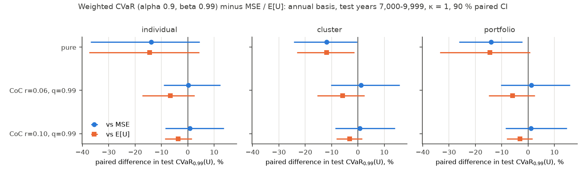
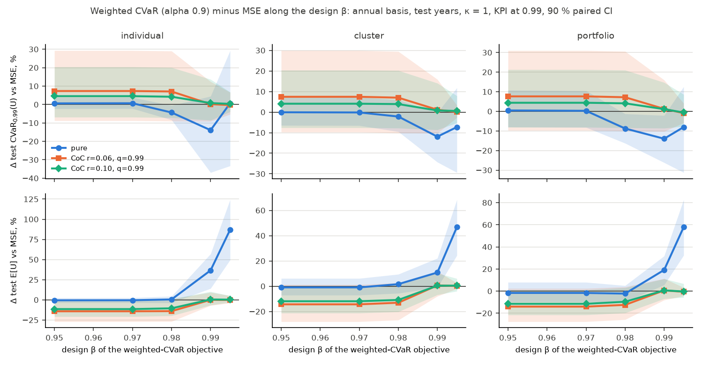
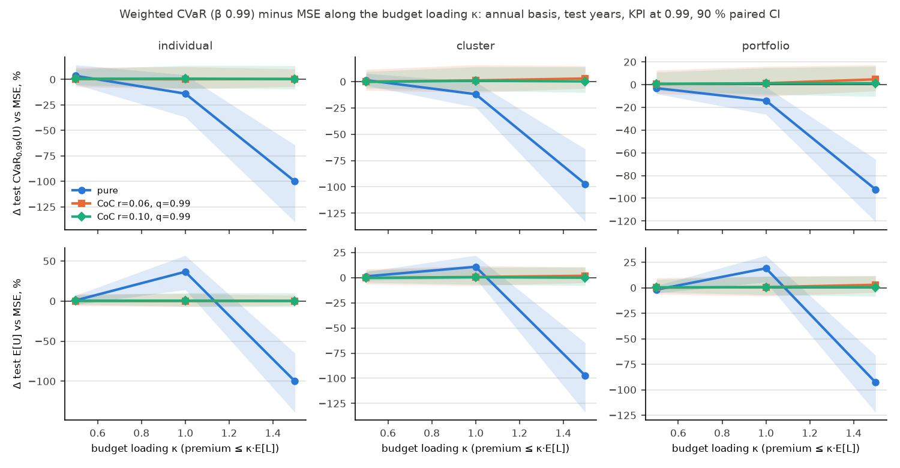
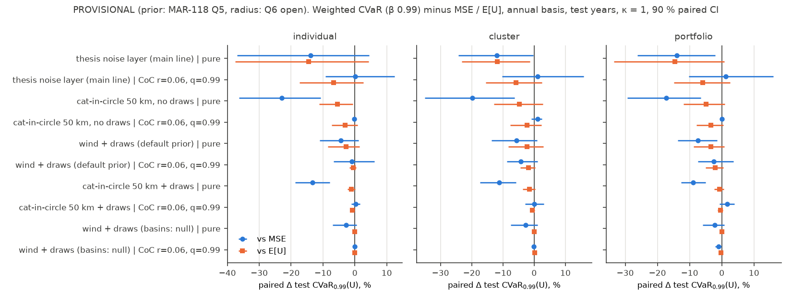

# Checkpoint C1: does the tail advantage hold under the core v1 features?

- Issue: [MAR-29](https://linear.app/marc-prinzing/issue/MAR-29/c1-checkpoint-does-the-tail-advantage-hold-under-the-core-v1-features) (Human / Gate / Decision), SPEC §6 "Checkpoint C1" and §1 publication rule.
- **Status: draft prepared by a worker agent on 2026-10-28, for the owner.** Sections 1–6 are observations. Section 7 is the agent's recommendation, clearly marked. Section 8 is empty: the narrative, D4 and D6 are the owner's decisions.
- Scripts: `research/scripts/c1_build_eventsets.sh` (F-12 EventSets), `research/scripts/c1_checkpoint.py` (runs, bootstrap, tables), `research/scripts/c1_figures.py` (figures and `research/data/c1/tables.md`). Base config: `research/configs/c1/c1_main.yaml`.
- Data: `research/data/c1/`. `runs.csv` maps every run to its full `config_hash` and `run_id`. `kpis_<family>.csv` and `paired_<family>.csv` hold every number below. `tables.md` holds every table of the grid, generated. Hashes in this note are the first 12 hex digits of the `sha256:` config hash.

## Publication rule (unchanged until the owner marks C1 Done)

Until C1 is Done, external outputs (website, posts, CRC showcase, CLIMADA tutorial):

- present the method and the tool;
- state the setup of every number shown (portfolio, basis-risk model, pricing);
- use numbers from out-of-sample runs on the annual basis;
- make **no general claim** that tail optimisation outperforms.

Nothing in this draft changes that. The owner's decision in section 8 decides which claims may be made afterwards.

## 1. The question

Using the core v1 features (F-09 to F-12): does the weighted-CVaR design still lower tail basis risk **out of sample**, under **realistic basis risk** and **loaded pricing**, compared with the MSE and E[U] designs, for each scope (individual, cluster, portfolio)?

## 2. Setup of every number

**Main line** (`family = main`; every number in sections 3–5 unless stated otherwise):

| Item | Setting |
|---|---|
| Portfolio | Thesis portfolio, 9 Miami assets (`A1`–`A9`). EventSet `parity/tests/data/thesis_eventset`, content hash `sha256:404b0c3a3aefa38965ad3ace2747d308685a67e3b218cb835d45a9ab375294df`, IRIS 10,000 years |
| Basis-risk model | Thesis noise layer: heteroscedastic, η = 0.3, 13 copies, seed 42; threshold 20 m/s on the index (it drops only zero-loss rows: `expected_loss_dropped = 0`); 13,897 rows after preparation |
| Basis | `annual` (paper basis, SPEC §6.2). An outcome is a (year, copy) slot; U_y = Σ_{e∈y}(L_e − π_e)⁺; CVaR over slots. CVaR₀.₉₉ is the mean of the worst 1 % of slots (the 100-year level) |
| Split | Holdout, `train_fraction` 0.7: calibrate on years 0–6,999, evaluate on years 7,000–9,999 (**test**). Train values are in-sample |
| CIs | Year-block bootstrap, B = 1000, seed 0, level 0.9, percentile intervals. All designs of one (variant, scope) are bootstrapped on the same resampled test years, so **paired** differences are reported (`bootstrap.paired_difference`) |
| Payout | Step payout, 15 bins on [20, 70] m/s |
| Scopes | individual (9 problems); cluster (3 clusters, thesis Ward, `beta_tail` 0.9; `cap_n_clusters` stays at its default `false`: C1 runs no `n_assets` sweep); portfolio (1 problem) |
| Designs | MSE; E[U] (`expected_uncovered`); weighted CVaR, α = 0.9, design β ∈ {0.95, 0.97, 0.98, 0.99, 0.995} |
| Pricing | `pure` (premium = E[π]); `cost_of_capital` r = 0.06 and r = 0.10, q = 0.99 (premium = (1 − r)·E[π] + r·CVaR_q(π)) |
| Budget | premium ≤ κ·E[L] on the train years, κ ∈ {0.5, 1, 1.5}; κ = 1 unless stated |
| KPIs | Portfolio level only (sum over the 9 assets and all payouts). Evaluated on the test years at KPI β 0.95, 0.99 and 0.995; the config's `evaluation.beta` is 0.99. **No per-asset KPIs of joint (cluster, portfolio) designs** (MAR-98, MAR-100: not unique without an allocation rule) |
| Solver | `solve.DEFAULT_POLICY` (LP: CLARABEL → HiGHS → SCS; QP: OSQP at 1e-8 → CLARABEL; inaccurate accepted). **Never `THESIS_POLICY`** (MAR-98) |
| Code | Package `0.1.0.dev0`, `origin/main` at 5836676 (MAR-131 merged) |

**Headline design.** The headline weighted-CVaR design is β = 0.99, read at KPI β 0.99. This is the agent's choice, proposed rather than settled: on the annual basis about 5 % of slots have an uncovered loss, so at β ≤ 0.97 the weighted-CVaR design is the E[U] design (section 5.1, MAR-24 observation 4), and the thesis β = 0.95 would compare E[U] with itself. All five β are reported.

**Reference column** (`family = reference`): the same thesis config on the thesis basis, `event_conditional` (CVaR over event rows given an event), KPI β 0.95 (thesis) and 0.99, weighted CVaR at the thesis β 0.95, κ = 1. Its pure-pricing rows reproduce MAR-23 (`research/notes/bootstrap-headline.md`) exactly: same config hashes (`f8725a9beee8`, `76fa6a211ef8`, …) and the same paired intervals.

**F-12 sensitivities** (`family = f12`, **provisional**, section 6): annual basis, holdout, bootstrap as above, κ = 1, pricing pure and r = 0.06, designs MSE, E[U], weighted CVaR β 0.95 and 0.99. No noise layer: the basis risk comes from the index and the loss model.

| Label | EventSet | Index | Loss | Threshold, payout | Content hash |
|---|---|---|---|---|---|
| `cic50` | `thesis_cat_in_circle.yaml` | (b) cat-in-a-circle, r = 50 km | base Emanuel (`v_half` 74.7) | none; one bin per category 0–5 | `sha256:de0153d3…304279a` |
| `vuln` | `thesis_vulnerability.yaml` | (a) wind at the asset | 10 `v_half` draws, default prior (wind-only NA, 17 events) | 20 m/s; 15 bins [20, 70] | `sha256:18170363…f849e9` |
| `cic50_vuln` | `thesis_cat_in_circle_vulnerability.yaml` | (b), 50 km | 10 draws, default prior | none; one bin per category | `sha256:8050edc7…098939d627` |
| `vuln_basins_null` | `research/configs/c1/eventsets/thesis_vulnerability_basins_null.yaml` | (a) | 10 draws, prior without basin filter (19 events, MAR-103) | 20 m/s; 15 bins | `sha256:f93e7cdd…99c314f9` |

The `vuln` and `cic50_vuln` content hashes equal those in `docs/methodology/vulnerability.md` (MAR-132 builds). Full hashes: `research/data/c1/summary.json`.

**Size.** 312 runs (189 main, 27 reference, 96 F-12), all solved (`optimal` 304, `optimal_inaccurate` 8: CLARABEL on the `cic50_vuln` E[U] and weighted-CVaR β 0.95 runs, accepted by the policy). Wall time 4,147 s at `--jobs 3` on the shared 10-core Mac (load average up to 34): 2,707 s solving, 1,435 s bootstrapping. Regenerate with:

```bash
IRIS_CATALOGUE=<…>/IRIS_NA_10000Y_merged.txt research/scripts/c1_build_eventsets.sh
uv run python research/scripts/c1_checkpoint.py --jobs 3
uv run python research/scripts/c1_figures.py
```

## 3. Main result per scope (annual basis, test years, κ = 1)

Test expected loss: 231,626 per year (train 215,536). Money in the fixture's loss unit (USD).

### 3.1 Pure pricing

| Scope | Design | Test CVaR₀.₉₉(U) [90 % CI] | Test E[U] [90 % CI] | Train CVaR₀.₉₉(U) | Config hash |
|---|---|---|---|---|---|
| individual | MSE | 1,004,087 [650,025, 1,396,670] | 10,552 [6,942, 14,618] | 983,110 | `b6a790bd484c` |
| individual | E[U] | 1,011,027 [648,216, 1,405,215] | 10,500 [6,779, 14,620] | 977,257 | `9326e4840c25` |
| individual | wCVaR β 0.99 | 864,213 [679,984, 1,058,017] | 14,412 [11,856, 17,301] | 901,744 | `f89028d0ef02` |
| cluster | MSE | 1,231,809 [806,023, 1,686,791] | 13,067 [8,643, 18,035] | 1,006,788 | `80bee12e4c89` |
| cluster | E[U] | 1,230,165 [798,845, 1,665,920] | 12,934 [8,480, 17,713] | 991,669 | `b78a04a941dd` |
| cluster | wCVaR β 0.99 | 1,084,783 [752,179, 1,459,088] | 14,481 [10,698, 18,724] | 900,985 | `9a25ee86197d` |
| portfolio | MSE | 995,075 [676,459, 1,344,372] | 10,784 [7,430, 14,537] | 848,637 | `4d63dddd3335` |
| portfolio | E[U] | 1,001,281 [636,576, 1,417,756] | 10,621 [6,731, 15,069] | 841,320 | `08a569620416` |
| portfolio | wCVaR β 0.99 | 856,026 [635,489, 1,115,816] | 12,844 [10,032, 16,092] | 745,547 | `7d700f7bd02d` |

Paired differences, weighted CVaR (β 0.99) minus the other design, test years:

| Scope | Δ CVaR₀.₉₉(U) vs MSE [90 % CI] | Δ CVaR₀.₉₉(U) vs E[U] | Δ E[U] vs MSE | Δ E[U] vs E[U] design |
|---|---|---|---|---|
| individual | −139,875 [−370,782, 44,789] (−13.9 %) | −146,814 [−379,308, 43,448] (−14.5 %) | +3,860 [1,488, 6,015] (+36.6 %) | +3,912 [1,549, 6,167] (+37.3 %) |
| cluster | −147,026 [−299,700, −3,843] (−11.9 %) | −145,383 [−285,647, −16,451] (−11.8 %) | +1,414 [−140, 2,887] (+10.8 %) | +1,547 [63, 2,881] (+12.0 %) |
| portfolio | −139,049 [−260,374, −21,146] (−14.0 %) | −145,255 [−335,117, 8,519] (−14.5 %) | +2,060 [598, 3,421] (+19.1 %) | +2,223 [264, 3,820] (+20.9 %) |

At the 200-year level (KPI β 0.995) the same design is 17.7–30.8 % below MSE and E[U] in every scope, every paired interval excluding zero; the β 0.995 design is 24.1–31.1 % below (`tables.md`, β grid).

### 3.2 Cost-of-capital pricing (q = 0.99)

| Scope | Design | r = 0.06: test CVaR₀.₉₉(U) [90 % CI] | Config hash | r = 0.10: test CVaR₀.₉₉(U) [90 % CI] | Config hash |
|---|---|---|---|---|---|
| individual | MSE | 14,463,870 [11,281,120, 17,052,150] | `af9fe556d6aa` | 15,655,240 [11,937,800, 18,900,210] | `9aed2418ab22` |
| individual | E[U] | 15,522,110 [10,608,130, 20,672,730] | `3bee2dabbfe6` | 16,364,080 [11,445,180, 21,519,090] | `a8e3d193b7d2` |
| individual | wCVaR β 0.99 | 14,487,770 [11,014,520, 17,943,110] | `9c0222a65bad` | 15,777,460 [11,595,110, 19,940,740] | `102653e1f758` |
| cluster | MSE | 14,445,040 [11,194,970, 17,107,260] | `96457b8a9204` | 15,726,040 [11,978,510, 19,029,020] | `f514d937ee8b` |
| cluster | E[U] | 15,520,700 [10,601,950, 20,676,270] | `f5d42cdbabde` | 16,366,780 [11,447,530, 21,522,400] | `7bcffc295bd3` |
| cluster | wCVaR β 0.99 | 14,610,290 [11,025,160, 18,203,530] | `a56b270c97e4` | 15,848,360 [11,667,830, 20,084,470] | `9e2e281aa4b6` |
| portfolio | MSE | 14,401,690 [11,162,160, 16,970,350] | `0ada0ff98fb2` | 15,670,310 [11,933,050, 18,906,000] | `b4a513c6f1ab` |
| portfolio | E[U] | 15,500,420 [10,582,900, 20,656,070] | `e86fd26ac86f` | 16,354,950 [11,435,290, 21,510,610] | `94bbfeba79fe` |
| portfolio | wCVaR β 0.99 | 14,582,600 [10,994,790, 18,275,400] | `a705dea1563a` | 15,845,120 [11,703,940, 20,136,770] | `120c06502b37` |

Paired differences, weighted CVaR (β 0.99) minus the other design, test CVaR₀.₉₉(U):

| Scope | r = 0.06 vs MSE | r = 0.06 vs E[U] | r = 0.10 vs MSE | r = 0.10 vs E[U] |
|---|---|---|---|---|
| individual | +23,901 [−1,325,494, 1,796,445] (+0.2 %) | −1,034,338 [−2,693,054, 402,611] (−6.7 %) | +122,217 [−1,337,830, 2,136,726] (+0.8 %) | −586,622 [−1,418,371, 246,517] (−3.6 %) |
| cluster | +165,245 [−1,481,874, 2,297,194] (+1.1 %) | −910,416 [−2,397,953, 396,210] (−5.9 %) | +122,314 [−1,356,780, 2,209,850] (+0.8 %) | −518,426 [−1,334,430, 267,572] (−3.2 %) |
| portfolio | +180,911 [−1,480,112, 2,301,200] (+1.3 %) | −917,815 [−2,309,289, 390,144] (−5.9 %) | +174,803 [−1,346,318, 2,304,175] (+1.1 %) | −509,835 [−1,330,037, 281,874] (−3.1 %) |

Every one of these twelve intervals contains zero. At KPI β 0.995 the weighted-CVaR designs (β 0.99 and 0.995) are 7.8–20.3 % below E[U], intervals excluding zero, and within ±6.3 % of MSE, intervals containing zero.



### 3.3 Observations on sections 3.1–3.2

1. **Pure pricing.** The weighted-CVaR design's test CVaR₀.₉₉(U) is 11.8–14.5 % below MSE and E[U] in every scope. The paired 90 % interval excludes zero against MSE in the cluster and portfolio scopes and against E[U] in the cluster scope; the other three contain zero, with upper bounds of +8,519 to +44,789. The separate intervals of the three designs overlap in every scope.
2. **Its cost.** The same design's test E[U] is 10.8–37.3 % higher than MSE's and E[U]'s; that interval excludes zero in five of six cases (not cluster vs MSE).
3. **Cost-of-capital pricing.** The weighted-CVaR and MSE designs are within ±1.3 % of each other on test CVaR₀.₉₉(U), with paired intervals about ±10–16 % wide. Against E[U] the weighted-CVaR design is 3.1–6.7 % lower, intervals containing zero.
4. **Why MSE and weighted CVaR tie under the load (arithmetic, observed).** On the train years the MSE, weighted-CVaR β 0.99 and β 0.995 designs of the cluster and portfolio scopes have the same expected payout (31,057), the same premium (215,536 = the budget) and the same train CVaR₀.₉₉(U) (13,936,399–13,936,405). With q = 0.99 and all payout in at most 1 % of slots, CVaR₀.₉₉(π) = E[π]/0.01, so the premium is (0.94 + 0.06/0.01)·E[π] = 6.94·E[π], and the binding budget fixes E[π] = 215,536 / 6.94 = 31,057 for any such design. If those slots are the worst-loss slots, CVaR₀.₉₉(U) = CVaR₀.₉₉(L) − E[π]/0.01 is then fixed by the budget alone. So when the load's q equals the KPI β, the tail KPI cannot separate the designs in sample; out of sample they differ only by sampling noise. The E[U] design spreads its payout (E[π] about 63,000) and has the higher tail. MAR-27 (annual section, in sample, KPI β 0.95) found the weighted-CVaR (= E[U]) design 12.6–20.9 % below MSE: the order depends on which KPI β is read.
5. **Out-of-sample gap.** On the test years every design's CVaR₀.₉₉(U) is higher than on train in the cluster and portfolio scopes (pure: +15 to +24 %), and the test expected loss is 7.5 % above train (231,626 vs 215,536).

## 4. The event-conditional reference column (thesis basis)

Weighted CVaR (thesis β 0.95) minus MSE / E[U], test CVaR over event rows (per event, not per year):

| Pricing | Scope | KPI | Δ vs MSE [90 % CI] | Δ vs E[U] [90 % CI] | Hash wCVaR / MSE / E[U] |
|---|---|---|---|---|---|
| pure | individual | CVaR₀.₉₅ | −487,913 [−1,022,660, −15,911] (−29.3 %) | −482,276 [−1,022,426, −13,310] (−29.1 %) | `f8725a9beee8` / `76fa6a211ef8` / `a9256cc9b34c` |
| pure | cluster | CVaR₀.₉₅ | −462,011 [−831,624, −116,770] (−23.0 %) | −461,977 [−822,261, −126,836] (−23.0 %) | `691419c8ea6e` / `d54442e350cc` / `e7d6062c6f2e` |
| pure | portfolio | CVaR₀.₉₅ | −458,863 [−826,914, −122,980] (−28.0 %) | −450,630 [−901,711, −65,205] (−27.6 %) | `effe8566488c` / `b3b396a3e817` / `1dff61a5f097` |
| CoC r 0.06 | individual | CVaR₀.₉₅ | −553,757 [−1,614,855, 1,284,718] (−4.9 %) | −2,784,793 [−4,306,054, −711,415] (−20.6 %) | `0e97a9d29c21` / `41b74f19563a` / `2536de7fa7a6` |
| CoC r 0.06 | cluster | CVaR₀.₉₅ | −52,262 [−1,345,635, 1,764,759] (−0.5 %) | −2,743,902 [−4,567,404, −418,471] (−20.3 %) | `365c816e1846` / `c2d84badeb59` / `036fcac0c6bf` |
| CoC r 0.06 | portfolio | CVaR₀.₉₅ | −132,545 [−1,468,472, 1,756,785] (−1.2 %) | −2,688,614 [−4,388,348, −413,197] (−20.0 %) | `909ecc5c722e` / `0ca0a44fb462` / `c69b087130d2` |
| CoC r 0.10 | individual | CVaR₀.₉₅ | −251,483 [−758,771, 397,259] (−1.8 %) | −2,554,788 [−3,072,061, −938,046] (−15.8 %) | `1320905a2b60` / `7d0011502138` / `bcddf7bb67ae` |
| CoC r 0.10 | cluster | CVaR₀.₉₅ | −102,168 [−572,966, 681,755] (−0.7 %) | −2,476,715 [−3,319,315, −588,898] (−15.3 %) | `61001be28e26` / `0822a0132856` / `87ee9059b49b` |
| CoC r 0.10 | portfolio | CVaR₀.₉₅ | −71,199 [−628,188, 634,874] (−0.5 %) | −2,380,465 [−3,185,780, −441,900] (−14.8 %) | `a2cb9a2e589f` / `056ca8575b1c` / `26acf8347604` |

Observations:

6. On the thesis basis under pure pricing the paired intervals exclude zero in every scope (MAR-23 reproduced). Under the loads the lead over MSE falls to 0.5–4.9 % with intervals containing zero, and the lead over E[U] stays at 14.8–20.6 % with intervals excluding zero. Read at CVaR₀.₉₉ (per event), the loaded weighted-CVaR design is 3.5–17.4 % **above** MSE (interval excludes zero only for individual, r = 0.10) and 8.4–15.8 % below E[U] (`tables.md`).
7. The size of the pure-pricing lead differs between the bases: 23–29 % per event on `event_conditional` at β 0.95, 12–15 % per year on `annual` at β 0.99.

## 5. Robustness of the main line

### 5.1 Design β (κ = 1)



Relative paired difference in test CVaR₀.₉₉(U), weighted CVaR at design β minus MSE (`*` = 90 % interval excludes zero; the full grid with KPI β 0.95 and 0.995 and the E[U] comparisons is in `tables.md`):

| Pricing | Scope | β 0.95 | β 0.97 | β 0.98 | β 0.99 | β 0.995 |
|---|---|---|---|---|---|---|
| pure | individual | +0.6 % | +0.7 % | −4.3 %* | −13.9 % | +0.7 % |
| pure | cluster | −0.1 % | −0.2 % | −2.2 % | −11.9 %* | −7.3 % |
| pure | portfolio | +0.5 % | +0.3 % | −8.8 %* | −14.0 %* | −8.0 % |
| CoC r 0.06 | individual | +7.3 % | +7.3 % | +7.1 % | +0.2 % | −0.3 % |
| CoC r 0.06 | cluster | +7.4 % | +7.4 % | +7.0 % | +1.1 % | +0.1 % |
| CoC r 0.06 | portfolio | +7.6 % | +7.6 % | +7.2 % | +1.3 % | −0.9 % |
| CoC r 0.10 | individual | +4.5 % | +4.5 % | +4.2 % | +0.8 % | +0.3 % |
| CoC r 0.10 | cluster | +4.1 % | +4.1 % | +3.9 % | +0.8 % | +0.6 % |
| CoC r 0.10 | portfolio | +4.4 % | +4.4 % | +4.1 % | +1.1 % | −0.6 % |

Observations:

8. **The β 0.90–0.97 coincidence.** At design β 0.95 and 0.97 the weighted-CVaR design is the E[U] design: its paired difference to E[U] is within ±0.4 % at every KPI β, pricing and scope. MAR-24 explained the arithmetic: when at most 5 % of slots carry an uncovered loss, VaR_β(U) = 0 for β ≥ 0.95 and CVaR_β(U) = E[U]/(1 − β), so the weighted-CVaR objective is a constant multiple of E[U] and has the same minimisers. Here the same holds through β 0.97 on the holdout train years. It separates from β 0.98.
9. **The matched β.** Under pure pricing the largest test-tail reduction at a KPI β is reached with the design β near that KPI β: at KPI 0.99 by β 0.99 (−11.9 to −14.0 %), at KPI 0.995 by β 0.99–0.995 (−17.9 to −30.6 %). At KPI 0.95 the β 0.99 and 0.995 designs are 10.7–87.2 % **above** MSE and E[U] (the tail at 0.95 is E[U]/0.05; observation 2).
10. **Under the loads** no design β gives a test CVaR₀.₉₉(U) below MSE with an interval excluding zero; β ≤ 0.98 (≈ the E[U] design) is 3.9–7.6 % above MSE.

### 5.2 Budget loading κ



Weighted CVaR (β 0.99) minus MSE / E[U], test CVaR₀.₉₉(U), relative [90 % CI]:

| Pricing | Scope | vs | κ 0.5 | κ 1 | κ 1.5 |
|---|---|---|---|---|---|
| pure | individual | MSE | +3.5 % [−4.9, +14.3] | −13.9 % [−36.9, +4.5] | −100.0 % [−139.7, −64.2] |
| pure | individual | E[U] | −14.0 % [−27.3, −1.6] | −14.5 % [−37.5, +4.3] | both 0 (see 12) |
| pure | cluster | MSE | +1.4 % [−3.7, +7.8] | −11.9 % [−24.3, −0.3] | −97.2 % [−133.2, −63.9] |
| pure | cluster | E[U] | +2.6 % [−0.9, +6.2] | −11.8 % [−23.2, −1.3] | −15.6 % [−29.8, −4.0] |
| pure | portfolio | MSE | −3.1 % [−8.0, +3.0] | −14.0 % [−26.2, −2.1] | −92.2 % [−120.7, −65.5] |
| pure | portfolio | E[U] | −4.5 % [−7.5, −0.5] | −14.5 % [−33.5, +0.9] | +1.9 % [−0.2, +4.5] |
| CoC r 0.06 | individual | MSE | +0.4 % [−7.3, +11.8] | +0.2 % [−9.2, +12.4] | +0.4 % [−7.1, +10.2] |
| CoC r 0.06 | individual | E[U] | −3.4 % [−7.1, +0.4] | −6.7 % [−17.3, +2.6] | −9.8 % [−27.7, +5.5] |
| CoC r 0.06 | cluster | MSE | +0.0 % [−8.3, +11.5] | +1.1 % [−10.3, +15.9] | +2.9 % [−6.5, +14.9] |
| CoC r 0.06 | cluster | E[U] | −3.0 % [−6.7, +0.6] | −5.9 % [−15.5, +2.6] | −9.1 % [−27.5, +6.4] |
| CoC r 0.06 | portfolio | MSE | +0.3 % [−8.0, +12.7] | +1.3 % [−10.3, +16.0] | +4.7 % [−5.5, +17.4] |
| CoC r 0.06 | portfolio | E[U] | −3.0 % [−6.7, +0.7] | −5.9 % [−14.9, +2.5] | −9.2 % [−26.6, +5.5] |
| CoC r 0.10 | individual | MSE | +0.6 % [−5.4, +10.1] | +0.8 % [−8.5, +13.6] | +0.4 % [−9.5, +13.5] |
| CoC r 0.10 | individual | E[U] | −1.9 % [−4.1, +0.5] | −3.6 % [−8.7, +1.5] | −5.4 % [−15.3, +3.1] |
| CoC r 0.10 | cluster | MSE | −0.3 % [−6.2, +9.5] | +0.8 % [−8.6, +14.1] | +0.2 % [−10.3, +13.9] |
| CoC r 0.10 | cluster | E[U] | −1.6 % [−3.9, +0.6] | −3.2 % [−8.2, +1.6] | −4.7 % [−13.7, +3.3] |
| CoC r 0.10 | portfolio | MSE | +0.7 % [−5.4, +11.0] | +1.1 % [−8.6, +14.7] | +1.3 % [−10.4, +16.0] |
| CoC r 0.10 | portfolio | E[U] | −1.6 % [−3.9, +0.7] | −3.1 % [−8.1, +1.7] | −4.7 % [−13.2, +3.3] |

Observations:

11. **Under the loads κ changes little.** Against MSE the difference stays within −0.3 to +4.7 % at every κ, intervals containing zero. Against E[U] it grows with κ (r 0.06: −3.0/−3.4 % at κ 0.5 to −9.1/−9.8 % at κ 1.5), intervals containing zero.
12. **Pure, κ 1.5 is a different regime.** The E[U] and weighted-CVaR designs pay out 1.44–1.50 times the train expected loss and have **zero** train uncovered loss in every scope (individual: also zero on test), while the MSE design leaves a third of the budget unused (budget use 0.667–0.669: overpaying raises the squared error). The −92 to −100 % "advantage" over MSE there is MSE not spending its budget, not a tail effect.
13. **Pure, κ 0.5.** The lead over MSE is gone (−3.1 to +3.5 %, intervals containing zero); over E[U] it is 4.5–14.0 % in the individual and portfolio scopes (intervals excluding zero) and +2.6 % in the cluster scope.

## 6. Realistic basis risk (F-12): provisional sensitivities

**These rows are provisional.** The vulnerability prior's default is open (MAR-118 Q5: the basin-filtered prior lowers the expected loss to about 0.37 times the base function's; options include recentring it), and so is the cat-in-a-circle radius (Q6). The runs below use the thesis radius (50 km) and two priors only, so that the owner can see how much the C1 answer moves with them. They choose neither.



Weighted CVaR (β 0.99) minus MSE / E[U], test CVaR₀.₉₉(U), κ = 1; last column the same for test E[U] against MSE:

| EventSet | Pricing | Scope | Δ CVaR₀.₉₉ vs MSE [90 % CI] | Δ CVaR₀.₉₉ vs E[U] [90 % CI] | Δ E[U] vs MSE | Hash wCVaR / MSE / E[U] |
|---|---|---|---|---|---|---|
| `cic50` (no draws) | pure | individual | −2,395,574 [−3,803,348, −1,122,670] (−22.9 %) | −467,194 [−952,987, −53,553] (−5.5 %) | −19.8 % [−33.0, −8.0] | `68af9dd29d49` / `cd924bdc540a` / `52f1033fd0e0` |
| `cic50` | pure | cluster | −1,942,095 [−3,439,219, −620,668] (−19.8 %) | −391,953 [−1,063,508, 231,204] (−4.7 %) | −16.0 % [−30.4, −3.6] | `875b87ea6c3d` / `28016e9477db` / `1957fb2ed7c7` |
| `cic50` | pure | portfolio | −1,702,525 [−2,905,307, −647,462] (−17.2 %) | −424,739 [−1,018,759, 80,484] (−4.9 %) | −13.9 % [−25.3, −4.0] | `37482b754d70` / `c0b61f74da65` / `309bac0d270f` |
| `cic50` | CoC r 0.06 | individual | −26,179 [−44,663, −5,646] (−0.2 %) | −499,512 [−1,176,441, 142,820] (−3.1 %) | −0.3 % [−0.4, −0.1] | `630397b025de` / `0bef181cc134` / `6e88696018c5` |
| `cic50` | CoC r 0.06 | cluster | +164,403 [−131,814, 386,563] (+1.1 %) | −365,498 [−1,231,022, 380,391] (−2.3 %) | −0.3 % [−2.6, +1.6] | `8ae9371b3689` / `d985959a47c1` / `ce25619e0b77` |
| `cic50` | CoC r 0.06 | portfolio | +10,759 [−17,486, 38,332] (+0.1 %) | −543,656 [−1,249,770, 71,068] (−3.4 %) | −0.2 % [−0.4, −0.0] | `7248df3df4b6` / `b6487e34b0cd` / `fdcc1dffdd40` |
| `vuln` (default prior) | pure | individual | −161,056 [−411,859, 41,640] (−4.3 %) | −99,323 [−309,268, 55,878] (−2.7 %) | +1.1 % [−5.7, +6.8] | `07a358596f2d` / `39c960edac57` / `510e25de745a` |
| `vuln` | pure | cluster | −217,402 [−520,340, 33,867] (−5.7 %) | −81,295 [−305,759, 106,120] (−2.2 %) | −0.2 % [−8.2, +6.5] | `a7c597d4cb8a` / `f659ad79493a` / `3b3652549050` |
| `vuln` | pure | portfolio | −286,274 [−524,574, −56,102] (−7.5 %) | −124,099 [−323,346, 29,144] (−3.4 %) | −2.5 % [−8.7, +3.3] | `071a05cfea70` / `bee80d9de843` / `e50bd2ef119d` |
| `vuln` | CoC r 0.06 | individual | −62,156 [−452,136, 415,709] (−0.9 %) | −36,606 [−116,021, 30,870] (−0.5 %) | −8.6 % [−14.7, −2.0] | `f35f6a190334` / `a3d507bc365c` / `12ad82a1f332` |
| `vuln` | CoC r 0.06 | cluster | −299,863 [−608,400, 79,333] (−4.3 %) | −126,536 [−301,968, 21,534] (−1.9 %) | −11.6 % [−16.8, −6.0] | `8b60936a7d0b` / `28e31882347c` / `ce12ea3edbc1` |
| `vuln` | CoC r 0.06 | portfolio | −168,700 [−503,294, 241,036] (−2.5 %) | −138,097 [−336,855, 33,470] (−2.0 %) | −9.8 % [−15.5, −3.8] | `019baa827f09` / `e78600315f04` / `982c9dc93107` |
| `cic50_vuln` (default prior) | pure | individual | −758,438 [−1,067,182, −451,177] (−13.3 %) | −52,675 [−115,667, 2,081] (−1.1 %) | −12.0 % [−17.7, −6.6] | `98809bd74191` / `6b3a82f1fa82` / `ba20e7794a76` |
| `cic50_vuln` | pure | cluster | −618,870 [−953,159, −323,279] (−11.3 %) | −76,590 [−184,120, 18,805] (−1.5 %) | −10.2 % [−16.3, −4.7] | `11596f3ed696` / `dba21ff10525` / `a8b78a2532b9` |
| `cic50_vuln` | pure | portfolio | −478,197 [−678,297, −268,620] (−8.9 %) | −36,077 [−117,895, 34,220] (−0.7 %) | −7.6 % [−11.7, −3.6] | `c5f813d92aa7` / `7a5ad7b997f7` / `80cff8be5fe5` |
| `cic50_vuln` | CoC r 0.06 | individual | +17,175 [−79,567, 112,991] (+0.2 %) | −56,216 [−107,151, −319] (−0.8 %) | −1.9 % [−3.7, −0.0] | `e32cb1866838` / `b4736037fd2c` / `564782ce44c4` |
| `cic50_vuln` | CoC r 0.06 | cluster | +1,143 [−200,450, 211,189] (+0.0 %) | −43,313 [−94,918, 8,809] (−0.6 %) | −2.4 % [−5.9, +1.0] | `5d202346e1fc` / `bec5df794959` / `0aad10cb3333` |
| `cic50_vuln` | CoC r 0.06 | portfolio | +117,636 [−46,672, 264,337] (+1.7 %) | −32,341 [−91,744, 27,392] (−0.5 %) | −0.4 % [−3.3, +2.4] | `02dd5fedba16` / `4b1a23389bfb` / `6627960abcc6` |
| `vuln_basins_null` | pure | individual | −899,134 [−2,248,331, 177,278] (−2.8 %) | +248 [−151, 666] (+0.0 %) | −2.8 % [−6.9, +0.5] | `280b72bb0cd0` / `ce56625c7f36` / `66e1b63a33f1` |
| `vuln_basins_null` | pure | cluster | −895,125 [−2,429,879, 335,513] (−2.8 %) | −25 [−87, 29] (−0.0 %) | −2.8 % [−7.5, +1.0] | `25e4772a02f2` / `60c13d3cef01` / `23629473b8a8` |
| `vuln_basins_null` | pure | portfolio | −703,308 [−1,941,715, 253,890] (−2.2 %) | −233 [−501, 15] (−0.0 %) | −2.2 % [−6.0, +0.8] | `6b2cf262d897` / `ff3889cde896` / `81119aede690` |
| `vuln_basins_null` | CoC r 0.06 | individual | −35,769 [−156,284, 110,902] (−0.1 %) | −15,674 [−87,051, 43,730] (−0.0 %) | −0.1 % [−0.5, +0.3] | `f48448ae8f68` / `89a256a82683` / `5f8794ac506d` |
| `vuln_basins_null` | CoC r 0.06 | cluster | −59,226 [−173,554, 55,586] (−0.2 %) | +82,779 [−46,401, 199,435] (+0.2 %) | −0.2 % [−0.5, +0.2] | `b84b1bef585a` / `48dd6afb1099` / `f0a734f87871` |
| `vuln_basins_null` | CoC r 0.06 | portfolio | −372,957 [−752,083, −37,821] (−1.0 %) | −78,858 [−282,656, 92,942] (−0.2 %) | −1.0 % [−2.1, −0.1] | `63d697ef93e8` / `0fdcb9d6e5e9` / `01b1bab14f62` |

Observations:

14. **Against E[U] the lead nearly disappears with vulnerability draws.** Under pure pricing it is 0.7–3.4 % on both draw EventSets with the default prior, every interval containing zero; without draws (`cic50`) it is 4.7–5.5 %, excluding zero in the individual scope only.
15. **Against MSE it depends on the index.** Pure pricing: 17–23 % with cat-in-a-circle and no draws, 8.9–13.3 % with cat-in-a-circle and draws (intervals excluding zero in all scopes), 4.3–7.5 % with wind and draws (excluding zero in the portfolio scope). On the cat-in-a-circle EventSets the MSE design leaves 5–7 % of its budget unused (budget use 0.929–0.953) and has the higher E[U] too.
16. **The prior without basin filter reproduces the β coincidence at β 0.99.** On `vuln_basins_null` the weighted-CVaR β 0.99 design equals the E[U] design (differences −233 to +248 under pure pricing): VaR₀.₉₉(U) of the E[U] design is 0–57 USD on the test years, so fewer than about 1 % of (year, draw) slots carry an uncovered loss and CVaR₀.₉₉(U) = E[U]/0.01. A design β above 0.99 would be needed to separate them; it wasn't run.
17. **Under the load** the F-12 differences are −4.3 to +1.7 % against MSE and −3.4 to +0.2 % against E[U]. Three of the 24 intervals exclude zero, all for differences of at most 1.0 %: `cic50` individual vs MSE (−0.2 %), `vuln_basins_null` portfolio vs MSE (−1.0 %), `cic50_vuln` individual vs E[U] (−0.8 %).
18. **Draws change the scale.** Test expected annual loss: 87,818 with the default prior, 433,418 without the basin filter, 231,743 for `cic50` (base function), against 231,626 on the main line (thesis noise layer, base function).

**What depends on Q5 (prior) and Q6 (radius).**

- Q5: whether the weighted-CVaR design differs from the E[U] design at β 0.99 at all (default prior: yes, by 0.7–3.4 % under pure pricing; prior without basin filter: no), and the size of its lead over MSE (4.3–7.5 % vs 2.2–2.8 %, wind index, pure).
- Q6: every cat-in-a-circle number. Only 50 km was run. MAR-133 found that at 50 km 36.7 % of the Florida counties' loss falls on category-0 pairs, against 7.3 % at 100 km (a different portfolio): the lead over MSE on `cic50*` may come from MSE fitting a coarse index badly, which a larger radius could change.
- Not dependent on Q5/Q6: the main line (sections 3–5), which uses the thesis noise layer.

## 7. Agent recommendation for the narrative (for Marc; not a decision)

> **This section is the worker agent's recommendation, as the issue asks. It is not a decision.** The owner decides the narrative in section 8.

**Recommendation: the nuanced narrative, "when does tail optimisation pay?", rather than a confirmed general advantage.**

Reasoning, from the observations above:

1. **There is a real effect in one regime.** Under pure pricing, on the annual basis, out of sample, a weighted-CVaR design whose β matches the tail level read lowers the 100-year uncovered loss by 12–15 % and the 200-year level by 18–31 % against both baselines, with paired intervals excluding zero in most scope/comparison cells (observations 1, 9). That is publishable and survives the move from the thesis basis to the paper basis, though at about half the thesis size (observation 7).
2. **It does not hold generally.** Under a cost-of-capital load with q equal to the tail level read, the lead over MSE disappears in every scope at every κ (observations 3, 10, 11, 17), and observation 4 shows why: the load prices exactly the tail the design buys, so the budget pins the tail KPI. Against E[U] it shrinks to a few per cent, and with vulnerability draws to 0.7–3.4 % with intervals containing zero (observation 14). A "confirmed advantage" claim would be contradicted by the paper's own robustness rows.
3. **It costs something measurable.** The tail gain under pure pricing comes with 11–37 % more expected uncovered loss (observation 2) and a worse tail at lower β (observation 9). That trade-off is a result in itself.
4. **The conditions are identifiable, which is what a "when does it pay?" paper needs:** the share of years with any shortfall relative to 1 − β (observations 8, 16), the pricing principle and its q relative to the tail level (observation 4), the budget κ (observations 12, 13), and the index/loss model (observations 14, 15). Each has a mechanism that can be shown, not just a number.
5. **The CIs are wide relative to the effects** (paired intervals 10–30 % wide; separate intervals overlap everywhere). A claim of superiority would rest on paired intervals whose upper bounds sit near zero in several cells, as MAR-23 already found on the thesis basis.

What the recommendation does not settle: the F-12 rows are provisional until Q5 and Q6 are answered, and the paper portfolio (Florida, D2) hasn't been run.

**If the owner chooses the nuanced narrative,** claims that the observations above would support for external outputs (to be decided by the owner, not by this draft), each with its setup stated:

- the method is a convex (LP) design that targets a chosen tail level of annual shortfall;
- under pure pricing on the thesis portfolio, out of sample, it lowered the 1-in-100-year shortfall by about 12–15 % against MSE and E[U] designs, at a higher expected shortfall;
- whether it pays depends on the pricing, the budget, the tail level and the basis-risk model; under cost-of-capital pricing it matched MSE.

## 8. Decisions (owner)

*To be filled in by Marc Prinzing. The agent records no decision here.*

- **Paper narrative:** _confirmed advantage / "when does tail optimisation pay?"_ —
- **D4, target venue:** —
- **D6, R2 (distributionally robust) in the paper:** — (if no: cancel MAR-35)
- **Claims external outputs may make from now on:** —

Options the agent sees, without a choice:

- **D4.** (a) *Natural Hazards and Earth System Sciences* (NHESS): open access, CLIMADA and Eberenz et al. publish there, fits an applied, hazard-model-based "when does it pay?" study with open code. (b) *Environment Systems and Decisions*: decision-oriented, fits the price-of-robustness framing. (c) *Insurance: Mathematics and Economics* or *ASTIN Bulletin*: actuarial, would expect a stronger formal contribution (e.g. a result on when the CVaR design coincides with E[U] or MSE, observations 4 and 8). (d) *Risk Analysis* or *Geneva Risk and Insurance Review*: a middle ground. SPEC §11 lists (a)–(c).
- **D6.** (a) Include R2: the bootstrap intervals here show that year-sampling uncertainty is as large as the effects (reasoning 5), which is what a distributional ambiguity set over year weights addresses. (b) Leave R2 out: SPEC's focus rule (one extension, R1), and R1 already covers the scenario uncertainties F-12 opens (prior, radius). (c) R2 as a short appendix or follow-up, if R1 lands early.

## 9. Limitations and open owner questions

- **Q5 (MAR-118), vulnerability prior.** Section 6 runs the default (basin-filtered) prior and the prior without basin filter only; recentring was not run.
- **Q6 (MAR-118), cat-in-a-circle radius.** Only 50 km (thesis) was run.
- **MAR-24, MSE on the annual basis.** The MSE design squares each year's summed residual (`docs/methodology/annual-basis.md`). An event-wise squared residual would give a different MSE baseline; every "vs MSE" number depends on this choice.
- **MAR-27, portfolio premium.** The premium KPI prices the aggregate payout; each design problem's budget constrains its own premium. Under a load in the individual and cluster scopes the two differ (MAR-27 observation 7); the budget uses in `runs.csv` are the sums of problem premiums.
- **One q.** Only q = 0.99 was run under the load. Observation 4 predicts that q ≠ KPI β breaks the tie with MSE; that is untested here.
- **One split.** One holdout split; no k-fold intervals (MAR-23 "Not covered"). The test expected loss is 7.5 % above train.
- **Interval coverage.** Percentile intervals for CVaR measured 85–92 % coverage in synthetic checks (`docs/methodology/bootstrap.md`).
- **Train values** are in-sample and carry no calibration uncertainty.
- **Portfolio.** Thesis portfolio only (9 assets in one city); the paper portfolio (D2, 67 Florida counties) was not run.
- **Solver.** 8 runs have `optimal_inaccurate` status (CLARABEL, `cic50_vuln`), accepted by the default policy.

## 10. What was cut, and why

- **q = 0.995 and r = 0** under the load: q = 0.995 because of the compute budget (machine shared with two other workers); r = 0 equals pure (MAR-27 observation 1).
- **κ sweep on F-12** and **r = 0.10 on F-12**: compute budget; the main line shows κ and r change little under the load.
- **Design β above 0.995**, needed to separate the weighted-CVaR and E[U] designs on `vuln_basins_null` (observation 16).
- **Cat-in-a-circle with draws and no basin filter**, and other radii: Q5/Q6 open.
- **Per-asset KPIs of joint designs:** not presented without an allocation rule (MAR-98, MAR-100).
