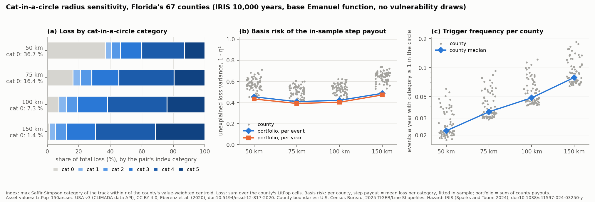

# Cat-in-a-circle radius sensitivity for the Florida counties (measurements)

- Issue: MAR-133 (P-05). Written by a worker agent on 2026-10-28.
- Asked for by: the owner's answer to MAR-118 Q3 (2026-10-27): run a sensitivity over the cat-in-a-circle radius before a radius is chosen for the paper portfolio (D2, SPEC §6.6). At 50 km, MAR-114 found 50.2 % of the loss on (event, county) pairs whose circle sees category 0 (`research/notes/d2-florida-eventset.md`).
- Status: **observations, not conclusions.** The choice of radius is the owner's (MAR-118).
- Data, hashes and the command that regenerates every number below: `research/data/cat-in-circle-radius-sensitivity/` (`README.md`, `summary.csv`, `counties.csv`, `checksums.json`, `radius_sensitivity.png`).

## Setup

- **EventSets.** Four builds of the CLIMADA adapter, `research/configs/climada/florida_counties_cat_in_circle_{50,75,100,150}km_no_draws.yaml` (in `packages/climada/configs/` until MAR-185 moved them byte-identical). Each is `packages/climada/configs/florida_counties_no_draws.yaml` (MAR-32) with index (b): the maximum Saffir-Simpson category (NHC breakpoints 64/83/96/113/137 kn, IRIS 1-minute `vmax`) of the storm's track, interpolated to 0.5 h, within `radius_km` of the county's value-weighted centroid (MAR-26). All radii are ≤ `proximity_km / 2` = 250 km. IRIS North Atlantic 10,000 years, 500 km proximity filter, H08 wind, 67 counties, loss = sum of the impacts on the county's LitPop cells.
- **No vulnerability draws.** The loss uses the base Emanuel USA function (`v_thresh` 25.7, `v_half` 74.7 m/s), one row per storm (13,902 rows). The index does not depend on the draws, only the loss does; without draws the result does not depend on the open question whether the MAR-132 basin-filtered prior stays the default (MAR-118). The four loss matrices are identical (hash `sha256:a417c756…2a4873`) and their EAL, 7,615,672,695 USD, equals the MAR-32 no-draws build's.
- **Category distribution.** Per category 0-5: the share of the 13,902 × 67 (event, county) pairs, and the share of the total loss (rate-weighted; all rates are equal here) on those pairs.
- **Basis-risk measure (the same at every radius).** Per county, the least-squares step payout on the category: it pays the county's mean loss of each category, `P_j(c) = E[L_j | I_j = c]` (attachment 0, integer breakpoints, six levels, fitted in-sample on all rows). The basis risk is the share of the loss variance it leaves unexplained, `Σ (L - P)² / Σ (L - mean L)²` (= 1 − η², η the correlation ratio; 0 is a perfect step payout, 1 a payout that explains nothing). For the portfolio, the county payouts are summed and compared with the portfolio loss, per event and per year (annual sums over the 10,000 years, empty years count as zero).
  - Check on the in-sample fit: the same measure with each half of the years (0–4,999 and 5,000–9,999) paid by the levels fitted on the other half ("two-fold").
  - This measure is variance-based, so it weights large losses heavily; it says nothing about a tail objective (CVaR) or a premium. It is a like-for-like comparison of radii, not the paper's design metric.
- **Trigger frequency.** Per county, the expected number of events a year with category ≥ 1 in the circle.

## Results

| Radius | 50 km | 75 km | 100 km | 150 km |
|---|---:|---:|---:|---:|
| EventSet content hash | `sha256:81a739db…1136a` | `sha256:d62faf2e…31e4c` | `sha256:31bd914c…cf7fa57` | `sha256:45843d0e…cd74b` |
| Index-table hash | `sha256:06d8ef4e…40af7` | `sha256:89d5290c…07a7b` | `sha256:b46334a6…c1c24` | `sha256:5d07310a…e8200` |
| **Loss share on category-0 pairs** | **36.7 %** | **16.4 %** | **7.3 %** | **1.4 %** |
| Loss share, category 1 / 2 / 3 | 3.9 / 5.9 / 13.4 % | 4.7 / 7.1 / 17.1 % | 4.6 / 7.4 / 18.8 % | 4.0 / 6.8 / 18.6 % |
| Loss share, category 4 / 5 | 27.2 / 12.9 % | 35.1 / 19.7 % | 37.9 / 24.0 % | 38.0 / 31.3 % |
| Pairs with category 0 | 98.00 % | 96.90 % | 95.74 % | 93.24 % |
| Pairs with category 1 / 2 / 3 / 4 / 5 | 0.76 / 0.41 / 0.38 / 0.34 / 0.11 % | 1.15 / 0.64 / 0.59 / 0.55 / 0.19 % | 1.53 / 0.86 / 0.82 / 0.78 / 0.28 % | 2.35 / 1.32 / 1.32 / 1.28 / 0.49 % |
| Storms with category ≥ 1 at some county | 3,057 | 3,411 | 3,739 | 4,468 |
| **Basis risk, portfolio, per event** | **0.454** | **0.408** | **0.421** | **0.487** |
| Basis risk, portfolio, per year | 0.433 | 0.391 | 0.403 | 0.472 |
| Basis risk, portfolio, per event, two-fold | 0.478 | 0.423 | 0.433 | 0.497 |
| Basis risk, county median (min–max) | 0.575 (0.442–0.712) | 0.508 (0.381–0.604) | 0.536 (0.435–0.622) | 0.654 (0.495–0.740) |
| Basis risk, county, EAL-weighted mean | 0.559 | 0.502 | 0.546 | 0.657 |
| Basis risk, county median, two-fold | 0.615 | 0.536 | 0.563 | 0.680 |
| Events a year with category ≥ 1, county median (min–max) | 0.022 (0.018–0.061) | 0.035 (0.029–0.093) | 0.049 (0.041–0.122) | 0.079 (0.064–0.185) |

Full hashes and config SHA256s: `research/data/cat-in-circle-radius-sensitivity/README.md` and `checksums.json`.

## Observations (not interpreted)

- The category-0 loss share falls with the radius: 36.7, 16.4, 7.3 and 1.4 %. Per county it spans 27.9–48.1 % at 50 km, 13.2–26.6 % at 75 km, 4.4–12.7 % at 100 km and 0.7–3.4 % at 150 km (`counties.csv`).
- The portfolio basis risk of the step payout is lowest of the four radii at 75 km (0.408 per event, 0.391 per year) and highest at 150 km (0.487, 0.472); 100 km (0.421) is close to 75 km. The per-year values are 0.015–0.021 below the per-event ones at every radius.
- Per county, 51 of the 67 counties have their lowest in-sample basis risk at 75 km, 11 at 100 km and 5 at 50 km; none at 150 km. With the two-fold fit: 54, 10 and 3. Only four radii were run, so a minimum between them is not resolved.
- Out-of-sample (two-fold) basis risk is 0.010–0.024 above the in-sample value for the portfolio at every radius, and the order of the radii is the same. At 50 km, 7 (event, county) pairs had a category not seen in the other half of the years (paid 0); none at the larger radii.
- A larger circle sees more storms and higher categories: storms reaching category ≥ 1 at some county go from 3,057 (50 km) to 4,468 (150 km), and the median county's trigger frequency from 0.022 to 0.079 events a year (about one in 45 years to one in 13). The category-5 loss share rises from 12.9 to 31.3 %.
- The five counties with the largest EAL (Miami-Dade, Broward, Palm Beach, Hillsborough, Orange) follow the portfolio pattern, except Miami-Dade, whose in-sample basis risk is lowest at 50 km (0.487, against 0.536 at 75 km).
- The index tables at 50 km are the same with and without draws (the MAR-132 index is the no-draws index repeated per draw; checked with `np.array_equal`), and so are the pair shares by category.

**Provisional comparison: the MAR-132 draws default at 50 km.** EventSet `florida-counties-iris-cat-in-circle-50km-vulnerability` (content hash `sha256:c7d6b765…2dfa67f`, 10 draws per storm from the 17-event basin-filtered prior; the default is an open question on MAR-118). Category-0 loss share **35.97 %** (as in `d2-florida-eventset.md`: 36.0 %); portfolio basis risk of the same step payout 0.741 per event and 0.727 per year (two-fold 0.755); county median 0.798. The step payout cannot explain the loss spread across draws of the same storm, which the index does not see; the no-draws numbers above do not contain that spread. Labelled provisional; not in the figure.

## Limits

- The basis-risk measure is one simple, variance-based measure on an in-sample step payout. It is not the paper's CVaR-optimised design, and a tail-focused measure could rank the radii differently.
- The index is at one point per county (the value-weighted centroid). A larger circle covers more of a large county but also more storms that miss the county's assets; the measure above is the net of the two at these four radii only.
- The loss has no vulnerability uncertainty; with draws, the basis risk of any index rises (provisional line above).

## Question for the owner (MAR-118)

Which cat-in-a-circle radius for the paper portfolio (D2)? Options seen in these measurements:

- **50 km** (the current configs and the Steinmann et al. 2023 range of 10–50 km): 36.7 % of the loss on category-0 pairs; portfolio basis risk 0.454.
- **75 km**: 16.4 % on category 0; the lowest portfolio basis risk of the four (0.408) and the most counties at their minimum (51 of 67).
- **100 km**: 7.3 % on category 0; basis risk 0.421; trigger frequency about one in 20 years for the median county.
- **150 km**: 1.4 % on category 0; the highest basis risk (0.487) and the highest trigger frequency.
- A finer grid between 50 and 100 km, or a per-county radius, if the choice should rest on the minimum.

Whichever radius is chosen, the D2 cat-in-a-circle EventSet (`configs/florida_counties_cat_in_circle.yaml`, 50 km, with draws) would be rebuilt at it once the prior question is settled. (Done: the owner chose 75 km, and MAR-145 rebuilt it; the 75 km config here builds its no-draws counterpart.)
