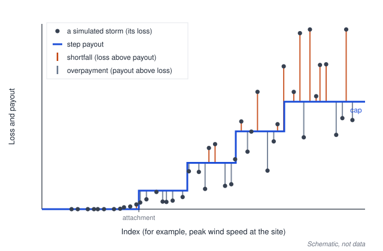

<!--
Draft prepared by an agent for MAR-57. Marc Prinzing edits, approves and publishes.
Do not publish before owner approval. Publication rule (AGENTS.md, SPEC §1): until
checkpoint C1 (MAR-29) is Done, present the method and the tool, state the setup of
every number, and make no general claim that tail optimisation outperforms.
Notes for the owner are in HTML comments like this one and in the "Notes for the
owner" section at the end. Remove both before publishing.
-->

# Why tail-optimised parametric payouts?

Parametric insurance pays on a number, not on a damage assessment. If a hurricane passes close to a hospital with winds above an agreed level, the contract pays an agreed amount, often within days. No loss adjusters, fewer disputes, and money arrives when it is needed.

That speed has a price. The payout follows the index, the loss follows the storm, and the two never match exactly. This post is about how we choose the payout, and why the usual way of choosing it may not protect the buyer where protection matters most.

## Basis risk: the gap between payout and loss

A parametric contract has three parts: an **index** (for example the peak wind speed at a site), a **payout function** that turns the index into money, and a **premium**. Basis risk is the difference between what the contract pays and what the buyer actually lost.

The gap runs in two directions:

- **Shortfall:** the loss is larger than the payout. The buyer pays the difference out of pocket.
- **Overpayment:** the payout is larger than the loss. The buyer has been paid more than needed, and has paid for that through the premium.

Some basis risk cannot be designed away. Two storms with the same wind speed at a site can do very different damage, depending on rainfall, storm surge or the state of the building. And the losses used for design usually come from a catastrophe model, which is itself an approximation. The design question is therefore not how to remove basis risk, but where to put the basis risk that remains.

## Fitting to the average

A common way to calibrate the payout function is to make it fit the modelled losses as closely as possible on average. Take a large set of simulated events, compute the gap between payout and loss for each, and choose the payout that minimises the mean squared gap (MSE, or its square root, RMSE).

This is a sensible starting point. Squaring the gap already gives large errors more weight than small ones, and published frameworks choose RMSE partly for that reason (Steinmann et al., 2023). But fitting to the average has two features worth looking at.

**It is an average over all events.** Most simulated events are moderate, so a criterion that averages over all of them spends most of its effort there. A better fit in many moderate storms can outweigh a worse fit in the few severe ones.

**It is symmetric.** A shortfall and an overpayment of the same size count the same. For the buyer they are not the same. Being paid too much in a moderate storm does not help when the contract pays too little in a severe one. The money arrives at the wrong time.

Add a fixed premium budget and the trade-off becomes concrete. Under a given budget, every extra unit of expected payout in severe events has to come from somewhere, usually from smaller events. The choice of objective decides where along the severity range the cover goes.

## The tail question

Now look at the problem from the buyer's side. A city, a utility or a company that buys parametric cover usually wants liquidity in a bad year. A small gap in a mild year is an inconvenience. A large gap in the worst year can mean delayed repairs, emergency borrowing or a budget crisis.

So the quantity to watch is the **uncovered loss**: the shortfall, U = max(0, loss − payout). And the part of its distribution to watch is the **tail**, the worst outcomes.

![Schematic distribution of the uncovered loss over simulated years. The average (E[U]) sits in the body of the distribution; CVaR is the average over the shaded worst share of years. Illustrative, not data.](figures/post-01-mean-vs-tail.svg)

A standard way to measure the tail is **conditional value-at-risk (CVaR)**, also called expected shortfall. CVaR at level β is the average of the worst (1 − β) share of outcomes. For example, with β = 0.99 it is the average uncovered loss in the worst 1 % of years. Two designs can have the same average shortfall and very different CVaR: one leaves the buyer short a little in many years, the other leaves the buyer badly short in a few.

## The weighted CVaR objective

The design idea from my thesis is to calibrate the payout against both quantities at once:

> minimise  α · CVaR_β(U) + (1 − α) · E[U]

subject to a premium budget, a payout that never decreases as the index rises, and a cap on the payout.

- **α** is a dial between the average shortfall (α = 0) and the tail shortfall (α = 1). In between, the design weighs both.
- **β** sets how deep into the tail the CVaR looks.

Two technical points make this practical. First, the payout is a step function of the index, so the design reduces to choosing one payout level per index band. Second, a result by Rockafellar and Uryasev (2000) turns CVaR minimisation over a set of simulated events into a **linear program**, which solves exactly and quickly, even for large event sets.

That second point matters for portfolios. A single owner with several sites, such as a city with a hospital, a water plant and a port, cares about its total shortfall, not about each site on its own. The same linear program can calibrate a separate payout for each site jointly against the owner's total uncovered loss, under one shared budget. That is the subject of the next post.

<!-- OWNER: the paragraph above describes positioning claim A without calling it new.
Keep "without calling it new" until MAR-28's positioning is approved. -->

Neither CVaR nor tail-risk objectives are new. CVaR is a standard risk measure in finance and insurance, and tail measures have been used before to design index insurance (for example Fan, Tan and Zhang, 2023). What this work combines is a weighted tail objective on the uncovered loss, exact linear-program calibration, and joint calibration across one owner's sites.

## What a tail focus costs

A tail-weighted design is not free. Under a fixed budget, more cover in severe events means less cover elsewhere. Depending on the weights, the buyer may see larger gaps in moderate events, or a worse fit on average. Whether that trade is worth it depends on what the buyer needs the money for. The α dial is there to make the trade explicit rather than hidden in a fitting criterion.

There is a second risk. The tail of a simulated event set contains few events, and a design tuned to those few events may not hold up on events it has not seen. Any honest evaluation has to test the design on events that were not used to build it.

## Where this comes from, and what we are testing now

The idea comes from my master's thesis at the Technical University of Munich, which built the method and tried it on a small illustrative portfolio of nine sites in Miami, with synthetic hurricanes from the IRIS catalogue and losses from the open-source CLIMADA platform.

The thesis was a first, deliberately simple test. Its evaluation used the same simulated events for design and for scoring. The gap between index and loss came from a synthetic noise layer on top of a wind-based loss. Shortfall and budget were measured per event rather than per year, and the premium carried no risk load. These simplifications are reasonable for a thesis, but not enough to say whether the tail focus helps in practice.

<!-- OWNER: no thesis numbers are quoted on purpose. If you want one, label it
"thesis result, in-sample, 9-asset Miami portfolio, IRIS/CLIMADA, synthetic noise
basis risk, per-event basis, pure premium" and add it to the setup box below. -->

So the open question is the one that matters: **does the tail-weighted design still lower the buyer's tail shortfall, compared with average-fit designs, when it is tested properly?** "Properly" means:

- out of sample, on simulated years the design has not seen, with confidence intervals;
- on an annual basis, so that β has a return-period meaning;
- with realistic basis risk: an index computed from the storm track (cat-in-a-circle), and losses that include uncertainty in how buildings respond to wind;
- with a premium that includes a cost-of-capital load, not just the expected payout.

We are running that test now, and we will publish the answer whichever way it goes. Until then, this series presents the method and the tool, not a verdict.

## What comes next

We are rebuilding the thesis code as an open, tested Python library, `parametric-insurance-design`. Interactive explorers will let you move the α and β dials and watch the payout shape and the shortfall distribution respond. The next post looks at portfolios: what happens when one owner's sites are calibrated together, and why an optimiser may choose to leave one of them uncovered.

<!-- OWNER: decide whether to link the public repository here
(https://github.com/marc272/parametric-insurance-design). The CLIMADA module is not
mentioned on purpose, because the maintainer discussion (K-01) has not started. -->

### References

- Rockafellar, R. T. and Uryasev, S. (2000). Optimization of conditional value-at-risk. *Journal of Risk*. doi:10.21314/JOR.2000.038
- Steinmann, C. B., Guillod, B. P., Fairless, C. and Bresch, D. N. (2023). A generalized framework for designing open-source natural hazard parametric insurance. *Environment Systems and Decisions*. doi:10.1007/s10669-023-09934-x
- Fan, Q., Tan, K. S. and Zhang, J. (2023). Empirical tail risk management with model-based annealing random search. *Insurance: Mathematics and Economics*. doi:10.1016/j.insmatheco.2023.02.005
- Prinzing, M. (2026). *Tail-risk-optimized payout design in parametric insurance*. Master's thesis, Technical University of Munich.

> **Setup of every number in this post**
>
> This post reports **no results**: no basis-risk values, premiums, improvements or comparisons, from the thesis or from new runs.
>
> The only numbers are definitional or descriptive:
>
> - **β = 0.99 and "the worst 1 % of years"**: an example of how the CVaR level is read. It is not a result.
> - **α = 0 and α = 1**: the two ends of the weighting dial, by definition.
> - **"nine sites in Miami"**: the size of the thesis's illustrative portfolio (thesis, Appendix A.2). It describes the setup, not a result.
>
> Both figures are hand-drawn schematics, not model output.

---

## LinkedIn version

<!-- 1,237 characters including spaces and line breaks (limit 1,300). -->

Parametric insurance pays on an index, such as the wind speed at a site, not on a damage assessment. That makes it fast. It also means the payout never matches the loss exactly. That gap is basis risk.

Payouts are often calibrated to fit modelled losses on average, for example by minimising the mean squared gap. That is a sensible start, but it averages over all events, most of them moderate, and treats paying too much in a mild storm like paying too little in a severe one. For the buyer, they are not the same.

In my master's thesis I explored a different objective: calibrate the payout against the buyer's uncovered loss, with a weight on its tail (CVaR, the average of the worst outcomes). A dial sets the balance between average and tail. The problem stays a linear program, so many sites can be calibrated jointly for one owner under one budget.

The thesis was a simple first test. The real question is open: does the tail focus still help out of sample, with realistic basis risk and loaded premiums? We are testing that now and will publish the answer either way.

New post: why tail-optimised parametric payouts, and what we still need to find out. [link]

#ParametricInsurance #ClimateRisk #RiskManagement #CatModelling

---

## Figure ideas

Made for this draft (hand-built schematics, SVG, no data; each under 10 kB). They were generated by a small standard-library Python script kept outside the repository, as the issue asks. Both carry an accessible title and description and a "Schematic, not data" label:

1. **`figures/post-01-basis-risk.svg`**: index on the x-axis, loss on the y-axis, a cloud of illustrative storms, a capped step payout, and the shortfall and overpayment gaps marked. Used in "Basis risk".
2. **`figures/post-01-mean-vs-tail.svg`**: a right-skewed distribution of the annual uncovered loss with the mean marked and the worst (1 − β) share shaded as the CVaR region. Used in "The tail question". *Simplification:* a real annual distribution has many years with no shortfall at all (a spike at zero), which the smooth curve leaves out for readability.

Ideas not made, for the owner to decide:

3. **Same budget, different shape.** Two step payouts side by side under one premium budget, one fitted to the average and one tail-weighted, with arrows showing cover moving from moderate to severe index bands. *Caution:* the actual shape of an optimised payout is a model result, so this should either wait for real output from the explorer (W-02) or be drawn clearly as an idea of the trade-off, not as a solution.
4. **The α dial.** A small animation or slider (later, from the W-02 explorer) where α moves from 0 to 1 and the payout steps and the shortfall distribution respond. Needs out-of-sample, annual-basis runs (F-09, F-10) before any numbers appear.
5. **Two designs, one average.** Two shortfall histograms with the same mean but different tails, to make "same average, different CVaR" visual. Purely conceptual, easy to draw.
6. **One owner, three sites.** A sketch of a city with a hospital, a water plant and a port, each with its own payout, feeding one total shortfall. A teaser for post 2.

---

## Notes for the owner

Remove this section before publishing.

- **Positioning (MAR-28, still a draft).** The post makes no novelty claim. It says CVaR and tail objectives are not new, cites Fan, Tan and Zhang (2023) as prior tail-objective index design, and describes the joint multi-asset calibration (claim A) without calling it new. The sentence "What this work combines is ..." is the closest the post comes to positioning. Adjust it once the positioning is approved.
- **One-sided measure.** The post presents the uncovered loss as the buyer's natural quantity, but does not claim that the one-sidedness is what makes the tail term distinctive (see observation O1 in `research/lit/notes.md`).
- **Maier and Scherer.** Their work on asymmetric (expectile) payouts is not mentioned or cited, because positioning against the thesis chair's line of work is your call (MAR-28).
- **Average-fit criteria treated fairly.** Following observation O5, the post says that RMSE already weights large errors and that Steinmann et al. chose it partly for that reason. It does not present MSE as wrong, only as an average.
- **Thesis numbers.** None are used. The thesis is described by its setup and its simplifications (SPEC §3.2, M1 to M4), not by its results.
- **Thesis title.** The reference keeps the submitted title's spelling ("Optimized"), while the post otherwise uses British spelling like the repository docs. Check the exact form you want to cite.
- **Links to decide:** the public repository, the thesis (if it will be available), and the LinkedIn post link.
- **Teaser for post 2.** The last paragraph says "an optimiser may choose to leave one of them uncovered". That is a qualitative thesis observation (the planned post 2 topic), not a number. Drop it if you prefer no thesis findings at all in post 1.
- **Not mentioned on purpose:** the CLIMADA module (maintainer discussion not yet opened), the CRC showcase, the paper and any timeline.
